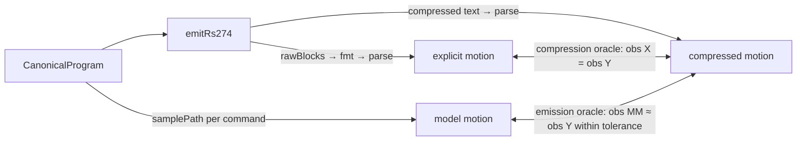

# Claims and Their Evidence — Lossless Encoding, Signed Error Budgets, Per-Claim Certificates and Three-Key Shortcuts

Most of the structure in DROPCUT Studio is standard: typestate, capability tables, branch and bound, a Redux store with a cache beside it. This chapter is about the four ideas that are not standard, and about one thread that connects them. Each idea is a mechanism for attaching **evidence** to a **claim** the pipeline makes about its output:

| Claim the pipeline makes | Mechanism | Section |
|---|---|---|
| "The G-code text means the same as the explicit blocks." | modality as a final pass, checked by a round-trip oracle | 1 |
| "The machined surface is within $E$ mm of the model." | error budget | 2 |
| "This safety check passed, at this resolution." | per-claim certificate with sticky poisoning | 3 |
| "This shortcut motion is allowed here." | capability, permission and proof as three separate keys | 4 |

For each one, the chapter first explains the idea on its own terms, then measures how strong the evidence actually is. In three of the four cases, experiments run for this chapter show the evidence is weaker than the claim, in ways that are specific and repairable. That gap is the most useful thing to learn from this codebase, more than any one of the patterns.

> [!summary]
> - **A round-trip oracle is only as strong as what it observes.** The project's oracle compares positions only. In a mutation experiment, a compressor that turns cuts into rapids slips past the 400-run property, and compressors that drop feed changes, and an emitter that inverts arc direction, pass all 235 tests. Adding three lines that also compare motion kind and feed makes the property catch the first two.
> - **An error budget entry is a claim, not a measurement.** The budget declares 0.0100 mm of chord error. Measured on the dome benchmark, refined raster passes deviate from the exact CL surface by up to 0.034 mm on the gouge side with a 3 mm ball and 0.085 mm with a 6 mm ball; about 8% of segments exceed the declared tolerance. The budget also needs a **sign**: error towards the part and error away from it have different consequences.
> - **Evidence must name the one claim it supports.** One record upgrading two certificate rows produced a `PASS gouge` with no gouge computation. Recertification should be a per-claim, order-independent join, with escape hatches poisoning exactly the claims their declared effects can touch.
> - **A shortcut needs three keys:** the target can do it, policy allows it, and someone has proved it safe here. Distance thresholds currently stand in for proof.

---

## 1. Lossless encoding: modality as a final pass

### 1.1 The idea, briefly

[[Research/Software Architecture Garden/dropcut-studio/claude-opus/02 - Modality as a Final Compression Pass - The Non-Modal IR and Its Round-Trip Oracle|Chapter 02]] develops this in full; the core is short. G-code is **modal**: words such as `G1`, `F800` and `G17` persist until replaced, so a line means something only relative to the interpreter state built up before it. DROPCUT Studio keeps that state out of its semantic model. The emitter writes every word on every line, and one pure function, `compress()`, removes the words the controller would infer. Because the project owns a G-code interpreter, the claim "compression is lossless" can be checked by parsing both texts and comparing.

What chapter 02 did not pin down is *what "comparing" means*, and that turns out to decide everything.

### 1.2 An oracle has an observation function

Write $B$ for the explicit blocks, $C = \mathrm{compress}(B)$, and $\mathrm{fmt}$ for formatting. The round-trip property is not "the texts are equivalent". It is

$$
\mathrm{obs}\big(\mathrm{parse}(\mathrm{fmt}(C))\big) \;=\; \mathrm{obs}\big(\mathrm{parse}(\mathrm{fmt}(B))\big)
$$

for some **observation function** $\mathrm{obs}$ that extracts what the test compares. Any difference that $\mathrm{obs}$ discards is invisible to the test, however many programs are generated.

In `roundtrip.test.ts`, $\mathrm{obs}$ is `motionPolyline`:

```ts
export function motionPolyline(r: ParseResult): Vec3[] {
  const out: Vec3[] = [];
  for (const s of r.segments) {
    const pts = s.points ?? [s.from, s.to];
    if (out.length === 0) out.push(pts[0]);
    for (let i = 1; i < pts.length; i++) out.push(pts[i]);
  }
  return out;
}
```

The parser's `ParsedSegment` records `kind` (rapid or cut), `feed`, `rpm`, `tool` and `spindleOn` for every segment. `motionPolyline` keeps only positions. So the property proves that compression preserves *where the tool goes*. It cannot see *how* it gets there: at rapid or at feed, at which feed rate, with which spindle state.

### 1.3 Measuring the oracle: a mutation experiment

**Mutation testing** measures a test suite by deliberately introducing plausible bugs ("mutants") and checking whether any test fails. A mutant that survives is a bug the suite cannot detect.

Six mutants were applied one at a time to a scratch worktree at `f3ebac2`, and the full suite (235 tests) was run against each. Each mutant is a one-line change a reasonable person could make while "simplifying" `compress()` or the emitter.

| Mutant | Change | Failing tests | Caught by the property? |
|---|---|---|---|
| M1 | compare axes with the last *seen* value instead of the last *emitted* | none | no |
| M2 | treat arc offsets `I J K` as modal | `compress() never drops arc offset words` | no — example test only |
| M3 | never restate the motion word once set, so `G1` after `G0` is dropped and cuts become rapids | `makera.test.ts › one program, two machines…`, `arc round trip › a full circle survives…` | **no** — caught incidentally |
| M4 | never restate the feed once set, so every cut runs at the first feed | **none** | **no** |
| M5 | do not restate `S` on `M3`/`M4` | `compress() keeps a restated S word…` | no — example test only |
| M6 | emitter: invert the G2/G3 direction test | **none** | **no** |

Read the M3 and M4 rows twice. M3 converts cutting moves into rapid moves through material, the most dangerous mistake a G-code compressor can make. The 400-run property passes, because the rapid goes to the same coordinates. M4 runs every cut in the program at the first cut's feed rate. Nothing in the suite fails.

### 1.4 Repairing the observation

The repair for M3 and M4 is to observe what the interpreter state affects. Three lines added to the first property:

```ts
// Stronger observation: what KIND of motion, at what FEED.
const obs = (t: string) => parseGcode(t).segments.map((s) => `${s.kind}@${s.feed}`);
expect(obs(compressed)).toEqual(obs(uncompressed));
```

With that change, the unmutated suite still passes (235/235). M3 now fails the property itself, and M4 fails it as the only failing test.

The general rule is a three-way correspondence. For every class of word that `compress()` may drop, three things must exist:

1. a field in the observation function that the word affects;
2. a generator that varies that word, so the property exercises it;
3. a rule in `compress()`.

At the analysed commit the correspondence looks like this:

| Word class | Compression rule | Observed by `motionPolyline` | Varied by `arbStep` |
|---|---|---|---|
| Position `X Y Z` | drop if unchanged | yes | yes |
| Motion `G0..G3` | drop if unchanged | positions only, not kind | yes (traverse vs cut) |
| Feed `F` | drop if unchanged | **no** | yes (random feeds) |
| Plane `G17..G19` | drop if unchanged | no | **no** |
| Arc offsets `I J K` | never drop | positions of arc points | **no** (no arcs generated) |
| Spindle `S`, `M3/M4/M5` | drop `S` unless restating | **no** | **no** |

Every empty cell in the last two columns is a rule the property cannot defend. M1 survives for a different reason: the generator rounds coordinates to 0.001 mm while the compressor's epsilon is $10^{-9}$, so "last seen" and "last emitted" never differ in generated programs. That rule only matters if a caller raises `CompressOptions.epsilon`, and nothing generates programs that would show it.

### 1.5 Two oracles, not one

M6 shows the second limit, which no observation function can fix. The inverted arc direction is introduced in the *emitter*, so it is present in both `rawBlocks` and the compressed text. A differential oracle compares those two, and they agree.

Catching emitter bugs needs a second oracle that compares the parsed text against the **model**, not against the explicit blocks:



The **compression oracle** isolates `compress()` exactly and needs only equality. The **emission oracle** checks the emitter against the semantic model, and must allow for the declared approximations: traverse decomposition, arc linearisation, rounding. The existing arc tests are partial emission oracles. They check that points lie on the right circle, but not that they lie on the right *side* of it, which is why M6 survives.

### 1.6 What generalises

The modality pattern applies to any stateful output format (terminal escape sequences, PDF graphics state, SVG relative paths, HPACK headers). The lesson from the experiment applies even more widely: **choose an oracle's observation function from the failure modes, not from what is convenient to compare.** A round trip that compares only the easy part of the output is a test of the easy part.

---

## 2. Error budgets: claims about accuracy

### 2.1 Tolerance stack-up

Mechanical engineers call the problem **tolerance stack-up**. When several dimensions each carry a tolerance and they combine into one assembly dimension, the assembly's tolerance must be computed. The two standard methods are:

- **worst case:** $E = \sum_i e_i$, valid whatever the errors do;
- **statistical (root-sum-square):** $E = \sqrt{\sum_i e_i^2}$, valid only when the errors are independent and roughly centred.

A CAM pipeline is an assembly of lossy stages. Each one can move the machined surface away from the model: sampling the CL surface, approximating curves with chords, linearising arcs, rounding coordinates to three decimals. DROPCUT Studio treats the stack-up as a first-class value. Every `ValidatedProgram` carries an `ErrorBudget` of named contributions and a total, and the CLI prints it:

```text
error budget           0.0105 mm  (chord-refinement 0.0100 · gcode-rounding 0.0005)
```

The project chooses the worst-case sum, and its reason is correct: the contributions are not independent. A coarse field and a loose chord tolerance push the same direction on the same feature, so a safety figure must assume they align.

Two uses make the budget more than decoration. First, a stage that cannot meet a request can say so: `checkBudgetAgainstRequest` warns when a requested finish is finer than the total budget and names the dominant contribution. Asking for a 0.005 mm scallop from a pipeline with a 0.0105 mm budget is self-defeating, and without a budget nothing would say so. (At the analysed commit, that function is called only from tests.) Second, the budget is a place where every approximation must be declared, which is how a missing declaration becomes visible.

This is uncommon in software. Compilers and data pipelines usually treat precision loss as an implementation detail of each stage, not as a quantity that composes.

### 2.2 A budget entry is a claim; what supports it?

The `chord-refinement` entry is computed in `buildBudget` as *the worst declared chord tolerance across all cutting paths*. It is the parameter the planner was asked to honour, not a measurement of what it achieved. Whether the claim holds depends on `refineSpan` in `packages/planner/src/refine.ts`:

```ts
const zm = evaluate(xm, ym);
const deviation = Math.abs(zm - (z0 + z1) / 2);   // checked at the MIDPOINT only
if (len > opts.maxSegment || deviation > opts.tolerance) { /* split */ }
// stop unconditionally if depth <= 0 or len < opts.minSegment
```

Three properties of this loop limit the guarantee.

1. **The midpoint test is not a bound.** It measures deviation at one point. A crease in the CL surface between the quarter points — which tessellated meshes produce at every facet edge — passes the test and deviates elsewhere. The module comment acknowledges the risk and caps segment length at about one tool radius (`maxSegment`), which reduces it without eliminating it.
2. **The minimum segment stops refinement regardless of deviation.** `minSegment = max(0.04, 2·tolerance)`. Where the surface curves sharply in Z — near the steep rim of a dome, or where the CL surface meets the floor — a 0.04 mm chord can still deviate by more than the tolerance.
3. **The recursion depth caps refinement** at 11 levels (2,048 points per span), again regardless of deviation.

### 2.3 Measuring it

A scratch probe ran the raster strategy's own refinement call (`refineSpan` with `defaultRefineOptions`) across the built-in dome (a hemisphere of radius 14 mm, 96×96 tessellation). It used passes every 0.5 mm in Y, a ball tool, and the exact drop-cutter as the reference surface. Each output chord was sampled at 63 interior points against the exact CL height. *Gouge side* means the chord lies below the CL surface, so the tool goes deeper than intended; *excess side* means it lies above, leaving material.

| Tool | Declared tolerance | Segments | Over tolerance | of which at `minSegment` | Worst gouge side | Worst excess side |
|---|---|---|---|---|---|---|
| 3 mm ball | 0.010 mm | 5,616 | 446 (7.9%) | 120 | **0.034 mm** | 0.059 mm |
| 3 mm ball | 0.002 mm | 10,452 | 1,010 (9.7%) | 466 | **0.016 mm** | 0.059 mm |
| 6 mm ball | 0.010 mm | 5,102 | 418 (8.2%) | 96 | **0.085 mm** | 0.592 mm |

Three observations follow.

- The declared 0.010 mm is exceeded by a factor of three to eight on the gouge side. Since the budget's total is a plain sum including this entry, the printed total understates the pipeline's real error by about the same factor.
- Most violations are *not* at the minimum segment length (326 of 446 in the first row). They are the midpoint test missing creases, mechanism 1 above. Tightening the tolerance helps less than expected: at 0.002 mm the violation rate rises, because more segments reach the length floor.
- The 6 mm ball's two worst chords are mirror images across the rim: $x = -16.88 \ldots -15.75$ (0.085 mm gouge side) and $x = 15.75 \ldots 16.88$ (0.59 mm excess side), each running from $z \approx 3.3$ on the flank down to the floor. One 1.1 mm chord spans both the convex flank, where it lies below the surface, and the concave junction with the floor, where it lies above. The two deviations nearly cancel at the chord's midpoint, so the midpoint test accepts a segment whose interior deviates by half a millimetre. This is mechanism 1 in its clearest form.

Vertical deviation is an upper bound on how far the tool penetrates the part, not the penetration itself. A ball whose centre is $d$ too low on a CL surface of slope angle $\theta$ penetrates by about $d\cos\theta$, so on steep regions the true gouge is smaller than the vertical figure. The claim "within 0.010 mm" is still violated wherever the slope is moderate.

### 2.4 Budgets need a sign

The experiment also shows why one unsigned number is the wrong shape for a budget. A chord on a **convex** region of the surface lies below it: the error is on the gouge side. A chord on a **concave** region lies above it: the error leaves material. Rounding is symmetric. The two directions have different consequences. Gouge-side error scraps the part; excess-side error spoils the finish or leaves stock for the next operation.

A **signed budget** keeps two ledgers:

$$
E^{-} = \sum_i e_i^{-} \;\;\text{(towards the part)}, \qquad E^{+} = \sum_i e_i^{+} \;\;\text{(away from the part)}.
$$

Each contribution declares which ledgers it affects:

| Contribution | $e^-$ (gouge side) | $e^+$ (excess side) |
|---|---|---|
| Chord refinement | convex regions | concave regions |
| G-code rounding | 0.0005 | 0.0005 |
| Bull-nose CL approximation (max of flat and ball) | 0 — conservative by construction | up to the corner geometry |
| V-bit CL approximation (flat disc of tip diameter) | **unbounded** — non-conservative | 0 |
| Stock-to-leave (inflated surface) | not an error; an intended offset | not an error |

The safety-relevant figure is $E^-$. A contribution with unbounded $e^-$, such as the V-bit approximation, makes $E^-$ unbounded, and that should change the certificate. The gouge row becomes `unverifiable — tool geometry approximated non-conservatively` instead of being reported at a resolution. This is how the budget and the certificate of section 3 connect: **the direction of an approximation decides which claims it can invalidate.**

### 2.5 Making budget entries into evidence

A budget entry should say how it is known, using the same grades the certificate uses for checks:

| Grade | Meaning | Example |
|---|---|---|
| bounded analytically | a proof gives the bound | rounding: $\tfrac12 \cdot 10^{-3}$ exactly; arc linearisation: sagitta formula $R(1-\cos\tfrac{\theta}{2}) \le$ tol |
| measured to resolution | the bound was checked by sampling | chord deviation sampled at $k$ points per segment, as in the probe |
| declared | a parameter was requested, nothing checked it | today's `chord-refinement` |

Arc linearisation can be bounded analytically because a circle has constant curvature. Chord refinement on a tessellated CL surface cannot: the surface is not twice differentiable at facet creases, so the sagitta bound $\kappa L^2/8$ has no finite $\kappa$ to use. For that entry the honest grade is *measured*, and the measurement already exists in the form of the probe above: sample each emitted chord against the exact evaluator and declare the worst deviation found, with its sampling density.

---

## 3. Per-claim evidence and sticky poisoning

### 3.1 The idea

[[Research/Software Architecture Garden/dropcut-studio/claude-opus/05 - Graded Evidence Certificates - Say What Was Verified and to What Resolution|Chapter 05]] describes the certificate: one status per check (`verified-exact`, `verified-to-resolution`, `not-checked`, `unverifiable`), with sampled checks upgraded after emission by `recertify`. Two parts of that design are not standard.

- **Monotone recertification.** Evidence can only move a check upwards from `not-checked`. It can never demote a check, and it cannot rescue one that was marked unverifiable.
- **Sticky poisoning.** A raw G-code escape (`RawCmd`) marks the checks it could affect as `unverifiable`, and later simulation evidence does not override that. The verifier cannot model what the raw text does, and neither can the simulator.

That is taint propagation applied to a verification report. It is uncommon outside formal-methods tooling.

### 3.2 The law the implementation missed

Both properties are stated over *statuses*. The law that makes them meaningful is stated over *evidence*:

> **Every piece of evidence names exactly one claim, and may change only that claim's status.**

`recertify` receives one `SampledEvidence` record, which carries a resolution, a tolerance and diagnostics but names no claim. It writes the same upgraded status into two rows, `gouge` and `rapidCrash`. The simulator computed rapid-through-stock and spoilboard penetration; nothing computed gouge. Chapter 05 §7.1 shows the result: a 2.5D pocket cut 13 mm into the dome part compiles with `PASS gouge — verified to 0.240 mm grid`. This failure mode can be called **evidence fan-out**: one record upgrading several claims.

### 3.3 Recertification as an order-independent join

The repair is easiest to see when certificates are treated as a small algebra. For each claim $c$, statuses form an order:

$$
\texttt{not-checked} \;\sqsubset\; \texttt{verified}(h_1) \;\sqsubset\; \texttt{verified}(h_2) \;\sqsubset\; \texttt{exact} \qquad (h_2 < h_1,\ \text{finer resolution is stronger})
$$

with `failed` and `unverifiable` as **absorbing** elements: once a claim is failed or unverifiable, no further evidence changes it. Evidence is a pair $(c, s)$, a claim key and the status the evidence supports. Recertification updates one key:

$$
\mathrm{recertify}(\mathit{cert}, (c, s)) = \mathit{cert}\,[\,c \mapsto \mathit{cert}[c] \sqcup s\,]
$$

where $\sqcup$ is the least upper bound in the order above. Absorbing elements dominate, and among passes the finer resolution wins.

Because $\sqcup$ is commutative, associative and idempotent, the final certificate does not depend on the order in which evidence arrives, or on whether the same evidence arrives twice. That matters as soon as simulation moves to Web Workers: a gouge simulation and a rapid-crash simulation can run in parallel and report in either order. Fan-out is impossible by construction, because evidence without a claim key does not typecheck:

```ts
type ClaimKey = "travel" | "spindle" | "feedLimits" | "interlocks"
              | "gouge" | "rapidCrash" | "fixture" | "holder";

interface Evidence {
  readonly claim: ClaimKey;
  readonly status: CheckStatus;
  readonly producer: string;          // e.g. "dexel.rapid-through-stock@0.240mm"
}
```

The `producer` field is cheap and would have exposed the bug in plain sight. The certificate line would have read `PASS gouge — verified by dexel.rapid-through-stock`.

### 3.4 Poisoning by declared effect

The current poisoning rule is all-or-nothing on three rows. A raw escape makes `travel`, `spindle` and `interlocks` unverifiable, and leaves `gouge` and `rapidCrash` free to be upgraded by simulation, which is the latent case noted in chapter 05. The IR already contains the information needed for a precise rule:

```ts
export interface RawCmd {
  readonly kind: "raw";
  readonly text: string;
  readonly dialect: string;
  readonly effects: readonly string[];   // declared, used today only in a warning message
  readonly provenance: Provenance;
}
```

If effects are drawn from a small vocabulary (`motion`, `spindle`, `coolant`, `tool`, `offset`, `unknown`), each effect maps to the claims it can invalidate:

| Declared effect | Poisons |
|---|---|
| `coolant` | nothing modelled |
| `spindle` | `spindle`, `interlocks` |
| `tool` | `interlocks`, `gouge`, `rapidCrash`, `holder` |
| `motion`, `offset` | `travel`, `gouge`, `rapidCrash`, `fixture`, `holder` |
| `unknown` or none declared | every claim |

A raw `M8` declared as `coolant` would then leave the certificate intact, while an undeclared escape would poison all of it. The default is conservative, and precision is available to anyone who declares effects.

---

## 4. Shortcuts need three keys

### 4.1 Two keys in the emitter

A **shortcut** here means any motion that saves time by relying on something being true: a diagonal rapid that relies on straight-line interpolation, a stay-down link that relies on cleared material. The emitter's traverse logic (chapter 03) requires two independent conditions for a diagonal rapid:

```ts
if (cmd.clearance.allowCoordinated && machine.rapidSemantics === "coordinated") {
  linear(target, "G0", ...);           // one diagonal rapid
  return;
}
// otherwise: retract, move at safe height, descend
```

`machine.rapidSemantics` is a **capability**: the controller can move all axes along a straight line at rapid. `allowCoordinated` is a **permission**: the planner, which knows what lies between the endpoints, allows it here. They are owned by different components, the machine profile and the planner. Neither can force the shortcut alone. The linker sets `allowCoordinated: false` on every retract-and-rapid link, because those links cross material it has not proved clear. The two-key form is what keeps a capable machine from taking a diagonal rapid over unknown stock.

### 4.2 The third key is proof

[[Research/Software Architecture Garden/dropcut-studio/claude-opus/08 - Strategies Produce Geometry, the Planner Owns the Gaps|Chapter 08]] and the CAM-002 ticket show what the two keys leave out. The stay-down decision in `planLink` uses a distance threshold (`gap ≤ max(3 × stepover, 1.5 mm)`) and a sampled check against the *static part surface*. Neither is evidence that the material between the points is gone: a short link can cross an uncut island, and a long one can be safe through a cleared cavity. CAM-002 puts it exactly: *distance is a cost heuristic, not a collision predicate*. It also rejects the obvious user-facing switch: `keepToolDown` must be *a preference constrained by clearance proof, never a command to bypass safety.*

Put together, a shortcut $s$ should be emitted only when

$$
\mathrm{shortcut}(s) \iff \underbrace{\mathrm{capable}(\text{target}, s)}_{\text{machine profile}} \;\wedge\; \underbrace{\mathrm{permitted}(\text{policy}, s)}_{\text{planner / user preference}} \;\wedge\; \underbrace{\mathrm{proven}(\text{evidence}, s)}_{\text{whoever has the knowledge}}
$$

and otherwise the long, safe form is emitted together with a diagnostic, in the same shape as the entry ladder's `entry.degraded`.

| Keys present | Typical failure if the missing key is assumed |
|---|---|
| capability only | diagonal rapid through unknown stock on a coordinated machine |
| permission only (a user flag) | `keepToolDown` dragging the tool through an island |
| proof only | an instruction the controller cannot execute, such as an arc on a Makera |
| capability + permission, distance as "proof" | CAM-002's repeated retracts, or worse, a short link across uncut material |

The proof key is the one that needs a type. The strategy that cleared a pocket knows the centre corridor is empty, so the contract should let it hand that knowledge to the linker as a value, for example `ClearedRegion` or `ClearanceProof`, and the linker should treat its absence as "not proven". That proof is itself evidence in the sense of section 3. It names one claim ("this swept volume is clear") and has a producer and a grade (analytic for a rectangular pocket the strategy generated, sampled for a stock model).

---

## 5. The common thread

The four ideas share a shape: a claim, a mechanism that produces evidence for it, and a measured gap.

| Claim | Evidence today | Measured gap | Repair |
|---|---|---|---|
| Compressed text ≡ explicit blocks | round-trip property over positions | M3, M4, M6 survive; plane, `S` and arcs never generated | observe kind, feed, spindle, tool; generate every word class; add an emission oracle against the model |
| Surface within $E$ of the model | declared tolerances, summed | chord error 3–8× the declared value on the gouge side | signed ledgers; grade each entry as bounded, measured or declared; measure chords |
| Check $c$ passed at resolution $h$ | one evidence record fanned out to two checks | `PASS gouge` with no gouge computation | evidence keyed by claim; order-independent join; effect-scoped poisoning; producer named in output |
| Shortcut allowed | capability ∧ permission; distance as proof | excess retracts; stay-down decided by proximity | proof as a typed value supplied by the component that knows |

The habit worth adopting is not any one of these mechanisms. It is to ask of every claim the system prints: *what computation produced this, and what would a violating input look like?* Then write that input as a test. Three of the four gaps in this chapter were found by doing exactly that: a mutant, a probe, a counterexample program.

## 6. Candidate ecosystem guidance

1. **Name the observation function of every oracle**, and derive it from the failure modes. For a stateful format, observe everything the interpreter state affects.
2. **Keep a correspondence table** between encoder rules, observed fields and generated variations; an empty cell is an undefended rule.
3. **Measure test suites with mutants** of the kind a maintainer might write while simplifying.
4. **Separate compression oracles from emission oracles.** Differential tests cannot see bugs present on both sides.
5. **Treat error budgets as composed, signed quantities**, worst-case summed, with each entry graded as bounded, measured or declared.
6. **Let an approximation's direction decide which claims it can invalidate.** A non-conservative approximation makes the affected claim unverifiable.
7. **Key every piece of evidence to one claim and name its producer.** Combine evidence with an order-independent join so parallel verifiers can report in any order.
8. **Scope poisoning by declared effect, defaulting to everything.**
9. **Require capability, permission and proof for every shortcut.** Make proof a typed value, and emit a diagnostic when the long form is chosen.

## 7. Open questions

- Should the emission oracle compare against `samplePath` of the canonical program with tolerances taken from the error budget? That would make the budget a test input as well as a report.
- Should chord refinement switch from a midpoint test to a multi-point or curvature-aware test? Or should it keep the midpoint test and *measure* the result, declaring the measured worst case?
- What vocabulary of `RawCmd.effects` is small enough to be used and precise enough to matter?
- Can `ClearanceProof` from 2.5D strategies share a type with sampled evidence from a future stock model, so the linker treats both uniformly?

## 8. Evidence and reproduction

All experiments were run against `f3ebac2` in a scratch git worktree; nothing was changed in the repository.

- **Mutation experiment** (§1.3): `python3 -I tools/mutate.py <worktree>`. Baseline 235/235; per-mutant failing tests as tabulated.
- **Strengthened observation** (§1.4): `tools/strong-observation.patch`, three lines added to `roundtrip.test.ts`. Baseline still 235/235; M3 fails three tests including the property; M4 fails the property alone.
- **Chord probe** (§2.3): `tools/chord-probe.ts`, run with `npx tsx` inside the worktree. Dome preset, rows every 0.5 mm, 63 interior samples per chord, exact drop-cutter as reference.
- **Gouge counterexample** (§3.2): chapter 05 §7.1.
- Scripts are in `/tmp/claude-1000/-home-manuel-code-wesen-dropcut-studio/7c2b5e4f-5bc1-452b-a4c6-7d6d31b73e92/scratchpad/tools/` at the time of writing. That scratch directory is session-local, so copy the scripts if they should be kept.
- Source anchors: `packages/gcode-parser/src/index.ts` (`motionPolyline`, `ParsedSegment`); `packages/compiler/src/gcode-ir.ts:76` (`compress`); `packages/planner/src/refine.ts` (`refineSpan`, `defaultRefineOptions`); `packages/compiler/src/validate.ts:243` (`buildBudget`); `packages/compiler/src/recertify.ts:31`; `packages/ir/src/commands.ts` (`RawCmd.effects`); `packages/post-rs274/src/index.ts` (`emitTraverse`); `packages/planner/src/linker.ts:72` (`planLink`).
