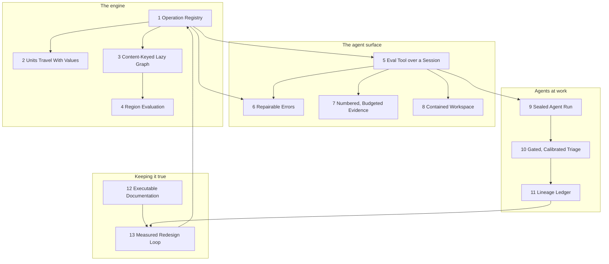

# Agent-Operated Engines: a pattern language

This language describes how to build a domain engine that language-model agents operate by writing code, and how to
run, check and record the work those agents do. It distils four projects that solved the same problems more than
once, in different languages and with different degrees of care. Each chapter names one pattern, explains the forces
that shape it, and gives a sketch that works in any codebase.

## The kit and the quality

The systems this language serves have three layers. An **engine** holds a domain's operations: image filters,
spreadsheet formulas, geometry, queries. An **agent surface** lets a model drive the engine, usually by sending
small programs and reading back text and pictures. A **labour layer** runs many agents on many items, checks their
answers against something known, and records who decided what.

The quality the language aims for is that each layer stays small, honest and replaceable. Concretely, it answers
these questions:

- How does one description of an operation serve validation, documentation, error messages and the agent's context
  at once?
- How does an engine compute only what was asked, and never the same thing twice?
- What does an agent need to see after each step so that its next step is right, and what must it never be asked to
  read off a picture?
- How do you run an agent so that its run can be repeated, compared and trusted?
- How do you know an agent's answers are good enough to save a person's time, and which ones still need the person?
- How do the documentation and the API stay true as both change?

## The running examples

Four projects supply the examples. Nothing in the language depends on them; they show that each pattern was needed
and what went wrong without it.

- **goja-cv** is a Go image-analysis engine that agents script in JavaScript through one MCP `eval` tool. It was
  built for inspecting film scans for dust and went through five design iterations driven by agent transcripts.
- **go-go-goja** is the Go toolkit goja-cv runs on: JavaScript runtimes, persistent REPL sessions with pluggable
  result processing, an MCP server for sessions, and a documentation hub.
- **The Editor lab** is a photo editor in one browser page, with a tiled, content-cached engine, an agent with one
  `eval` tool, a benchmark bench and a textbook whose code blocks run. It and goja-cv descend from the same nine
  prototypes, which is why several patterns appear in both.
- **The dust pipeline** (DUST-002 and DUST-003 in the film-dust project) trains a dust detector with labels from
  people and agents: isolated agent runs as annotators, validators and judges, deterministic gates, planted controls,
  review queues and a human review tool.

## How each pattern is written

Every chapter follows one template (the pattern-extraction skill's): intent, other names, motivation, the problem in one sentence, the forces in
tension, the solution (beginning "Therefore:"), applicability (including when not to use it), structure,
collaborations, a sketch, implementation notes, variations, consequences, known uses and related chapters.

Two ratings head each chapter:

| Rating | Meaning |
| --- | --- |
| ★★ | Close to invariant: any system with this problem ends up with this shape. |
| ★ | A good form among several; the variations section names the others. |

Each chapter also carries the Garden's maturity label in its frontmatter (`established`, `emergent`, `candidate`),
describing how well the originating projects implement it, not how good the pattern is.

The implementation notes name the originating projects' real mistakes. Those notes are the most useful lines in the
language: each one is a bug that shipped or a cost that was paid.

### Roles, not modules

A chapter describes forces and responsibilities, not a file layout. Agents that built software from these chapters
showed what happens otherwise: given a table of participants, they wrote one module per row; given a sketch, they
copied details that belonged to the originating project (a module loader into a library with no modules, a cost
constant nobody had measured). Blind reviewers then judged the builds made without the chapter better adapted to their
task, while the chapter builds resolved more of the forces. To keep the forces and lose the transcription, every
chapter is written this way:

- **The Structure table has a "Needed" column.** "Always" marks the core; "only when …" names the condition under
  which a participant earns its place. A participant is a responsibility: in a small system it is a function, a field
  or a row in a table, not a class or a module.
- **Sketches show the shape, not the originating project.** Details that belong to goja-cv, the Editor lab or the dust
  pipelines appear in the implementation notes and known uses, labelled as such. Numbers in a sketch are placeholders
  unless a note says where they were measured.
- **The first variation is the smallest form:** what the pattern looks like when only the "always" participants are
  built, and when that is enough.

Start from the smallest form and the forces your system actually has; add a participant when its condition shows up.

## Pseudocode conventions

| Notation | Means |
| --- | --- |
| `value T:` | an immutable record type; its methods return new values |
| `copy(x, f: v)` | x with field f replaced by v |
| `a ⊕ b` | map a with b's entries laid over it |
| `xs ++ ys` | list concatenation |
| `f(a) → B` | a signature: f returns a B |
| `x → expr` | an anonymous function |
| `match x:` | case analysis over the forms x can take |
| `refuse(kind, …)` | return a structured refusal: kind, message, hints, fix, where |
| `-- text` | a comment |

## The pattern map



Read an arrow as "is completed by": a registry is completed by units on its arguments and by a graph that runs its
operations; an eval tool is completed by repairable errors, visual evidence and a contained workspace; agent runs are
completed by triage, and triage by a ledger. The loop at the bottom closes the language: what the redesign loop
learns flows back into the registry.

## The chapters

The engine:

1. [Self-Describing Operation Registry](01-self-describing-operation-registry.md) — one table per operation drives
   checking, units, help, errors, the agent's context and tests.
2. [Units Travel With Values](02-units-travel-with-values.md) — lengths, coordinate frames and value encodings are
   tags on values, converted by declared rules and never silently.
3. [Content-Keyed Lazy Graph](03-content-keyed-lazy-graph.md) — calls build hash-consed nodes; values are computed on
   demand and cached by a key built from what produced them.
4. [Reach-Declared Region Evaluation](04-reach-declared-region-evaluation.md) — every operation declares how far it
   reads, so a request for a small area computes only that area and its margin.

The agent surface:

5. [One Eval Tool over a Scripted Session](05-one-eval-tool-over-a-scripted-session.md) — the agent sends programs to a
   persistent session through a single tool and gets back capped text, a context block and pictures; task libraries
   load into the session in layers.
6. [Repairable Errors](06-repairable-errors.md) — every failure carries a code, where it happened, why, the valid
   alternatives and a fix written as code.
7. [Numbered, Budgeted Evidence](07-numbered-budgeted-evidence.md) — pictures are for seeing and numbers for
   measuring; pictures carry ids, arrive in sheets, and are rationed.
8. [Contained Workspace](08-contained-workspace.md) — one writable directory, read-only inputs, and writes that cannot
   escape, follow links or overwrite what was read.

Agents at work:

9. [Sealed Agent Run](09-sealed-agent-run.md) — an agent run is a pure function of a saved prompt and mounted tools,
   with a fixed output contract and a kept transcript.
10. [Gated, Calibrated Triage](10-gated-calibrated-triage.md) — a deterministic gate filters agent proposals, planted
    controls measure the judges, and people review only the uncertain middle.
11. [Lineage Ledger](11-lineage-ledger.md) — every artefact is stamped with what made it, and every decision is an
    appended event folded into state.

Keeping it true:

12. [Executable Documentation with Outcome Contracts](12-executable-documentation-with-outcome-contracts.md) —
    examples in the documentation run in tests and declare their expected outcome, including errors.
13. [Measured Redesign Loop](13-measured-redesign-loop.md) — transcripts of real agent use drive API changes, and every
    change is judged by rerunning fixed scenarios into a ledger.

## Using the language

Introduce each pattern when its need first shows, in roughly this order:

1. Start with the **registry** (1) the day you have three operations; every later pattern reads it.
2. Add the **eval tool** (5), **repairable errors** (6) and a **contained workspace** (8) before the first agent
   touches the engine.
3. Add **units** (2) when the first silent mix-up happens, or before, if your domain has more than one coordinate
   system or value scale.
4. Add the **lazy graph** (3) when agents start repeating work, and **region evaluation** (4) when inputs grow beyond
   what fits comfortably in one pass.
5. Add **evidence** (7) as soon as agents look at pictures.
6. Add **sealed runs** (9) the first time you run more than a handful of agents, then **triage** (10) and the
   **ledger** (11) when their answers start to matter.
7. **Executable documentation** (12) and the **redesign loop** (13) run alongside everything from the start; they are
   how the other patterns stay correct.

## All of them in one sketch

```text
-- 1 Registry: one record per operation
registry.define("blur", args: [sigma: Length(docPx), min 0], reads: within 3·sigma,       -- 2 units, 4 reach
                kinds: Image → Image, doc: "Gaussian blur of sigma doc px", run: blurKernel)

-- 5 Eval tool: the agent's program runs in a persistent session
session = Session(registry, workspace: Workspace(root: "run/ws", read: ["data/"]),        -- 8 contained workspace
                  libraries: ["helpers.js", "task-helpers.js"])                            -- 5 layered libraries
result = session.eval("""
  img = open("tile-17.tif")                                   -- 3 builds a node; nothing is computed
  spots = await img.blur(2).peaks({ snr: 3 })                 -- 3 computed once, cached by content key
  return sheet(spots.slice(0, 12)).look("candidates")        -- 7 numbered evidence, counted against a budget
""")
-- result: capped text + context block + the sheet; a failure would be     -- 6 repairable error with a fix
--   { code: E_ARG_RANGE, path: open → ✗ blur, hint, fix: "img.blur(2)", line: 2 }
-- a zoom on one spot computes only its window plus the blur's reach       -- 4 region evaluation

-- 9 Sealed run: one item per run, saved prompt, fixed JSON answer
answer = sealedRun(prompt: assemble(role, playbook, items(blind ids), contract), tools: [session], budget: 50)

-- 10 Triage: gate, then calibrate on planted controls, then route
kept    = [p for p in answer.proposals if gate(p) == keep]       -- deterministic metric
quality = score(judgeAnswers, controls)                            -- AUC, calibration on known items
queue   = [i for i in items if quality.uncertain(i.verdict)]       -- people see only the middle

-- 11 Ledger: every artefact stamped, every decision appended
ledger.append(Decision(item, verdict, by: person, at: now))
label = stamp(Label(...), madeBy: { run: answer.runId, eval: 17, script: "helpers.js:36" })

-- 12 Executable docs: the guide's examples run in CI with declared outcomes
-- 13 Redesign loop: mine transcripts, change the registry, rerun the fixed scenarios into the results ledger
```

## The same language in other systems

| System | Registry and units | Graph and regions | Eval tool and evidence | Runs, triage and ledger |
| --- | --- | --- | --- | --- |
| A geospatial raster service for agents | operations on bands with metres, degrees and CRS tags | tiles of a map, reach of focal operations | agents send map algebra, get numbered map snippets and numeric tables | agents label land cover; controls from surveyed plots; analysts see uncertain cells |
| A spreadsheet or BI agent tool | functions with typed, unit-tagged arguments (currency, percent) | recalculation graph, only visible ranges computed | formulas or scripts in one tool; charts with labelled points | agents reconcile accounts; known-correct ledgers as controls; reviewers see disagreements |
| A code-maintenance agent harness | refactoring operations with typed targets | build graph with content keys, affected targets only | one shell or REPL tool; diffs and test tables as evidence | one sealed run per issue; tests as the gate; reviewers see failing or risky patches |
| A document-extraction pipeline | extractors with field types and units | cached page analyses per document and region | agents query a document session; page crops with numbered boxes | extraction runs per document; checksums as the gate; gold documents as controls |

## What to leave out

The language deliberately omits the parts of the originating projects that belong to their domains or their
interfaces: the catalogue of image operations and layer kinds, blend modes and undo history, the dust taxonomy and
detector training, the browser dock and stage, and the review tool's screens. It also omits patterns that the
Garden's other studies already cover well, such as the runtime-owner discipline for single-threaded JavaScript
runtimes (see the go-go-goja study) and event-sourced session streams (see the sessionstream study).

## Further reading

- Christopher Alexander, Sara Ishikawa and Murray Silverstein, *A Pattern Language* (1977).
- Erich Gamma, Richard Helm, Ralph Johnson and John Vlissides, *Design Patterns* (1994).
- Andrey Mokhov, Neil Mitchell and Simon Peyton Jones, "Build Systems à la Carte", ICFP 2018.
- Jonathan Ragan-Kelley et al., "Halide: A Language and Compiler for Optimizing Parallelism, Locality, and
  Recomputation in Image Processing Pipelines", PLDI 2013.
- John Yang et al., "SWE-agent: Agent-Computer Interfaces Enable Automated Software Engineering", 2024.
- Xingyao Wang et al., "Executable Code Actions Elicit Better LLM Agents" (CodeAct), ICML 2024.
- Jianwei Yang et al., "Set-of-Mark Prompting Unleashes Extraordinary Visual Grounding in GPT-4V", 2023.
- The libvips documentation, "How it works".
- [[Research/playbooks/pi-coding-subagents-handbook|Handbook - Running pi coding agents as measured subagents]].
