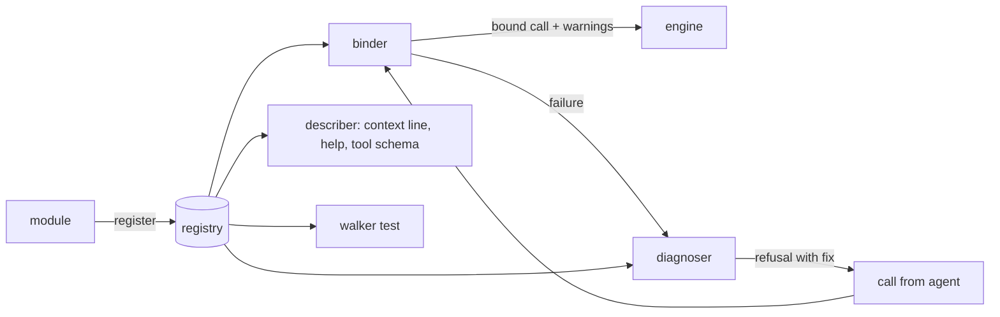

# Chapter 1 · Self-Describing Operation Registry

*One record per operation drives argument checking, help, error messages, the agent's context and the tests.*

Rating: ★★ (close to invariant: any system with this problem converges on this shape; see the overview).

## Intent

Describe every operation of an engine once, as a data record, and make every part of the system that needs to know
about operations read that record. Checking a call, explaining an operation, suggesting a correction and testing the
catalogue then cannot disagree, because there is nothing for them to disagree about.

## Also known as

Op table, operation schema, Type Object (for operation kinds), single source of truth for an API.

## Motivation

goja-cv offers agents about sixty image operations: `gaussian`, `levels`, `peaks`, `measure`, `mask.luminance` and
so on. An agent writes `img.gaussian(2).crop([x, y, 64, 64])`. goja-cv was designed after a comparison of nine
prototypes of the same idea, and the prototypes, then goja-cv's first version, failed in four ways that all trace
back to operations without one authoritative description:

- **Documentation promised what did not exist.** The prototypes' documentation advertised functions nobody had
  built; agents called them and got generic failures.
- **Lengths had no stated unit.** Two prototypes did not scale radii and crops when exporting at full size, so the
  exported picture differed from the preview the user had approved.
- **A wrong default was taken silently.** In goja-cv v1, `cv.open(path, { encoding: P.choice(…) })` passed a value
  where a literal was expected; the accessor read it as an empty string and the file opened as sRGB instead of
  linear. Nothing failed; every number afterwards was on the wrong scale.
- **Agents typed near-misses.** Transcripts show `look({ box: [...] })` meaning "crop first" and
  `mask.luminance({ min: 0.6 })` meaning "above 0.6". A refusal that only says "unknown option" sends the agent back
  to the documentation; one that names the intended call does not.

The Editor lab, written separately, reached the same structure: one table of layer kinds, each with typed parameter
specifications, drives its sliders, its defaults, its agent's `kinds()` answer and the validation of presets.

The problem is not specific to images:

- A **command-line framework** needs each flag's type, default and help text for parsing, `--help`, shell completion
  and error messages.
- A **query engine's** function catalogue needs argument types for the planner, the documentation and the "no
  function matches the given argument types" error.
- A **card game's** rules engine needs each card's cost, targets and effects for play legality, tooltips and the
  computer opponent.

## Problem

**When several consumers each keep their own idea of what an operation accepts and returns, they drift apart, and
the caller, often an agent, gets silent wrong behaviour instead of a precise refusal.**

## Forces

- **Fluency against honesty.** A plain method call reads well in a script, but a plain method accepts anything and
  ignores what it does not understand.
- **One source against expressiveness.** A declarative record is easy to read and check, but some rules (two
  arguments that must agree, a result shape that depends on an argument) do not fit in a table.
- **Generated against written documentation.** Help generated from records is always current but flat; prose written
  by hand explains, and drifts.
- **Strictness against forgiveness.** Rejecting an unknown option prevents silent errors, but an agent that typed a
  near-miss deserves to be told what it meant rather than merely refused.
- **A small core against a growing type system.** Every new argument type (a box, a colour, a list of points) makes
  the checker more capable and more complicated.

## Solution

**Therefore: give every operation one record: its name, the kind of value it applies to, each argument with type, unit,
default, hard limits and documentation, the kind and fields of its result, its documentation and its implementation; add
a usual range, a cross-argument hook, flags or redirects only when something needs them. Validate each record when it is
registered, and what spans records once registration is complete. Make every consumer read the records: the binder
checks calls and returns warnings with them, the describer renders help, tool schemas and the agent's reference, the
diagnoser builds refusals with the valid alternatives, and a test walks every record and calls it. A redirect never
rewrites a call; it only gives the refusal a fix naming the intended call. Where host policy decides a flag (which
operations need confirmation), the registry answers and every consumer asks it. The few operations that cannot be
records are listed in one place and tested separately; any other list of operations found outside the registry is a
bug.**

## Applicability

Use it when:

- more than one consumer needs to know an operation's shape (a checker, docs, a UI, an agent's context, tests);
- callers are agents or end users who cannot read the source;
- operations are added often, by several people, or by users at run time.

Do not use it when:

- only one consumer needs an operation's shape and the caller can read the source; a function signature is enough.
  Build the registry when a second independent consumer exists or is clearly coming, not when a count is crossed;
- the operations are general-purpose code rather than a catalogue (a registry of every function in a program is a
  second type system);
- the platform already gives you the records (a typed RPC schema that generates clients, docs and validation); use
  that schema as the registry instead of building a parallel one.

## Structure

| Participant | Responsibility | Needed |
| --- | --- | --- |
| **Operation record** | Name, receiver kind, arguments, result kind and fields, samples for the walker, doc, and an implementation or an expansion (a graph of other operations). | Always. Fields computed from the bound arguments only when an option adds fields; an expansion only for composites. |
| **Argument spec** | Name, type, unit, default or optional, hard limits, doc; a usual range with a hint; a position. Defaults and limits are in the declared unit. | Always. A usual range only when a legal value can be unwise; a position only for positional calls. |
| **Registry** | Validates and stores records, one per receiver kind and name; checks across records after start-up; enumerates them; answers what every consumer must answer alike ("needs confirmation?"). | Always. |
| **Binder** | Turns a raw call into checked arguments plus warnings, or a failure. Never rewrites the call. | Always. |
| **Describer** | Context line, full help, tool schemas. | Always: it is the second consumer. |
| **Diagnoser** | Turns a failure into a refusal with valid names, nearest name and fix (see [Chapter 6](06-repairable-errors.md)). | Always. |
| **Walker** | A test that calls every record with its samples and applies the one result check. | Always. |
| **Argument type** | Accepts and checks a value, names the spec keys it allows, gives an example, parses text, describes itself. Its table belongs to one registry. | Only when types go beyond a few built-in ones, or plug-ins bring their own. |
| **Flags** | Properties others act on (needs confirmation, needs its whole input, not callable by agents). Host policy may raise a flag; a record cannot lower it. | Only when a participant acts on the flag; add each with its first user. |
| **Cross-argument hook** | `validate(args)` for a rule spanning arguments, in the diagnoser's vocabulary. | Only when a record has such a rule. |
| **Redirects** | Observed near-misses (option, method, old name) mapped to the intended call, for the fix. | Only when near-misses have been seen (see [Chapter 13](13-measured-redesign-loop.md)). |

## Collaborations

1. At start-up, each module registers its records; a malformed record fails before any call. Then the registry
   checks what spans records, such as redirect targets.
2. The binder looks up the record by receiver kind and name, refuses unknown keys, fills defaults, checks types and
   limits in the declared units and runs the cross-argument hook if there is one. Units are converted to the working
   scale later, at evaluation (see [Chapter 2](02-units-travel-with-values.md)).
3. A failure goes to the diagnoser, which reads the same record for the valid names, the nearest match and, if one
   is declared, a redirect, and returns a refusal. The caller sends the corrected call.
4. Warnings travel on the bound call; whatever runs the call copies them into the reply the caller reads (see
   [Chapter 5](05-one-eval-tool-over-a-scripted-session.md)), around the result if its shape is fixed. A warning
   that reaches only a log is no warning.
5. Only with confirmation: the runner and the describer ask the registry the same question, "needs confirmation?".
6. The describer renders the catalogue at two lengths: a short form for the agent's standing context and full help on
   request. goja-cv's full reference is about eight times the size of the instructions it keeps in every turn.
7. In the test suite, the walker calls every record and applies the result check to each result. It runs against a
   test host (fakes, a dry-run mode, a copy of the data): records whose operations act on the world (unlock a door,
   delete a file, send a message) must never be walked against a live one. In construction experiments, all five
   self-tests of a home-automation hub ran every action for real, confirmation granted.



The registry sits in the middle; every arrow out of it is a consumer that would otherwise keep its own copy.

## Sketch

```text
-- the records
value ArgSpec:   name, type, unit, default?, optional, min?, max?, doc,  -- default, min, max are in `unit`
                 usual?, usualHint?,          -- only when a legal value can be unwise
                 values?, position?,          -- only if the type allows values; only if calls are positional
                 redirects?                   -- only for observed near-misses: wrong key → intended call
value OpRecord:  name, on: Kind, args: [ArgSpec], returns: Kind, fields(boundArgs) → [FieldSpec],
                 samples, doc, run | expand,  -- an implementation, or a graph of other operations
                 validate?(args) → ok | Failure, flags?, redirects?   -- each only when something needs it

-- argument types (only when they multiply): everything type-specific lives here
value ArgType:   name, keys,                  -- the spec keys it allows: number → min, max, usual
                 accepts(v) → bool, check(v, spec) → ok | Failure(why, valid?, suggestion?),
                 example(spec) → v,           -- for fixes and generated probes
                 parse(text) → v | Failure,   -- only when some caller sends text (a command line)
                 describe(spec, consumer)     -- a schema fragment, a help phrase
registry.types: name → ArgType                -- one table per registry, never module-global

registry.register(rec) → ok | refuse(E_BAD_RECORD, …)
  -- structural: one of run/expand, a result kind, unique typed args, required before optional,
  --             spec keys allowed by the type, samples present
  -- semantic:   default passes its type's check, usual range within limits, (on, name) unique
registry.finalize() → ok | refuse(E_BAD_RECORD, …)   -- once all modules have registered:
  -- every redirect target exists, every sample binds

-- binding a call
bind(on, name, raw) → BoundCall(rec, args, warnings) | Failure
  rec = registry.lookup(on, name)
  if rec is none: return Failure(UNKNOWN_METHOD, name, on)          -- even if a redirect exists: never follow it
  args, warnings = {}, []
  for key in unknownKeys(raw, rec): return Failure(UNKNOWN_OPTION, key, rec)    -- first: a near-miss beats "missing"
  -- if positional: a spec given both positionally and by name is Failure(ARG_DUPLICATE), never an override
  for spec in rec.args:
    v = take(raw, spec) else spec.default else (spec.optional ? skip : return Failure(ARG_MISSING, spec))
                                                 -- optional without a default: absent from args
    if not spec.type.accepts(v): return Failure(ARG_TYPE, spec, v)   -- never coerce to a zero value
    check = spec.type.check(v, spec); if check is Failure: return Failure(ARG_VALUE, spec, v, check)
    if supplied(raw, spec) and outside(v, spec.usual):               -- defaults never warn
      warnings = warnings ++ [Warning(RANGE, spec, spec.usualHint)]
    args = args ⊕ {spec.name: v}
  if rec.validate: check = rec.validate(args); if check is Failure: return check
  return BoundCall(rec, args, warnings)

-- confirmation (only with side effects): one answer; run, tool schemas, help and context line all ask it
needsConfirm(rec) = rec.name in host.confirmPolicy or rec.flags.confirm   -- host raises; a record cannot lower
run(call, confirmed) → result | refuse(E_CONFIRM, fix: the same call, confirmed)

-- the diagnoser: one entry point; a redirect only ever becomes a fix
explain(failure, registry) → Refusal              -- a known redirect beats the nearest name; show both
  match failure.kind:
    UNKNOWN_METHOD → r = registry.redirectFor(failure.on, failure.name); names = registry.names(failure.on)
                     refuse(E_UNKNOWN_METHOD, fix: r.call or none, valid: names, nearest: closest(failure.name, names))
    UNKNOWN_OPTION → r = redirectFor(failure.key, failure.rec)
                     refuse(E_UNKNOWN_OPTION, failure.key, fix: r.call or none, valid: optionNames(failure.rec))
    ARG_TYPE       → refuse(E_ARG_TYPE, failure.spec, fix: failure.spec.type.example(failure.spec))
    ARG_VALUE      → refuse(E_ARG_RANGE, failure.spec, valid: failure.check.valid, fix: failure.check.suggestion)
    HOOK           → refuse(failure.code, args: failure.args, hint: failure.why)   -- hooks use the same vocabulary

contextLine(rec) → "name(arg, …) → Kind: first sentence of doc"   -- help(rec) is the long rendering

-- the result check: one function; the walker calls it, and run may too
checkResult(rec, args, v) → ok | Failure(E_RESULT)  -- the record author's fault, never the caller's
  declared = rec.fields(args)
  if declared is empty: v has kind rec.returns                     -- values without fields: kind only
  else: keys(v) ⊆ names(declared) and required(declared) ⊆ keys(v)

for rec in registry.all():                                         -- the walker test, against a test host:
  call = bind(rec.on, rec.name, rec.samples); assert checkResult(rec, call.args, run(call)) is ok
                                                                   -- never a live one (actions have effects)

-- in use (numbers are placeholders)
OpRecord(name: "blur", on: Image, returns: Image, samples: {sigma: 2}, run: blurKernel, doc: "Gaussian blur",
         args: [ArgSpec(name: "sigma", type: number, unit: px, default: 2, min: 0, max: 200, usual: [0.5, 20],
                        usualHint: "above 20 px, downsample first")])
```

## Implementation notes

1. **Validate the record for structure and consistency.** goja-cv's `Register` refuses a record with both or neither
   of an implementation and an expansion, with no result kind, with a duplicate argument, with a required positional
   argument after an optional one, or with an untyped argument. It does not check that a default lies within the
   limits or that a redirect points at an existing operation, and such mistakes reach agents before anyone notices.
   Both kinds of check belong to the pattern. Checks across records (a redirect to an action another plug-in
   registers later) run at the end of start-up, not record by record.
2. **Separate hard limits from usual ranges, both in the declared unit.** A value outside the hard limits is a
   refusal; a value outside the usual range binds with a warning that says what to do instead. goja-cv's `heal`
   takes a radius from 0 to 200 document pixels but warns outside 0.5 to 20. Both apply to the value as written.
   Only values the caller supplied warn; a default outside the usual range is the record author's choice and belongs
   in help, not in every reply.
   Check unknown keys before missing arguments, so a near-miss (`temp` for `target`) gets its repair.
3. **Nothing falls back to a default silently.** Unknown keys are refusals, and a value of the wrong type is a
   refusal, not a zero. goja-cv v1 read an encoding given as a parameter object as an empty string and applied the
   default; v2 makes options literals and makes accessors fail loudly on a wrong type. Silent acceptance is worst for
   an agent: the result looks plausible.
4. **Keep every near-miss redirect in the records, and only ever refuse with it.** Option-level redirects live in
   argument specs (`{ min }` → use `above`); method-level ones (`look({ box })` → use `crop`, a misremembered method
   name) live in the operation record or the registry. goja-cv has the first kind in its specs but keeps method,
   help and look redirects in three tables outside the registry. That is debt: a redirect added to one table is
   invisible to the others. A redirect or a case-insensitive match is never followed, only offered as the fix; in
   construction experiments, a build that followed them could run an action the caller had not named.
5. **Walk the whole registry, check results in one place, and know what the walk does not prove.** goja-cv's
   `TestRegistryWalk` renders help for every record and calls every operation on each receiver kind it accepts;
   `TestSchemaProperty` requires every row-returning result to have exactly the declared fields, optional ones excepted.
   Fields depend on the bound arguments, because some options add columns. Write the result check once; if `run` also
   checks results, it calls the same function and reports a mismatch as the operation's fault, not the caller's. One
   happy-path call per record does not exercise limits, redirects, warnings or optional arguments; generate those probes
   from the records. Put the samples in the record, so registration can require them; goja-cv keeps them in the test
   file, which is why its registration cannot.
6. **Make argument types pluggable before they multiply; give the type everything type-specific.** goja-cv's binder
   is the largest file in its graph package and mixes generic types (numbers, enumerations, objects) with image ones
   (boxes, points, colour names). Accept, check and describe are not enough: in construction experiments, every
   build with pluggable types still switched on `number` and `enum` by name for which spec keys apply, for example
   values in fixes and for parsing command-line text. So the type also names its spec keys, gives an example and
   parses text. Keep the type table in the registry, not in a module: two builds with a global table leaked types
   between registries and tests. Consumers (help, tool schemas, controls) are modules that read records; the core is
   registration, binding and storage. A new type is then one new file, a new consumer a two-line delegate.
7. **One record per receiver kind and name.** goja-cv keys records by receiver kind and name, so `measure` on an
   image and `measure` on regions are two records. It does not overload a name by argument types within a kind; a
   query engine that does must let the lookup return candidates and the binder choose (see Variations).
8. **Records evolve, and their defaults are part of identity.** Bound defaults enter the hash of a call (see
   [Chapter 3](03-content-keyed-lazy-graph.md)), so changing a default changes cache keys and the meaning of saved
   scripts. Rename with a redirect from the old name, not with a silent alias: the old name is refused with a fix
   naming the new one, so callers learn the new name and there is still one way to say each thing. Treat a changed
   default as a change of behaviour that the tests and the documentation show.
9. **Enumerate the exceptions and test them separately.** A few parts of an API cannot be records: goja-cv binds
   `cv.open` by hand and writes the "Globals" section of its reference as fixed text. Keep such parts in one visible
   list, with a test that every name the agent can call appears either in the registry or in that list. This means
   the operations and globals of the agent's language, not the host tool's own command line or admin commands. The
   Editor lab generates its agent's view of layer kinds from its table but writes the reference for its own API
   functions by hand, and nothing checks that the two agree.
10. **Composite and user-defined operations are records too.** goja-cv defines some operations as small graphs of
    others (a difference of Gaussians is two blurs and a subtraction); each still has a record, so help, errors and
    the reference treat it like any operation. The Editor lab normalises a user's JavaScript layer settings into the
    specs its built-in kinds use; goja-cv reads a helper's parameter list and first comment from its source, so user
    code appears in the agent's context with a signature and a doc line.
11. **A flag that host policy decides has one answer, asked by every consumer.** goja-cv's flags are its own:
    `Global` (needs the whole image), `Internal` (not callable from JavaScript, used by `convert`), an `Identity`
    predicate (neutral arguments return the input) and `Lossless` (looks default to PNG). A system with side effects
    adds confirmation, decided by the host. The registry combines host policy and the record's flag into one answer
    that the runner, tool schemas, help and context line all ask. In construction experiments, two of three chapter
    builds rendered tool schemas from the record's flag and told the assistant a host-guarded action was safe.

## Variations

- **Smallest form.** Only the "always" participants, with a closed switch over a few built-in argument types. It
  gives up pluggable types, the hook, flags, usual ranges and redirects. It is enough while the types are few and
  no plug-in brings its own: in construction experiments, the smallest build refused unknown names, bad limits and
  bad defaults as well as the larger ones. Add argument types when a new one would mean editing switches in several
  places.
- **Code-first or schema-first records.** Records derived from annotations, decorators or struct tags need less
  boilerplate, but limits, usual ranges and redirects fit awkwardly into annotations. Records in an external file
  (YAML, TableGen, protobuf) with code generation are language-neutral and reviewable, at the cost of a build step
  and generated code to read.
- **Overload sets.** The lookup returns every record with the name, and the binder picks the one whose argument
  types match, as query engines and many languages do. More flexible; refusals must then explain why each candidate
  failed.
- **One record per tool** instead of per operation, as in an MCP server's tool schemas. Coarse-grained and simple, but
  the checker sees only one large argument object per tool.

## Consequences

- \+ Checking, help and refusals agree by construction; the walker makes sure every record runs at least once.
- \+ An agent's context can be generated, and it grows with the catalogue at no writing cost.
- \+ New operations are cheap to add correctly, and harder to add incorrectly (the walker and registration fail).
- \+ Users' own operations can join the same machinery.
- − Generated help is flat; good explanation still needs hand-written guides (see
  [Chapter 12](12-executable-documentation-with-outcome-contracts.md)).
- − The binder becomes a small type system that needs its own design and tests.
- − The walker proves less than it seems: one call per record is coverage, not correctness.
- − A central table makes every new operation touch shared code, which some teams experience as friction.

## Known uses

- **PyTorch** describes its operators once in `native_functions.yaml`; bindings, dispatch and parts of the
  documentation are generated from it.
- **ONNX** operator schemas (inputs, attributes, type constraints, docs) drive validation, shape inference and the
  published operator documentation.
- **Kubernetes** validates resources against published OpenAPI schemas, and `kubectl explain` renders them as help.
- **MCP** tool input schemas serve both client-side validation and the model's context.
- **Glazed** (go-go-golems) derives flags, help and parsing from one definition of each command parameter.

## Related chapters

- [Chapter 2 · Units Travel With Values](02-units-travel-with-values.md): the units an argument spec carries and when
  they are converted.
- [Chapter 3 · Content-Keyed Lazy Graph](03-content-keyed-lazy-graph.md): bound calls become graph nodes.
- [Chapter 5 · One Eval Tool over a Scripted Session](05-one-eval-tool-over-a-scripted-session.md): where the context
  line and the warnings reach the agent.
- [Chapter 6 · Repairable Errors](06-repairable-errors.md): the refusals the diagnoser builds.
- [Chapter 12 · Executable Documentation with Outcome Contracts](12-executable-documentation-with-outcome-contracts.md):
  the prose the registry cannot write.
- [Chapter 13 · Measured Redesign Loop](13-measured-redesign-loop.md): where the redirects come from.
- Classic patterns: **Type Object** (Johnson and Woolf) for operation kinds as objects; **Interpreter** when records
  are interpreted rather than run; **Command** for a bound call as a value.
