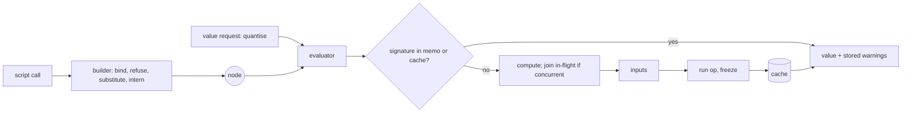

# Chapter 3 · Content-Keyed Lazy Graph

*Calls build hash-consed nodes; values are computed only when needed and cached under a key built from what
produced them.*

Rating: ★★ (close to invariant: any system with this problem converges on this shape; see the overview).

## Intent

Let a script describe a computation as a graph of operation calls without running it, make identical calls share
one node, and compute a node's value only when something asks for it. Cache each value under a key derived from the
operation, its arguments and the keys of its inputs, so that the same computation is never done twice, whoever asks
and however it was written.

## Also known as

Lazy dataflow graph, hash-consing with memoization, content-addressed cache. In build-system vocabulary its keys
are deep constructive traces (keys built from the keys of dependencies).

## Motivation

An agent inspecting a film scan works in rounds. In one eval it writes `img.as("linear").view("speck")` and looks
at a crop; in the next it measures twelve points on the same view; in a third it zooms on two of them. Each round is
a separate program, written from scratch, often repeating the chain in slightly different words. On a 24-megapixel
scan the speck view costs about a third of a second; a blur of large radius, several seconds. Naively, every round
recomputes everything it mentions.

The naive alternatives fail in specific ways:

- **Eager evaluation** computes every intermediate as soon as it is written, including the ones the agent then
  abandons, and computes the same chain again in the next round.
- **Caching by variable** (remembering the value of `view`) does not survive a new program, and returns stale values
  when the agent rebinds the variable to something else.
- **Caching by source text or object identity** of a function returns stale results when the function refers to a
  variable whose value changed. Several of the nine prototypes that preceded goja-cv keyed functions by their source
  and did exactly that.

goja-cv and the Editor lab (a browser photo editor descended from the same prototypes) both solve this with the
same structure. In goja-cv a node is created per distinct call and a value is cached per signature; the second
round's `view("speck")` is the first round's node, and its windows cost nothing. In the lab, every tile of every
layer has a key made of the layer's settings, the pixel revisions it reads and the keys of the tiles below; moving
a slider recomputes only the tiles whose keys changed.

The same structure solves other problems:

- A **build system** must rebuild only what changed, and share results between developers.
- A **spreadsheet** must recompute only the cells that depend on an edited one.
- A **data-analysis notebook** over large tables must not rerun a twenty-minute join because a later cell changed.

## Problem

**When computations are expensive, written repeatedly in different words, and requested piecemeal, recomputing them
on each request wastes most of the work, and caching them by name or by source text returns stale results.**

## Forces

- **Laziness against immediacy.** Deferring work saves what is never needed, but a statement that only builds a
  node does nothing visible, which surprises the person or agent who wrote it.
- **Key precision against key cost.** A key that captures every input exactly is safe; computing it costs time, and
  a key that is too coarse returns wrong values.
- **Structural keys against output keys.** Keys built from inputs need no data to look up; keys built from outputs
  let a rebuild stop early when a value did not change, but cost a hash of every output.
- **Memory against recomputation.** Every cached value is memory; every evicted one is work to redo.
- **Bounded values against a growing graph.** The byte budget bounds cached values; the interned nodes and the
  sources they hold grow outside it with every distinct call and file.
- **Sharing against isolation.** Sharing nodes and values across callers multiplies hits, and makes any mutation of a
  shared value a bug that corrupts other callers' results.
- **Functions as arguments against hashability.** Callers want to pass functions ("apply this inside the mask"), but
  a function's behaviour cannot be hashed from its text or its identity.

## Solution

**Therefore: make every operation call return a node instead of a value, and intern nodes by a hash of the
operation, its canonical arguments and its input nodes, so that equal calls are one node. Refuse any argument that
has no canonical form, and turn a function argument into an ordinary subgraph when the call is built. Compute a node
only when a value is requested. Give each value a key built from the node's hash, the operation's version, the
evaluation parameters (quantised where the request enters) and the keys of its inputs, recursively; look the key up
in a byte-budgeted cache before computing, and store with each value everything its computation reported. Store
values frozen, and copy one only where it leaves the graph for a caller.**

## Applicability

Use it when:

- operations are deterministic functions of their inputs and arguments;
- the same computations recur, across requests or within one;
- computations are expensive compared with hashing their descriptions;
- callers ask for parts of results at different times (a crop, a measurement, a look).

Do not use it when:

- operations have side effects or depend on hidden state (time, randomness without a seed, a mutable global); their
  keys would lie;
- callers must pass arguments that have no canonical form and cannot become subgraphs (live handles, callbacks that
  read the world);
- every computation is cheap and requested once; the graph and the cache cost more than they save;
- inputs change constantly at fine grain and most changes leave outputs unchanged; keys built from inputs then
  recompute everything downstream, and verifying keys with early cutoff fit better (see Variations).

## Structure

| Participant | Responsibility | Needed |
| --- | --- | --- |
| **Node** | An operation, its canonical arguments and its input nodes; immutable; identified by a structural hash. | Always |
| **Builder** | Interns nodes by hash; refuses arguments with no canonical form; substitutes inputs into function arguments' subgraphs. | Always; substitution only when operations take functions |
| **Source** | A leaf whose identity includes what it reads (file location, size and modification time, or content revisions). | Always |
| **Signature** | The cache key: the node's hash, the operation's version, the quantised evaluation parameters and the input signatures. | Always |
| **Evaluator** | Computes a requested node: memo, cache, identity short-cut, freeze and store. | Always; parallel inputs only when computations are long |
| **Run memo** | Signature to value for one request, so a value used twice is found without the shared cache. | Only when the cache may evict a value one request uses twice, or warnings are reported once per request |
| **Value cache** | Frozen values and their warnings under signatures, across requests, within a byte budget and a policy. | Always |
| **In-flight group** | Makes simultaneous requests for one signature share one computation. | Only when there are concurrent callers, parallel inputs included |

## Collaborations

1. The script calls operations. The builder binds each call against its record (see
   [Chapter 1](01-self-describing-operation-registry.md)), refuses arguments with no canonical form, substitutes the
   real input into any function argument's subgraph, hashes the call and returns the existing node if there is one.
2. The script asks for a value (by awaiting it, saving it or looking at it). The request quantises the evaluation
   parameters; the evaluator computes the node's signature from its hash and the signatures of its inputs.
3. If the signature is in the run's memo (where there is one) or the cache, the value is returned and its stored
   warnings are reported again.
4. Otherwise the evaluator computes it (joining a computation already in flight, when there are concurrent callers):
   it evaluates the inputs, applies the operation, freezes the value and stores it with its warnings. A neutral call
   returns its input's value, uncached. The caller gets a copy only if it may change the value.
5. When memory runs short, the cache evicts entries by its policy; an evicted value is recomputed on the next
   request, from inputs that are probably still cached.



## Sketch

```text
value Node:   op, args, inputs: [Node], hash
value Entry:  value, warnings, bytes             -- value is frozen: no operation or caller can write to it

-- building
intern(op, args, inputs) → Node
  h = hash(op.name, canonical(args), [i.hash for i in inputs])
  return nodes.get(h) else nodes.put(h, Node(op, args, inputs, h))

canonical(x) → Text
  match x:
    number, text, boolean, null, list, map: one spelling (keys sorted, 1 and 1.0 equal)
    function, handle, any other object:     refuse(E_ARG, "no canonical form")

-- function arguments (only when operations take them): substitute when the call is built
within(img, mask, f) → Node
  hole = placeholder()                           -- evaluating it is an error
  inner = f(hole)                                -- builds nodes, computes nothing
  return intern(within, {}, [img, mask, substitute(inner, hole, img)])

substitute(n, hole, x) → Node                    -- memoize per node on a graph with shared parts
  if n == hole: return x
  return intern(n.op, n.args, [substitute(i, hole, x) for i in n.inputs])

-- evaluating
request(n, rawParams) → Value                    -- the one place a value leaves the graph
  params = quantize(rawParams)                   -- before the key or the computation sees it
  memo = {}
  return thaw(evaluate(n, params))               -- a copy the caller may change, or the frozen value itself

signature(n, params) → Key                       -- memoized per node for the request
  return hash(n.hash, n.op.version, params, [signature(i, params) for i in n.inputs])

evaluate(n, params) → Value
  k = signature(n, params)
  if memo has k:  return memo[k]
  if cache has k: report(cache[k].warnings); memo[k] = cache[k].value; return memo[k]
  return inflight.once(k, () →                   -- only with concurrent callers; otherwise call directly
    ins = [evaluate(i, params) for i in n.inputs]    -- in parallel only where that pays
    if n.op.identity(n.args):
      return copy(ins[0], meta: n.meta)          -- shares the input's frozen data; not cached
    warnings = []
    v = freeze(n.op.run(ins, n.args, params, warn: w → warnings = warnings ++ [w]))
    cache.put(k, Entry(v, warnings, bytes(v)))   -- warnings of this node and its inputs (note 8)
    report(warnings)
    memo[k] = v
    return v)

-- in use
a = img.as("linear").view("speck")             -- round 1: builds nodes
b = img.as("linear").view("speck")             -- round 2, new program: a and b are the same node
await a.crop(w1).stats()                        -- a request: computes the view once
await b.crop(w2).stats()                        -- cache hit for the view; only the crop is new
```

## Implementation notes

1. **Intern at build time, and refuse what has no canonical form.** goja-cv's builder returns the existing node for
   an equal call, so common subexpressions cost nothing and the graph has no duplicates. Hash the bound arguments in
   canonical form (defaults filled, units declared), or two spellings of the same call become two nodes. Refuse an
   argument with no canonical form (a function, a handle, an opaque object). In construction experiments, three of
   five builds keyed such arguments by identity or printed form and served stale values when a captured variable
   changed: the Motivation's failure, one layer down.
2. **Quantise the evaluation parameters where the request enters, and compute at the quantised value.** goja-cv
   rounds the evaluation scale to 10⁻⁴ before anything uses it, so nearly equal scales share entries. Quantising only
   the key while computing at the raw value would store one value under another's key. Any parameter that changes the
   value (scale, precision, device) belongs in the key; any that does not, does not.
3. **What the key holds decides how far the cache can travel.** goja-cv's cache lives in one process, is rebuilt when
   the code changes, and identifies a file by location, size and modification time: cheap, and valid within one
   machine and session. A cache that survives a deploy or is shared between machines must key on the operation's
   implementation version, or a fixed kernel keeps serving old values, and on a content hash of each source.
4. **Make the key wide enough, then stop.** A collision returns a wrong value and nothing reports it. The lab's book
   applies the birthday bound: a long session creates about 10⁵ tile keys; at 32 bits that gives about 1.2 expected
   collisions, at its 52-bit keys about 10⁻⁶. goja-cv's 256-bit SHA-256 signatures cost little, since nodes are far
   fewer than tiles, and need no collision detection or salting.
5. **Leave out of the key what cannot affect the value.** The lab's key for an opaque fill that covers the whole tile
   ignores the layers below it; a hidden layer takes the key of what is below it; a pass-through group at full
   opacity takes the key of its top child. Each rule raises the hit rate and is a correctness obligation: a rule
   wrong in one case returns a stale picture in that case.
6. **Turn a function argument into an ordinary subgraph when the call is built.** goja-cv runs a function argument
   once, against a placeholder node, then substitutes the call's receiver for the placeholder throughout the
   subgraph, re-interning each node on the path. `img.within(mask, i => i.exposure(-0.4))` thus shares nodes and
   cache entries with `img.exposure(-0.4)`, and the evaluator never sees a placeholder; evaluating one that escaped
   its builder is an error (`E_PLACEHOLDER`). The function must be data-independent: it cannot branch on values it
   has not seen (`img.width > 1000 ? …`). Data-dependent choices become operations (a select, a threshold) or
   explicit arguments, which are hashed. Builders who bound the placeholder at evaluation instead (see Variations)
   first recursed forever on nested calls, and lost the sharing.
7. **Store values frozen; copy out where a value leaves the graph.** A cached value is shared by every later request.
   Store it in a form nothing can write to (read-only arrays, tuples), hand operations that form, and copy only at
   the request, for a caller that may change it. The identity short-cut then needs no copy, and its result is not
   cached: it is its input's value, and caching it charges the budget twice. goja-cv's Go buffers are writable, so it
   relies on operations only creating values. Four of five experimental builds froze values unprompted; the one that
   copied only on the identity path, as an earlier sketch did, let a probe corrupt the cache.
8. **Store what the computation reported with the value.** goja-cv keeps the warnings raised while computing a value
   in the cache entry and reports them whenever the value is served, once per evaluation; otherwise a warning appears
   on the first request and silently disappears on every cached one. A hit on a node serves none of its inputs, so
   its entry carries the warnings of the whole subgraph below it. A value too large to cache reports its warnings
   immediately, since nothing will replay them.
9. **Share in-flight work only when there are concurrent callers.** A single-flight group keeps two simultaneous
   requests for one signature from computing it twice; with one caller it is dead weight. Parallel inputs create
   concurrent callers (a diamond's shared input is asked for twice at once) and bring the group with them. goja-cv
   evaluates inputs concurrently and keys a group by signature. Without an asynchronous runtime, a bounded worker
   pool deadlocks once evaluations wait for inputs queued behind them; use a thread per distinct input signature, or
   evaluate inputs in order.
10. **Budget the cache, make the policy a setting, and know what the budget does not bound.** goja-cv caps its value
    cache at 2 GiB by default with LRU eviction. The lab offers LRU and GreedyDual-Size (priority = clock + cost /
    size); on its bench, undo-heavy editing recomputed a quarter as many tiles under GreedyDual-Size, while a brush
    stroke recomputed a third more. Neither policy wins; measure on your workloads. A size-aware policy must evict
    before inserting, or it can evict the value it was asked to store. The budget bounds values, not the graph: the
    node table and its sources need their own release rule (end of session, or nodes no live script can reach).
    goja-cv pins decoded sources outside the cap; that is its decoder's arrangement, not part of the pattern.
11. **Make evaluation points explicit.** goja-cv computes on `await`, `look()` and `cv.save`, and refuses to read a
    property of an unevaluated node (`E_NOT_AWAITED`). Its first version also dropped bare `x.look()` statements
    silently; the second delivers every look created in an eval. A lint for "node built but never used" was tried and
    deleted: it fired on legitimate code more than on mistakes.

## Variations

- **Smallest form.** Node, builder, source, a signature of node hash, version and quantised parameters, an evaluator
  and a byte-budgeted LRU cache of frozen values. No run memo, in-flight group, parallel inputs or function
  arguments. It gives up deduplicating simultaneous requests, and recomputes a shared input within one request when
  the cache cannot hold the request's working set. Enough for one caller and modest graphs. Smaller still is
  call-level memoization by canonical arguments: no laziness or inspection, good when calls are coarse and few.
- **Placeholder bound at evaluation.** Keep the placeholder in the graph and bind it to the real input per
  evaluation, when the input is only known then (a function applied to each item of a list computed later). The
  placeholder hashes to a constant; the binding enters every signature below it, never the shared node; nested
  calls need a rule for a placeholder bound to itself. The subgraph shares no entries with the same pipeline
  written directly.
- **Verifying keys with early cutoff.** Record the hashes of each computation's inputs and output; after a change,
  recompute bottom-up and stop where an output hash is unchanged. Keys built from inputs cannot do this: the lab
  measured a third to a half of the recomputation after editing a masked layer as avoidable, and none after a global
  edit, while hashing outputs cost 15 % to 22 % of a cheap layer's work. goja-cv's sources do not change during a
  session, so the waste is rare there; an editor should weigh it.
- **Persistent and shared caches.** Store values by key on disk or on a server so that later sessions and other
  users hit them, as build systems' remote caches do. Needs keys with every environmental input (note 3).

## Consequences

- \+ Repeated and overlapping requests cost almost nothing after the first.
- \+ Programs can be written naively (rebuilding chains each round) without paying for it.
- \+ The graph is inspectable: what will be computed, from what, and what was cached.
- \+ Independent inputs can be evaluated in parallel where that pays.
- − Memory is spent on values that may never be asked for again; the budget and policy need tuning.
- − The budget bounds values, not the graph; long sessions need a release rule for nodes.
- − Laziness confuses authors who expect a statement to act; evaluation points must be explicit.
- − Every operation must be deterministic and every relevant input must reach the key; one hidden input (a global, a
  clock, a mutable buffer, a captured variable) produces silently stale results.
- − Keys built from inputs waste work when a change does not change an output.

## Known uses

- **Nix** names every build output by a hash of its inputs (its derivation), and reuses any output whose hash exists.
- **Bazel** keys actions by digests of their inputs and command line, and shares results through local and remote
  caches.
- **Shake** and **Salsa** (the incremental engine behind rust-analyzer) record dependencies and support early
  cutoff when a recomputed value is unchanged.
- **Dask** builds task graphs whose keys are derived from the operation and its arguments (`tokenize`), and computes
  them on demand.
- **darktable** keys its pixel-pipeline cache by a hash chained through the modules of the pipeline.
- **Excel** recalculates only cells marked dirty by a change: dirty bits in place of keys, cheap in place, with no
  sharing across sessions.

## Related chapters

- [Chapter 1 · Self-Describing Operation Registry](01-self-describing-operation-registry.md): the records that bind
  calls before they are hashed.
- [Chapter 2 · Units Travel With Values](02-units-travel-with-values.md): inserted conversions are ordinary cached
  nodes.
- [Chapter 4 · Reach-Declared Region Evaluation](04-reach-declared-region-evaluation.md): keys for parts of values.
- [Chapter 6 · Repairable Errors](06-repairable-errors.md): warnings stored with cached values reach the caller.
- [Chapter 13 · Measured Redesign Loop](13-measured-redesign-loop.md): measuring the cache policy.
- Classic patterns: **Flyweight** (shared immutable nodes), **Proxy** (a node stands for a value not yet computed),
  **Memento** is not needed, because values are never modified.
