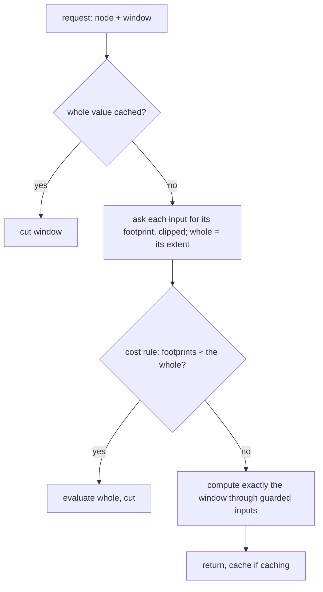

# Chapter 4 · Reach-Declared Region Evaluation

*Every operation declares how far it reads; a request for a small area computes only that area and its margin.*

Rating: ★★ (close to invariant: any system with this problem converges on this shape; see the overview).

## Intent

Let an engine compute part of a large result correctly without computing all of it. Each operation declares its
footprint: for an output window, which window of each input it reads. For most operations that is the output window
widened by the operation's reach, the distance it reads beyond the output it writes. A request travels down the
graph, each node asking its inputs for their footprints, and every node computes only the area its consumer needs.
The answer for the window is exactly what a whole-image computation would have given there.

## Also known as

Demand-driven evaluation, partial images (libvips), regions of interest, tiles with aprons (halos, overlap), windowed
evaluation.

## Motivation

An agent checks a dust candidate on a 6,000 × 4,000 scan: it crops a 64-pixel window around the point from a heavily
blurred version of the scan and measures it. goja-cv computes every operation over its whole frame and cuts the
window at the end. On that image, a 64-pixel window of a Gaussian blur cost 161 ms at σ 2, 662 ms at σ 8 and 3.1 s at
σ 32, because all 24 million pixels were blurred first; the window and the blur's margin are at most 0.3 % of them.
One short script peaked at 3.6 GB of memory. The cost grows with the scan, not with what the agent looks at, and
agents look at many small windows.

The Editor lab does not have this problem. Every layer kind declares a `reach`, the engine computes the picture in
tiles, and a request for one tile pulls from the layer below only that tile widened by the reach. Moving a slider on
a large picture recomputes only the tiles that change, each from a small neighbourhood.

The naive fixes fail:

- **Cropping the input first** (open only a window of the file) gives wrong results near the window's edge, because
  a blur there needs pixels outside the window, and it changes every whole-image statistic.
- **Computing at lower resolution** is fast but cannot find a three-pixel speck.
- **Caching whole results** helps the second window, not the first, and spends memory on pixels nobody asked for.

Other domains have the same problem:

- A **map server** renders tiles of a world map from layers with blurs, hillshading and label collision.
- A **video filter chain** processes regions of interest of 8K frames.
- A **scientific array library** applies stencil computations (finite differences, convolutions) to arrays larger
  than memory, chunk by chunk.

## Problem

**When an engine computes every operation over the whole input, the cost of a small request is the cost of the whole
input, and the only safe way to compute less is to know exactly what each operation reads.**

## Forces

- **Exactness against economy.** Computing less is only acceptable if the window comes out exactly as in a
  whole-image computation; any shortcut that changes values near the edge is a bug.
- **Small requests against shared work.** Computing exactly the requested window is cheapest once, but overlapping
  windows then compute their overlap twice; tiles or a per-cell memo share work, at the cost of rounding requests up
  or of memory.
- **Tile size against reach.** Small tiles waste little on small requests; large reaches make small tiles read many
  times their own area.
- **Local against global.** Statistics over the whole image (percentiles, histograms, connected components) cannot
  be computed from a window, and they sit inside otherwise local chains.
- **Declared against discovered reach.** A declared reach is cheap to use and easy to get wrong; measuring what an
  operation reads is safe and expensive.

## Solution

**Therefore: give every operation a declared footprint: for an output window, the window it reads from each input.
For point operations it is the window itself; for neighbourhood operations the window widened by the reach (per
axis when the operation is directional); for operations that move pixels (resize, rotation, a pyramid level) the
window mapped back through the transformation; for global operations, the whole input. Let an evaluation carry a
window. When a node is asked for a window, it asks each input for its footprint, clipped to the input's extent,
computes exactly the window from what it receives, and returns it. A global operation stops the request at its own
input and reads it whole; split an operation whose parameters are global but whose application is local into a
statistic node and a local operation that takes the statistic as an ordinary input, so windows pass through the
application. Prefer an existing whole result when one is cached. Prove the scheme with one test: for every operation,
alone and in chains, the window computed this way is bit for bit equal to the same window cut from a whole
computation.**

## Applicability

Use it when:

- inputs are large compared with what a typical request needs;
- most operations read a bounded neighbourhood of each output position;
- requests arrive as windows: crops, zoomed views, measurements around points, tiles of a display.

Do not use it when:

- most operations are global (sorting, global optimisation, connected components over everything); windows would
  stop at the first operation;
- inputs comfortably fit in memory and whole computation is fast enough; the machinery costs more than it saves;
- the reach of an operation cannot be bounded or stated (iterative algorithms that propagate across the whole image);
  treat those as global.

## Structure

| Participant | Responsibility | Needed |
| --- | --- | --- |
| **Footprint** | Per operation and input: the input window read for an output window (grown, mapped back, or whole). | Always |
| **Window** | A rectangle in the source's coordinates that a request asks for. | Always |
| **Region evaluator** | Propagates windows down the graph, widened and clipped at each node; computes each node on its window. | Always |
| **Invariance test** | Checks that windowed and whole-then-cut results are equal, per operation and in chains. | Always |
| **Footprint guard** | Cuts each input, sources included, to its footprint; a read outside raises. | Always in tests |
| **Global barrier** | Where a global operation reads its input whole. | Only when some operation is global |
| **Statistic node** | The global half of a split operation, wired in as an ordinary input of the local half. | Only when a global parameter sits in a local chain |
| **Cost rule** | Evaluates a node whole when its footprints for one window cost about as much as its whole inputs. | Only when whole runs are cheaper per pixel than windowed ones |
| **Scale conversion** | Turns a reach declared in source pixels into buffer pixels at the evaluation scale. | Only when evaluation happens at more than one scale |
| **Tile grid** or **cell memo** | Shares computed work between overlapping requests. | Only when overlapping requests are common |

## Collaborations

1. A request names a node and one or more windows (a crop's box, a zoomed look's view, the neighbourhoods of measured
   items). Each window is evaluated on its own; close ones may be merged, never replaced by their bounding box.
2. If the node's whole value is in the cache, the evaluator cuts the window from it and stops. Keep this step even in
   the smallest form whenever whole values are computed at all: it is the best case (every later window of a value an
   agent already looked at is free), and construction experiments showed builders dropping it when it read as
   optional.
3. The evaluator asks each input for its footprint, clipped to the input's extent: the window itself for a point
   operation, the window grown by the reach for a neighbourhood operation, the window mapped back for one that moves
   pixels, the whole extent for a global one. A whole footprint makes that input evaluate whole; the node's other
   inputs stay windowed.
4. Only when there is a cost rule: if this node's footprints for this window would cost about as much as its whole
   inputs, the node is evaluated whole and the window cut from it.
5. The operation computes its output for exactly the window, reading its inputs through the guard. The result is
   exact because every position read only computed inputs, with arithmetic that does not depend on where a buffer
   starts.
6. Only when windows are cached: the windowed value is stored under the node's key plus the window (or per tile).



## Sketch

```text
value Window:    x, y, w, h                                   -- in the source's coordinates
value Footprint: (window, inputIndex) → Window | whole

-- declared in each operation's record (Chapter 1)
footprint(gaussian(σ), w, i)      = grow(w, ceil(3σ))          -- reach: the kernel's truncation radius
footprint(motionBlurX(len), w, i) = grow(w, x: len, y: 0)       -- directional
footprint(exposure, w, i)         = w                           -- point operation
footprint(resize(f), w, i)        = expand(inverseMap(w, f), filterSupport)   -- moves pixels: map, not grow
footprint(percentile(p), w, i)    = whole                       -- global
-- only when evaluating at several scales: declare reach in source px, convert in one place, round outward

evaluate(n, window) → Value
  if window is none: return evaluateWhole(n)
  if cache.has(key(n)): return cut(cache.get(key(n)), window)   -- always, if whole values are ever cached
  fps = [footprint(n.op, window, i) for i in indices(n.inputs)]
  fps = [inp.extent if fp is whole else clip(fp, inp.extent) for (fp, inp) in zip(fps, n.inputs)]
  if sum(area(fp) for fp in fps) > FRACTION × sum(area(inp.extent) for inp in n.inputs):
    return cut(evaluateWhole(n), window)        -- only with a cost rule; per node and window; FRACTION: measure it
  ins = [guard(evaluate(inp, fp), fp) for (inp, fp) in zip(n.inputs, fps)]    -- sources included
  v = n.op.run(ins, window)                     -- computes exactly the window, indexing absolute coordinates
  return cache.put(key(n, window), v)           -- only when windows are cached

evaluateMany(n, windows) = [evaluate(n, w) for w in windows]   -- each on its own, never their bounding box
guard(v, fp) = v read in absolute coordinates; any read outside fp raises

-- a global parameter inside a local chain: the statistic is an ordinary input
stretch(img) = divide(img, percentile(img, 99))
footprint(divide, w, 0) = w
footprint(divide, w, 1) = whole                 -- the statistic's extent: one value, evaluated whole once

-- the invariance test: every non-global op, alone and in chains, on a fresh engine (no cache, no memo)
for op in registry.nonGlobal(), for c in [op alone, op after a blur, a blur after op]:   -- × each scale, if several
  full = evaluate(c, none)
  for w in [interior, each edge, each corner, 1 × 1, the whole extent]:
    assert evaluate(fresh(c), w) == cut(full, w)               -- equal, not close

-- in use
spot = crop(gaussian(img, σ: 32), [3000, 2000, 64, 64])
stats(spot)          -- reads (64 + 2·96)² = 65,536 input pixels instead of 24 million
```

## Implementation notes

1. **The footprint must be exact, and only a test can say so.** If an operation reads one pixel further than it
   declares, the outermost ring of every window differs slightly from the whole-image result, and no visual check
   notices. Test every operation at the largest arguments agents use, alone and in chains, on windows at the
   interior, edges and corners, each on a fresh engine: a cache filled by an earlier window hides a short footprint.
   With several scales, test them all; a footprint right at scale 1 and short at 0.37 is the likeliest bug.
2. **Exactness also needs arithmetic that ignores the buffer's origin.** A prefix sum or summed-area table built over
   the buffer adds values in a different order for every window, so the last bits differ even with a correct
   footprint. Compute each output position by the same arithmetic as the whole run, and test exact equality. In
   construction experiments, two builds used prefix sums with tolerance tests, which hid that most windowed cells
   differed. Where exactness is impossible (a reduction in varying order), say so per operation, with its tolerance.
3. **Guard every read.** Cut every input, sources included, to its declared footprint and raise on reads outside it.
   A short reach then fails at once instead of shifting edge values. Handing kernels the whole source loses this
   check exactly above the sources.
4. **Border rules apply only at the real border.** goja-cv mirrors the image at its edge; the lab extends the edge
   pixel; an average may count only the cells inside. All work with windows, because a window grown by the reach and
   clipped to the extent meets the real border where a whole computation would. A kernel that applies its border
   rule at the edge of its buffer breaks this; such kernels must be told where the real border is.
5. **Reaches add up along a chain.** A blur of reach 6 feeding an erosion of reach 4 needs inputs within 10 pixels.
   The evaluator gets this for free by widening at each node; a planner that computes the total ahead of time must
   sum the reaches itself.
6. **Convert units only when there are several scales.** With one scale a reach is a count of pixels and needs no
   conversion. With several, a blur of σ 8 source pixels has a reach of 24 buffer pixels at full scale and 12 at half
   scale; declare reach in one unit, convert in one place, round outward (see
   [Chapter 2](02-units-travel-with-values.md)).
7. **Find the hidden global operations, and wire the statistic as an input.** goja-cv marks `stats`, `histogram` and
   connected components as global, but its speck view hides one inside a local chain: its display stretch is five
   times the 99th percentile of the whole residual. Evaluated on a window, an unmarked global uses the window's
   percentile, so the same speck looks different in two zooms. Split it as `divide(img, stat(img))`: the statistic
   is an ordinary input with a one-value extent, so the evaluator needs no hook. Keep it exact (whole, cached); a
   coarse pyramid level is cheaper but needs its own validation.
8. **The cost rule is per node and per window.** Compare one window's footprints with that node's whole inputs. Never
   apply it to the bounding box of a request's windows: two scattered probes then compute the whole image. The
   fraction in the sketch is a placeholder; measure where windowed and whole runs cost the same. Per-cell evaluation
   (see Variations) has no such crossover and needs no rule.
9. **Keep the best case, and measure cold.** goja-cv's second window of a view costs nothing today, because the
   whole view is cached; check the cache first. A cache makes the same request cost different amounts, so give
   measurement a cold mode (a fresh cache).
10. **Windows first, tiles second.** A window request computes exactly the window plus margins and is the smaller
    change. Tiles add a grid, per-tile keys and assembly, and pay off once overlapping requests are common. A tile
    with reach `m` reads `(T + 2m)²` pixels to write `T²`; the lab's bench found a different best size per workload,
    so measure. Align the grid to the source, or two crops at different offsets never share a tile.
11. **Measurements around items are window requests too.** goja-cv's `measure` reads a core and a ring around each
    item. The request is the set of the items' neighbourhoods, not their bounding box, which for scattered items is
    nearly the whole scan; evaluate each neighbourhood (or each cluster of close ones) as its own window. For probes
    on a large scan this is almost the whole saving.

## Variations

- **Smallest form.** Footprints, a recursive evaluator that widens at each node, the guard and the exact invariance
  test, at one scale. No cache, no cost rule, no tiles; a statistic node only if a global parameter exists. It gives
  up shared work between requests and the speed of whole-image kernels on large windows. It is enough when requests
  are few and small compared with the input.
- **Per-cell demand with a memo.** Each output cell is computed by the whole-grid formula over absolute coordinates;
  a node computes only the missing cells of the demanded window and remembers them (as row spans, say). Results are
  exact by construction, overlapping windows share work without rounding, and there are no buffer origins or cost
  rule. The memo costs memory per cell, often many times a pixel array, and per-cell code forgoes vectorised kernels.
  For small grids it can be the smallest correct form.
- **Tiled demand-driven evaluation** (the lab, libvips): every request is rounded to tiles; tiles are the unit of
  work, caching and parallelism.
- **Scheduled fusion** (Halide): a compiler chooses, per stage, whether to store intermediates, recompute them per
  output, or tile with overlap, from the declared footprints of each stage. Dask's `map_overlap` is a fixed schedule
  of this kind: chunks extended by a declared depth.

## Consequences

- \+ The cost of a request follows its size, not the size of the input.
- \+ Memory use drops with it for local chains; only global operations still read their whole input.
- \+ Results are exact, because the scheme is a statement about what each operation reads.
- \+ Parallelism by region becomes available alongside parallelism by input.
- − Every operation needs a correct reach, and a wrong one fails silently at window edges unless reads are guarded.
- − Global operations and hidden global parameters must be found and split.
- − Overlapping requests repeat work until tiles or a memo are added, and tiles waste work on margins.
- − Window kernels must read their buffer's origin, which whole-image code never needed, and their arithmetic must not
  depend on it.

## Known uses

- **libvips** represents images as partial images that compute any requested region on demand, in threads, with
  small intermediate buffers.
- **Halide** (Ragan-Kelley et al., PLDI 2013) schedules image pipelines by trading off storage, recomputation and
  tiling, using each stage's declared footprint.
- **GEGL** (GIMP's engine) and **darktable** compute their pipelines on regions of interest, with tiling and overlap
  when memory is short.
- **Dask** arrays apply stencil functions chunk by chunk with `map_overlap` and a declared depth.
- **Web map tile servers** render map tiles on demand, each with a buffer around it for features that cross tile
  edges.

## Related chapters

- [Chapter 1 · Self-Describing Operation Registry](01-self-describing-operation-registry.md): where reach and the
  global flag are declared.
- [Chapter 2 · Units Travel With Values](02-units-travel-with-values.md): reach is a length and scales like one.
- [Chapter 3 · Content-Keyed Lazy Graph](03-content-keyed-lazy-graph.md): windows and tiles extend the cache key.
- [Chapter 7 · Numbered, Budgeted Evidence](07-numbered-budgeted-evidence.md): zoomed looks and sheets are the
  window requests agents make.
- [Chapter 13 · Measured Redesign Loop](13-measured-redesign-loop.md): measuring tile size and the windowing threshold.
- Classic patterns: **Proxy** (a partial image stands for pixels not yet computed); **Pipes and Filters** (Buschmann
  et al.), here pulled by demand instead of pushed.
