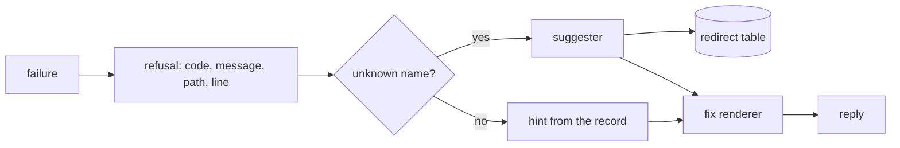

# Chapter 6 · Repairable Errors

*Every failure carries a code, where it happened, why, the valid alternatives and a fix written as code.*

Rating: ★★ (close to invariant: any system with this problem converges on this shape; see the overview).

## Intent

Turn every failure an agent can cause into a structured refusal that is enough to repair the call without reading
documentation: a stable code, a message, the chain of operations that led to it, the line in the agent's program,
the valid alternatives, a hint that explains the concept, and a fix written in the agent's own language. Raise
warnings the same way, at the line that caused them, and fold repeats.

## Also known as

Actionable diagnostics, did-you-mean errors, fix-its, compiler-style errors for agents.

## Motivation

An agent writes `img.zoom(4)`. goja-cv has no `zoom` method: zooming is an option of a look, applied after a crop.
A generic error ("TypeError: Object has no member 'zoom'") tells the agent only that something failed. It then
searches its context, guesses again (`img.resize`, `img.scale`), or gives up on the step. Each guess costs a round
trip and context.

goja-cv's reply to the same call (captured from the installed binary; only the file name shortened) is:

```yaml
error:
  code: E_UNKNOWN_METHOD
  message: Image has no method "zoom".
  where: 'line 2: return img.zoom(4)'
  path: open(tile.tif) → ✗ zoom
  hint: 'Zoom is a look option, not a node: crop the window, then look at it zoomed.'
  fix: 'node.crop([x, y, w, h]).look({ zoom: 8 })'
```

The agent repairs the call in its next eval. That hint and fix exist because transcripts of earlier agent runs showed
`zoom`, `resample`, `export` and `save` being typed again and again; goja-cv keeps those names as redirects with
literal fixes. The Editor lab does the same in a simpler form: an unknown layer id fails with "no layer 'X'; layers
are L1 Sky, L2 Glow, …", so the valid choices arrive with the refusal.

The pattern is not specific to agents:

- A **compiler** reports the source span, the rule broken and a suggested edit that a tool can apply.
- An **HTTP API** returns a machine-readable error type, the invalid field, the allowed values and a link.
- A **command-line tool** answers an unknown subcommand with the nearest valid one.

## Problem

**When a failure says only that something went wrong, the caller has to rediscover the API to recover, and an agent
pays for each guess with a round trip and part of its context.**

## Forces

- **Precision against noise.** A rich error repairs the call; a long one buries the important line.
- **Suggestion against misdirection.** A nearest-name suggestion helps when it is right and costs more than silence
  when it is confidently wrong.
- **Runnable against right.** A fix the agent can paste must bind, but a fix that binds is not a fix that is right.
  Filling a gap with a plausible value makes the fix run and quietly changes what the agent asked for.
- **Generic against mined.** Edit distance works for any name; the near-misses that matter most are conceptual
  ("zoom" for a look option) and only transcripts reveal them.
- **Errors against warnings.** Refusing is safe and blocks work; warning lets work continue and is easily ignored.
- **One place against many.** Errors arise in the binder, the evaluator, the kernels and the host language; repair
  information wants one shape and one vocabulary.

## Solution

**Therefore: give every failure one structured shape: a stable code from a closed list, a one-sentence message, the
path of operations from the source to the failing one, the line in the agent's program, the valid alternatives, a
hint that explains the concept behind the refusal, and a fix written as code the agent can paste. A fix rewrites
only the failing part of the agent's line, in the agent's names and line structure. When the right value cannot be
derived from the agent's own input, give a hint and no fix, never an invented value. Build suggestions in one fixed
order, from certain to guessed: the same name inside a namespace, names agents demonstrably typed (mined from
transcripts) with their literal fixes, a near spelling within an edit budget, and, only where values come in kinds
with their own methods, the same name on another kind. Translate failures from the host language into the same
shape, with one code from the closed list and the host's own error name kept as a field. Raise warnings with the
same fields at the line that caused them, fold repeats into one with a count, and deliver everything that was
produced before a failure.**

## Applicability

Use it when:

- callers are agents or people who cannot easily read the implementation;
- each failed attempt is expensive (a model round trip, a slow build, a support ticket);
- the API has many names, options and kinds of values that are easy to confuse.

Do not use it when:

- the caller is code that branches on errors and never retries with different input; a code and a message suffice;
- revealing the alternatives would leak information (authentication failures, access control: "no such user" versus
  "wrong password"); refuse uniformly there;
- the error space is open-ended (arbitrary validation from user plug-ins); give the shape, but do not promise fixes
  the system cannot compute.

## Structure

| Participant | Responsibility | Needed |
| --- | --- | --- |
| **Refusal** | Code, message, path, where (the line and its source), valid alternatives (a handful, nearest first), hint, fix, and `hostName`: the host's own error class (`TypeError`), empty unless the code is the host-failure code. | Always |
| **Code list** | The closed vocabulary of error and warning codes, each documented once and tested ([Chapter 12](12-executable-documentation-with-outcome-contracts.md)). | Always |
| **Fix renderer** | Rewrites the agent's line, changing only the failing part; no fix when the right value is not in the agent's input. | Always |
| **Suggester** | Produces a hint and a fix for a name that does not exist, in the fixed order. | Always, where names can be mistyped |
| **Redirect table** | Names agents demonstrably typed, each with a hint and a literal fix; one per registry, checked against it. | Only when transcripts show repeated near-misses |
| **Translator** | Turns host-language failures into refusals, keeping `hostName`. Receiver lookup only where agent code calls host objects. | Only when agent code runs in a host language that raises its own errors |
| **Site tracker** | Finds the agent's line for a failure raised inside host calls. | Only where agent code calls host objects; otherwise the parser's line number is the site |
| **Warning folder** | Folds identical warnings at one line into one with a count. | Only when warnings can repeat (loops); otherwise a list |

## Collaborations

1. The binder or evaluator detects a failure and builds a refusal with its code, message, path and line. The parser
   knows the line; only where agent code calls host objects does a site tracker find it.
2. For an unknown name, the suggester consults, in order: a namespaced member of the same name
   (`img.luminance` → `img.mask.luminance`, its own code `E_NAMESPACE`), the redirect table, a near spelling
   within an edit budget, and the same name on another kind of value. The first that answers wins. The fourth step
   needs values of several kinds with their own methods (an image, an awaited array). In a flat command language,
   skip it: rewriting the agent's command into another that takes the option is a confident wrong fix.
3. The fix renderer turns the answer into the agent's line with only the failing part changed. If the change needs
   a value the agent did not write, the refusal carries the hint and no fix.
4. Only where agent code runs in a host language: the translator maps a host failure to the host-failure code, keeps
   the host's error name in `hostName`, and adds a concept hint where it recognizes the failure (note 3).
5. Warnings raised during the program are folded by line and appended to the reply; on failure, the reply still
   carries the warnings and pictures produced before it.
6. Refusal shapes and codes are documented once, in pages whose examples are tested to raise exactly those codes.



## Sketch

```text
value Refusal:    code, message, path: [label], where, valid: [name], hint?, fix?,
                  hostName?                -- the host's error class, e.g. "TypeError"; empty unless code is E_HOST
value Suggestion: code, hint, change?      -- change: what to replace in the agent's line

-- call is the agent's parsed line: its prefix (a loop, an assignment), the name it used, its arguments
suggest(kind, name, call) → Suggestion | none
  for m in registry.methods(kind):                                -- 1. a structural fact
    if namespaceOf(m) ≠ none and memberOf(m) == name:
      return Suggestion(E_NAMESPACE, "it lives in the " ++ namespaceOf(m) ++ " namespace", rename(m))
  if registry.redirects has name:                                 -- 2. a known answer, mined from transcripts
    return Suggestion(E_UNKNOWN_METHOD, registry.redirects[name].hint, registry.redirects[name].change)
  c = closest(differingSegment(name), registry.methods(kind),    -- 3. a guess: "drop" vs "add", not "item.drop"
              budget: max(1, min(3, len / 3)))                    --    goja-cv's budget, not measured (note 2)
  if c: return Suggestion(E_UNKNOWN_METHOD, "did you mean " ++ c ++ "?", rename(c))
  for k in registry.kinds() where k ≠ kind and registry.has(k, name):   -- 4. only with kinds of value
    return Suggestion(E_UNKNOWN_METHOD, name ++ " applies to " ++ k ++ ", not " ++ kind, crossKind(k, name))
  return none

-- rewrite only the failing part; the prefix, the order and the other arguments stay as the agent wrote them
renderFix(call, change) → text | none
  if change needs a value that call does not contain: return none      -- a hint, never an invented value
  return call.prefix ++ render(apply(change, call.command))

unknownMethod(kind, name, call, path, where) → Refusal
  s = suggest(kind, name, call)                       -- valid: the nearest names, only when nothing answers
  return Refusal(code: s?.code or E_UNKNOWN_METHOD, path: path ++ ["✗ " ++ name], where: where,
                 valid: s ? [] : nearest(registry.methods(kind), name), hint: s?.hint, fix: renderFix(call, s?.change))

translate(hostError, where) → Refusal                 -- only when agent code runs in a host language
  r = Refusal(code: E_HOST, hostName: hostError.name, message: hostError.message, where: where)
  h = hostHints.match(hostError, where.source)        -- optional: concept hints
  return h ? copy(r, hint: h.hint, fix: h.fix) : r

foldWarnings(ws) → [Warning]                          -- only when a call can repeat
  return [w with count = n for (w, n) in groupBy(ws, (code, line, message))]

-- in use
repeat 3: item.ad name=w     → E_UNKNOWN_COMMAND, fix: "repeat 3: item.add name=w"    -- prefix kept
item.add name=w qty=abc      → E_ARG_TYPE, hint: "qty is a whole number", no fix      -- nothing to derive it from
```

## Implementation notes

1. **Mine redirects from transcripts, and decide what a redirect does.** goja-cv's method redirects are "the wrong
   method names agents demonstrably typed", collected by a script over pi transcripts (`zoom`, `resample`, `meta`,
   eight names for saving). Each has a hint that names the concept and a literal fix. No edit-distance rule would map
   `zoom` to `crop(…).look({ zoom })`. A mined name can refuse with a fix (goja-cv; it teaches but costs a round
   trip), run as a legal alias (it teaches nothing, and aliases accumulate), or run and warn with the canonical form.
   Refuse when the redirect changes the concept or needs a value the agent did not write.
2. **Suggest in one fixed order, from most to least certain, and state it once.** A namespaced member of the same
   name is a structural fact, a mined redirect a known answer, a near spelling a guess. goja-cv checks them in
   exactly that order. Its edit budget, `max(1, min(3, len/3))`, allows one edit for names up to five letters; it
   cannot tell a typo from a different word one letter away (`crop` and `drop`), which is why the mined redirects
   come first. Apply the budget to the segment that differs: the shared prefix makes `item.drop` and `item.add` look
   close (one build suggested exactly that).
3. **Fixes are code, in the agent's names and line structure.** A fix the agent can paste beats prose. goja-cv's
   translator finds the variable a failing method was called on, so `rows.count()` on an awaited array gets the fix
   `rows.length`. Rewrite only the failing part; keep the loop, the assignment and the other arguments. In
   construction experiments four of five builds dropped a `repeat N:` prefix, so pasting the fix changed what ran.
4. **Keep one shape and one closed code list for every layer.** Binding, evaluation, kernel and host failures all
   become the same record. goja-cv still reports a host `TypeError` under the host's own name as its code; a closed
   list needs one code for host failures, with the host's name in `hostName`, so callers can branch on codes. Fill
   `hostName` only then; one build stored the command name there.
5. **The path is part of the message.** `open(scan.tif) → exposure → ✗ gaussian` tells the agent which step of a long
   chain failed. goja-cv leaves conversions it inserted itself out of the path, because the agent did not write them.
6. **The line is in the agent's program, not the engine's.** goja-cv's site tracker records the first stack frame
   outside the engine for every call and quotes the source line (`where: 'line 2: return img.zoom(4)'`). It earns
   its place because agent JavaScript calls host objects. In a line-oriented language the parser's line number is
   the site.
7. **Warn at the line, fold repeats, and measure each warning.** A range warning inside a loop over 500 candidates is
   one warning with a count. A warning that is usually wrong is worse than none: goja-cv deleted its unused-node lint
   after it fired 19 times in an annotator study, 18 of them on correct code. Measure each warning on real
   transcripts before it ships (see [Chapter 13](13-measured-redesign-loop.md)).
8. **Deliver what was produced before the failure.** goja-cv's failure reply still carries the pictures and warnings
   created before the exception; they are often what the agent needs to see why it failed.
9. **One redirect table per registry, checked against it.** goja-cv has method redirects in its graph package, help
   redirects and member fixes in its module, and look redirects among its operations; a redirect added to one is
   invisible to the others. Keep the table on the registry instance and check at load that each fix names
   operations the registry has ([Chapter 1](01-self-describing-operation-registry.md)); in one build,
   module-level tables leaked across registries.
10. **Never invent a value to complete a fix.** When the right value is not in the agent's input, give the hint and
    the valid alternatives, and either no fix or a placeholder that cannot bind (goja-cv's `[x, y, w, h]`,
    `qty=<whole number>`), marked so the reply can tell it from a runnable fix. In construction experiments three
    builds made fixes bind by inventing values: `qty=0` for `qty=abc`, `name=widget` for a missing name, and a fix
    that turned "remove all" into "remove one".
11. **Test codes and fixes.** goja-cv's documentation marks examples that must fail with a given code
    (`js error=E_CODE`) and runs them; a code no example raises is probably dead. A fix that is itself wrong is the
    most damaging output the pattern can produce, because the agent pastes it and fails again. For each redirect and
    each templated fix, test two things: the fix binds, and it differs from the agent's line only in the failing part.

## Variations

- **Smallest form.** Refusal, code list, fix renderer and a near-spelling suggester over the registry's names; the
  line comes from the parser and warnings are a plain list. It gives up mined conceptual fixes, host translation and
  folding. It is enough for a command language run by the engine's own interpreter, before transcripts exist. In
  construction experiments the smallest build, with no translator, tracker or folder class, was judged best.
- **Run and warn.** A mined near-miss runs as its canonical form and the reply warns with that form ("rm is
  item.remove; ran item.remove name=w"). Work continues and the agent learns the name. Use it only when the mapping
  is exact and needs no value from the agent.
- **Fix-its applied by tools.** Compilers attach machine-applicable edits to diagnostics; editors apply them on
  request. Stronger than a pasteable fix; needs a structured edit format.
- **Uniform refusals** for security-sensitive failures: one code and message for every reason, logged in detail on the
  server side only.

## Consequences

- \+ Most failed calls are repaired in the next attempt without reading documentation.
- \+ Transcripts become a source of API improvements: every repeated near-miss becomes a redirect.
- \+ One error shape makes failures from every layer equally legible.
- − Building good hints and fixes is work per error, and they drift as the API changes unless tested.
- − A wrong suggestion, stated confidently, misleads, and a fix that binds can still change what was asked.
- − Rich errors take context; the reply must stay short when nothing is wrong.

## Known uses

- **Elm's** compiler error messages (Czaplicki, "Compiler Errors for Humans", 2015) state the problem, show the code
  and suggest a fix in plain words.
- **rustc** attaches suggestions to diagnostics, some marked machine-applicable so that tools can apply them.
- **Clang** emits fix-it hints that IDEs apply.
- **Git** suggests the nearest command for a mistyped one ("The most similar command is …").
- **Stripe's API** returns errors with a type, a code, the offending parameter and a documentation URL.

## Related chapters

- [Chapter 1 · Self-Describing Operation Registry](01-self-describing-operation-registry.md): valid names, limits and
  redirects come from the records.
- [Chapter 5 · One Eval Tool over a Scripted Session](05-one-eval-tool-over-a-scripted-session.md): where refusals
  and warnings reach the agent.
- [Chapter 12 · Executable Documentation with Outcome Contracts](12-executable-documentation-with-outcome-contracts.md):
  testing that documented codes are raised.
- [Chapter 13 · Measured Redesign Loop](13-measured-redesign-loop.md): mining redirects and measuring warnings.
- Classic patterns: **Null Object** is the opposite of this pattern (silent defaults); **Chain of Responsibility**
  for the ordered suggesters.
