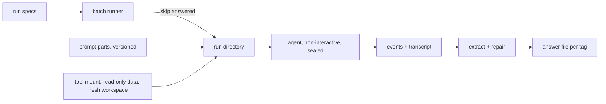

# Chapter 9 · Sealed Agent Run

*An agent run is a pure function of a saved prompt and mounted tools, with a fixed output contract and a kept
transcript.*

Rating: ★★ (close to invariant: any system with this problem converges on this shape; see the overview).

## Intent

Run an agent as one isolated, non-interactive invocation per unit of work, so that its result depends only on what
you gave it: a prompt assembled from versioned parts and saved with the run, tools mounted with least privilege, and
nothing from the operator's environment. Ask for one machine-readable answer in a fixed format, extract it
defensively, and keep the full event stream and a readable transcript. Many runs can then go in parallel, be retried,
be compared across models and prompt versions, and be audited later.

## Also known as

Agent run as a pure function, hermetic subagent, batch agent invocation, isolated agent job.

## Motivation

The dust project used agents as annotators, validators and judges over hundreds of film-scan tiles. An agent started
the ordinary way reads the operator's configuration files and skills, keeps an open conversation, and writes answers
wherever it chooses. Two prompts tried that way are not compared on equal terms: each run has seen different context,
and afterwards nobody can say exactly what a given run was told.

The fix, built three times in the project (an annotator, a validator and a judge script), was the same each time:

- one directory per run, holding the assembled prompt, a tool configuration that mounts the data read-only and gives
  the run its own writable workspace, the event stream and an exported transcript;
- the agent started non-interactively with its built-in tools, context files, skills and prompt templates switched
  off, so only the mounted tools exist;
- a final answer as one fenced JSON block, extracted from the event stream and repaired where models slip.

With runs sealed this way, batches of 360 judgements per variant were scored on the same blind controls across
several models and prompt versions, and this pattern language was checked by agents that saw nothing but one chapter
and one task.

The problem is general:

- **LLM evaluation harnesses** run a model over a benchmark, one item per run, and must compare models fairly.
- **Agentic CI checks** run an agent on each pull request and must not let one run's state leak into the next.
- **Document-extraction pipelines** process thousands of documents with an agent and must reprocess failures only.

## Problem

**An agent run that inherits the operator's environment, holds an open-ended conversation and answers in free text
cannot be repeated, compared or audited, and a batch of such runs cannot be retried or scored.**

## Forces

- **Isolation against usefulness.** A bare agent with no tools or context is reproducible and helpless; every tool and
  file mounted makes it more capable and less predictable.
- **One prompt against many variants.** A fixed prompt makes runs comparable; improving the instructions requires
  variants that must stay comparable with each other.
- **Free text against parseability.** Models reason better in prose and answer more reliably in a fixed format.
- **Strict contracts against model slips.** A strict parser rejects whole runs for one typo; a lenient one accepts
  wrong answers.
- **Parallelism against shared state.** Many runs at once finish sooner, and collide on any shared directory, cache or
  answer file.
- **Cost against coverage.** Every retry and every variant costs a full run.

## Solution

**Therefore: make each run a function call with explicit arguments: one unit of work, a model, a prompt version and a
tag. Give each run its own directory. Assemble the prompt from versioned parts (role, how to work, required steps,
known mistakes, the items with blind ids, the output contract, reference material) and save it there. Start the agent
non-interactively with nothing from the operator's environment, and mount tools only through an explicit, per-run
configuration with read-only inputs and a fresh writable workspace; never mount the answers. Require one fenced JSON
object as the final message, extract it from the event stream with known repairs, and keep the event stream and a
readable transcript. Run many in parallel, each variant under its own tag, skipping runs that already have an answer.**

## Applicability

Use it when:

- the same kind of work is done many times, by agents, and quality has to be measured;
- results must be compared across models, prompt versions or tools;
- runs must be retried, audited or reproduced later.

Do not use it when:

- the work is one interactive task with a person in the loop; sealing removes the conversation that makes it work;
- the task needs broad access to a live environment (a production incident); isolation would make it useless, and
  auditing must come from logs instead;
- there is no way to state what a correct answer looks like; you can seal the run, but not use its output.

## Structure

| Participant | Responsibility |
| --- | --- |
| **Run spec** | The explicit arguments of one run: work item, model, thinking level, prompt version, tag. |
| **Run directory** | Holds everything about one run: prompt, tool configuration, workspace, events, transcript, answer. |
| **Prompt assembler** | Builds the prompt from versioned parts in a fixed order and saves it. |
| **Tool mount** | Per-run configuration of the only tools the agent has: least privilege, read-only data, a fresh workspace. |
| **Agent invocation** | Non-interactive, with built-in tools, context files, skills and templates switched off (or limited to an explicit list). |
| **Extractor** | Finds the last fenced JSON block in the event stream and applies known repairs. |
| **Batch runner** | Runs specs in parallel, logs start and end, skips answered runs, keeps variants apart by tag. |

## Collaborations

1. The batch runner lists the run specs for one variant and skips those whose answer file exists.
2. For each spec, the run directory is created fresh; the assembler writes the prompt; the tool mount is written.
3. The agent is started inside the run directory with the prompt as its only input; its events stream to a file.
4. When it ends, the transcript is exported and the extractor writes the answer file, or records why it could not.
5. A comparison step scores the answers of each variant on the same items (see
   [Chapter 10](10-gated-calibrated-triage.md)); the behaviour in the event streams explains the scores.



## Sketch

```text
value RunSpec: item, model, thinking, promptVersion, tag

run(spec) → Answer | Failure
  dir = fresh(runsRoot / spec.tag / spec.item.id)
  write(dir / "prompt.md", assemble(spec.promptVersion, spec.item))       -- saved: the first thing to read later
  write(dir / "tools.json", mount(read: [dataDir, helpersDir], write: dir / "ws"))   -- never the answers
  events = agent(cwd: dir, prompt: read(dir / "prompt.md"), model: spec.model, thinking: spec.thinking,
                 builtinTools: none, contextFiles: none, skills: none, templates: none,
                 nonInteractive: true)                                        -- stdin closed: it never waits
  write(dir / "events.jsonl", events); exportTranscript(events, dir / "transcript.html")
  return extract(events)

assemble(version, item) → text
  return join([part(version, "role"), part(version, "how to work"), part(version, "required steps"),
               part(version, "known mistakes"), describeBlind(item), part(version, "output contract"),
               part(version, "reference")])

extract(events) → Answer | Failure
  text = finalAssistantText(events)               -- the contract says the final message; earlier blocks are drafts
  block = lastFencedJson(text)
  if not block: return Failure("no fenced JSON in the final message")
  try: return parse(block)
  try: return parse(repairs(block))               -- a dropped key, a colon after a bare id, raw newlines
  return Failure("unparseable JSON")

-- answers are written atomically, with the run's status; only a valid answer counts as done
finish(spec, result) → ok
  writeAtomically(answerPath(spec), { status: result.ok ? "ok" : "failed", spec: hash(spec), answer: result })

batch(specs, parallel: 6)
  todo = [s for s in specs if not (exists(answerPath(s)) and read(answerPath(s)).status == "ok"
                                    and read(answerPath(s)).spec == hash(s))]
  parallelMap(todo, s → finish(s, withTimeout(run(s), 20 min)), workers: parallel)   -- reruns retry failures only

-- in use
batch([RunSpec(item, "deepseek-4.1-flash", "high", "v3", tag: "v3") for item in items])
```

## Implementation notes

1. **Switch everything off, then mount what the run needs.** The dust runners start pi with
   `--no-builtin-tools --no-context-files --no-skills --no-prompt-templates` and give it tools only through a
   per-run MCP configuration. Without these flags, the operator's own instructions and skills leak into every run.
   When a run must build software, allow an explicit tool list (read, write, edit, bash) and give it its own
   directory holding only the task.
2. **Save the assembled prompt in the run directory.** When a result surprises you, the exact prompt is the first
   thing to read. Keep prompt versions as separate files behind a switch, never edited in place.
3. **Never mount the truth.** Items carry blind ids; controls with known answers are mixed in; the answers live
   outside every mount.
4. **Ask for one fenced JSON object in the final message, with a literal example of the schema.** Then extract from
   the final message only, defensively. The judge runs needed three repairs: a dropped key (`{"q003", …}`), a colon
   after a bare id, and raw newlines inside strings; without them a whole run of six answers was lost to one typo.
5. **Keep the event stream and export a transcript.** The events explain the answers: tool calls per run, which helper
   functions were used, which errors were met. In the dust project they explained every accuracy difference between
   models.
6. **Run variants under tags and skip answered runs.** Each variant writes to its own answer directory and log; a
   rerun of the batch retries only failures. Comparing variants is then a join on item ids.
7. **Every run gets its own writable workspace.** Parallel runs never share a writable directory (see
   [Chapter 8](08-contained-workspace.md)); a builder run gets its own subdirectory with only its inputs.
8. **State the budgets in the prompt.** An API that rejects conversations with more than 100 images ends a run with
   nothing; the prompt says so and sets a lower budget (see [Chapter 7](07-numbered-budgeted-evidence.md)).
9. **Expect the shell to bite.** Editing a script while a batch uses it changes in-flight runs; `[ cond ] && cmd` as
   the last command under `set -e` aborts; in zsh an unquoted variable holding several words is not split. All three
   happened while building these runners.
10. **Write the runner once.** The dust project wrote this recipe three times, with the same extraction code pasted
    into each script. One runner driven by a run spec, with prompt parts and tool mounts as data, removes the copies
    and their drift.
11. **Test the seal, and bound every run.** Put a canary in the operator's environment (a context file or skill that
    tells the agent to mention a nonsense word) and check that sealed runs never mention it; repeat after every agent
    upgrade, because a renamed flag silently reopens the leak. Give each run a timeout and the batch a budget: a closed
    stdin stops a run from waiting on a person, not on a hung tool or provider. A quick finish is not a failure, and a
    cost field may lie: some routed providers report zero.

## Variations

- **Container per run.** The agent runs inside a fresh container with mounted volumes. Stronger isolation (network,
  processes); heavier to start.
- **Subagents inside a host agent.** A coordinating agent spawns subagents with a brief and collects their reports.
  Convenient, and the host's context and tools leak into the briefs; harder to seal and to compare.
- **Resumable runs.** A sealed run can be resumed with a follow-up message (feedback, a change request), as a second,
  separately recorded stage; the coaching stage of this language's own validation does this.
- **Single-call evaluation** without tools: the prompt holds everything and the model answers once. The simplest
  sealed run; enough for reading and judging tasks.

## Consequences

- \+ Runs are reconstructible from their directories (exactly what each was given and did), and comparable across
  models and prompt versions run at the same time. They are not bit-reproducible: a routed model name can change
  underneath, so record the provider's model version and decoding settings where they are reported.
- \+ Batches parallelise and retry cheaply.
- \+ Transcripts make behaviour measurable, not only answers.
- \+ Failures are contained to one run and one directory.
- − Sealed agents know only what the prompt and tools give them; missing context shows up as worse answers.
- − Prompt assembly and extraction are code that needs maintenance and tests.
- − Isolation flags differ per agent product; the seal must be checked whenever the agent is upgraded.

## Known uses

- **SWE-bench** evaluates coding agents by running each task in its own container from a fixed repository state and
  scoring the resulting patch with the task's tests.
- **Inspect** (the UK AI Security Institute's evaluation framework) runs tasks as samples with solvers, sandboxes and
  scorers, and logs every sample.
- **OpenAI Evals** runs model evaluations from registered specifications and records the results per sample.
- The **pi coding subagents handbook** in this vault documents the dust project's version, with controls and
  comparisons.

## Related chapters

- [Chapter 5 · One Eval Tool over a Scripted Session](05-one-eval-tool-over-a-scripted-session.md): the session a run
  mounts as its tool.
- [Chapter 7 · Numbered, Budgeted Evidence](07-numbered-budgeted-evidence.md): budgets stated in the prompt.
- [Chapter 8 · Contained Workspace](08-contained-workspace.md): one workspace per run.
- [Chapter 10 · Gated, Calibrated Triage](10-gated-calibrated-triage.md): scoring and routing the runs' answers.
- [Chapter 13 · Measured Redesign Loop](13-measured-redesign-loop.md): prompt and API versions compared by runs.
- Classic patterns: **Command** (a run spec is a command object), **Template Method** (the fixed prompt order).
