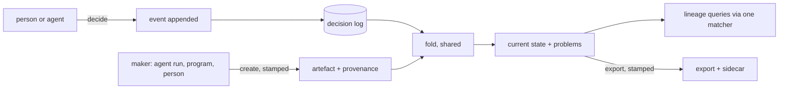

# Chapter 11 · Lineage Ledger

*Every artefact is stamped with what made it, and every decision is an appended event folded into state.*

Rating: ★★ (close to invariant: any system with this problem converges on this shape; see the overview).

## Intent

Make every artefact that agents, programs and people produce answer two questions on its own: what made it, and who
decided what about it. Stamp each artefact at creation with its maker (a program and line, an agent run and step, a
preset, a person, a model version) and its inputs; record each decision as an event appended to a log, never edited,
and derive the current state by folding the log. Then any label, layer or saved result can be traced back, filtered
by origin, measured by source, and corrected without losing history.

## Also known as

Provenance, lineage, audit trail, event-sourced decisions, append-only log.

## Motivation

The dust project's gold labels mix work from a person, from agent suggestions and from detectors. Each gold file
records the annotator, the pass, a timestamp, and for each point its origin: drawn by hand, or accepted from a named
suggestion; rejected suggestions are kept as decisions too. That record made three things possible:

- **Measuring the agents.** Because each accepted point names the suggestion it came from, the project could compute
  how often a person accepted agent suggestions in each confidence band: 81 %, 47 % and 20 %.
- **Controlling the training mix.** Training draws a configured share of each batch's positives from agent-labelled
  tiles (`agent_pos_frac`), which is only possible when every label knows its source.
- **Correcting the yardstick.** When a person re-checked "not dust" controls, the corrections went into a review
  log of decisions; the scoring scripts fold that log over the gold labels, so the corrections apply without editing
  the gold files.

The Editor lab stamps every layer with where it came from (`meta.source`: a preset, a program file and line, a script,
an agent's thread, turn and step) and reads it both ways: `source(id)` says what made a layer, `madeBy(query)` lists
the layers a preset or an agent turn made, and `reveal(id)` opens the preset or the program at the line.

Where lineage was missing, it cost. The gold labels stored a radius without saying it was a fitted radius, about twice
the speck's own; measurements made with it were wrong until someone compared numbers with pictures. goja-cv's saved
files carry no record of the eval, script or inputs that produced them, so a saved table of candidates cannot be
traced to the session that made it.

The same need appears elsewhere:

- **Data pipelines** must say which job, code version and inputs produced a table.
- **Generated code** must say which prompt, model and session wrote it.
- **Machine-learning datasets** must say which annotator, guideline version and tool produced each label.

## Problem

**When artefacts do not record what made them and decisions overwrite one another, nobody can measure a source,
filter by origin, audit a result or undo a decision without losing what came before.**

## Forces

- **Completeness against weight.** Recording every input and step is thorough and heavy; recording too little is
  useless when the question comes.
- **Stamping at creation against reconstructing later.** Stamping costs a little at every creation; reconstructing
  lineage from logs afterwards is expensive and often impossible.
- **Mutable state against history.** Editing a record in place is simple and destroys the history needed for audits
  and undo.
- **Readers against writers.** Many tools read the same records (training, review, scoring); each one that folds the
  log or interprets a maker itself is a copy that can drift.
- **One writer against several.** One process can allocate ids by reading the log; two processes doing it pick the
  same ids and lose records.
- **Inline against sidecar.** Provenance inside the artefact travels with it and changes its format; a sidecar keeps
  the format and can be separated from it.

## Solution

**Therefore: stamp every artefact when it is created with a provenance record: the kind of maker (person, agent run,
program, preset, detector), its identifiers (run id, step, file and line, model and prompt version, code version),
the inputs it read (with content hashes where they may change), and the time. Keep the field definitions and units of
every stored value in a schema written beside the data. Record every decision about an artefact (accept, reject,
correct, undo) as an event appended to a log with who, what, when and why; never edit an event. Derive current state,
and what each decision means, in one shared fold. Offer the queries both ways (what made this, what did this source
make) through one maker matcher.**

## Applicability

The two halves are separable. Stamp provenance whenever artefacts come from more than one kind of source; add the
decision log when decisions are revised over time or several people decide. Many systems need the first and not the
second.

Use it when:

- artefacts come from several kinds of sources (people, agents, detectors, programs) and will be compared, filtered
  or weighted by source;
- decisions are made over time, by several people or agents, and may be revised;
- results must be auditable or reproducible later, exports included.

Do not use it when:

- artefacts are disposable intermediates nothing will question (scratch buffers, cache entries);
- privacy rules forbid recording who did what; record only what the rules allow, and say so;
- the volume of tiny events would cost more than the questions they answer; aggregate first, then record.

## Structure

| Participant | Responsibility | Needed |
| --- | --- | --- |
| **Provenance record** | Kind of maker, identifiers, inputs with hashes, version, time. | Always |
| **Stamper** | The one call every creating path makes, exports included. | Always |
| **Schema** | Fields, units, definitions, allowed values; a file beside the data. | Always (a few lines) |
| **Lineage queries** | `sourceOf`, `madeBy`, aggregates; one maker-matching function. | Always |
| **Decision event** | Artefact id, decision, actor, time, reason; `undo` is one too. | When decisions are revised |
| **Decision log** | Append-only events, ordered by a sequence number. | With decision events |
| **Fold** | Turns the log into state; owns the status vocabulary. | With decision events |
| **Locked append** | One write per record under a lock; ids no two writers share. | Only with several writers |

## Collaborations

1. Every creating path calls the stamper, which attaches the maker's ids, the inputs it read and the code version.
2. *Only with a decision log:* a person accepts a suggestion and the review tool appends an event (`accept`,
   artefact, person, time). A correction appends another event; an undo appends `undo`.
3. Training, scoring and review read state through the one fold, which also returns what it could not apply.
4. "How good are the agent's suggestions?" The acceptance query groups decided artefacts by a provenance field,
   through the matcher `madeBy` uses.
5. A mistake is found in one source; `madeBy(source)` lists everything it made, to recheck or exclude.
6. *Only when state leaves the system:* an export is stamped like any artefact; its sidecar names the labels it
   carries and their makers.



## Sketch

```text
value Provenance: kind, ids: map, inputs: [(ref, hash)], version, at
value Artefact:   id, item, value, provenance                    -- no constructor without provenance
value Event:      seq, artefactId, decision, actor, at, reason?, newValue?
value ItemState:  origin: Provenance, original, current, status, decisions: [Event]   -- the stack an undo pops

-- the schema is written beside the data, not only kept in code
SCHEMA = { fields: {name: (definition, unit)}, makerKinds: [...], decisions: DECISIONS }
openLedger(dir) → if not exists(dir/"schema.json"): atomicWrite(dir/"schema.json", SCHEMA)

-- stamping at creation, in every creating path
create(item, value, ctx) → Artefact
  if ctx.kind ∉ SCHEMA.makerKinds: refuse(E_KIND, "unknown maker kind", hints: SCHEMA.makerKinds)
  return Artefact(newId(), item, value, Provenance(kind: ctx.kind, ids: ctx.makerIds,   -- run, step, file:line, ...
                  inputs: [(i.ref, i.hash) for i in ctx.inputsRead], version: codeVersion(), at: now()))
newId() → a random id                         -- not max+1 read from the log

-- a sidecar names the exact content it describes
save(path, data, prov) → ok
  atomicWrite(path, data)
  atomicWrite(path ++ ".provenance.json", prov ⊕ {contentHash: hash(data)})
-- a missing sidecar, or one naming another hash: readers treat the file as unstamped

-- decisions are appended, never edited; seq orders them, not the clock
decide(log, artefactId, decision, actor, reason?, newValue?) → ok
  if decision ∉ DECISIONS: refuse(E_DECISION, "unknown decision", hints: DECISIONS)
  if actor is none and not policy.anonymous: refuse(E_ACTOR, "a decision needs an actor")
  withLock(log):                                  -- only when several processes write
    append(log, Event(seq: log.next(), artefactId, decision, actor, now(), reason, newValue))   -- one write

-- the fold owns the vocabulary too; FOLD_VERSION goes with every derived number
STATUS_OF = { accept: accepted, reject: rejected, correct: corrected }    -- DECISIONS = its keys and undo
DECIDED   = { accepted, rejected, corrected }
ACCEPTING = { accepted, corrected }

fold(artefacts, events) → (map artefactId → ItemState, problems)
  state = { a.id: ItemState(a.provenance, a.value, a.value, pending, []) for a in artefacts }
  for e in sortBy(events, seq):
    s = state[e.artefactId]
    if s is none:                    problems += ("event for unknown artefact", e); continue
    if e.decision == undo:
      d = lastWhere(s.decisions, not undone)
      if d is none:                  problems += ("undo with nothing to undo", e); continue
      d.undone = true                                               -- history keeps it, marked
    else if e.decision in STATUS_OF: push(s.decisions, e)
    else:                            problems += ("unknown decision", e); continue   -- reported, never guessed
    live = [d for d in s.decisions if not d.undone]
    s.status  = live ? STATUS_OF[last(live).decision] : pending
    c = lastWhere(live, decision == correct)
    s.current = c ? c.newValue : s.original        -- the label in force
  return (state, problems)

-- lineage queries: only the matcher reads maker fields (an ensemble is a change here)
matches(prov, source) → every (field, v) in source: prov[field] == v
sourceOf(id) → artefacts[id].provenance
madeBy(source) → [a.id for a in artefacts if matches(a.provenance, source)]
acceptance(field) → for each value v of field among the artefacts:              -- only with a decision log
  decided = [s for s in fold(…).state if matches(s.origin, {field: v}) and s.status in DECIDED]
  count(s in decided where s.status in ACCEPTING) / count(decided)
unstamped() → count(a for a in artefacts if a.provenance.kind == unknown)   -- audit: legacy and missed paths

-- an export is a creating path; its sidecar names whose labels it carries
export(path, ctx, exclude: []) → ok                                   -- only when state leaves the system
  rows = [s for s in fold(…).state if s.status in ACCEPTING and s.id ∉ exclude]
  a = create("export", [(s.item, s.current) for s in rows], ctx ⊕ {inputsRead: ledgerFiles})
  save(path, a.value, a.provenance ⊕ {carries: [(s.id, s.origin) for s in rows]})
```

## Implementation notes

1. **Make stamping impossible to forget.** The Editor lab stamps layers added by presets, programs, scripts and the
   agent through one helper called from each path; a path that forgets it makes artefacts with no origin, which every
   later query silently drops. Make provenance a required argument of the constructor, give artefacts made before the
   pattern existed `kind: unknown`, and count unknowns in an audit. Exports and reports are creating paths too.
2. **Record origin per item, and keep rejections.** The gold files record the annotator once and the origin of each
   point separately; only that allowed acceptance rates by suggestion confidence. Without rejections a source's
   acceptance rate cannot be computed.
3. **Undo is an event, and order is a sequence number.** The dust review log records `undo` as an event that the
   fold applies; editing a line would lose history. An undo marks the latest live decision undone, so accept, reject,
   undo leaves the artefact accepted. Order by a sequence number from the log, not by clocks.
4. **Define the label in force, and test it as laws.** Corrections overlay; they do not rewrite (the dust control
   corrections were folded over intact gold labels). The label in force is the last live correction's value, or the
   original; the status comes from the last live decision. Test against a small reference model on random sequences:
   correct then accept keeps the correction; undoing a correction restores the one before; replay gives equal state.
   In construction experiments four of five builds broke the first law.
5. **Write the fold once, and let it own the vocabulary.** The dust project folds its review log in the review tool
   (Go) and again in two scoring scripts that copied the function; three folds can disagree on an edge case. The fold
   also owns which status each decision gives and which count as decided or accepting; builds that redefined
   "decided" in a query, or folded unknown decisions as rejections, miscounted a new `escalate`. Unknown decisions
   are reported, not guessed. Version the fold and record the version with every derived number.
6. **Match makers in one place.** `madeBy`, acceptance by source and an export's exclude list all ask whether a
   provenance record matches a source. Give them one function, so ensembles or a renamed field are one change.
7. **Several writers need atomic appends and collision-free ids.** Write each record in one append under a file lock
   (`flock` with `O_APPEND` on POSIX), with random ids or ids assigned inside the lock. In construction experiments,
   ids allocated as `max + 1` from a read of the file lost a third of 400 labels to four concurrent writers.
8. **Record who decided, unless policy forbids it.** The dust review events record the item, the decision and the
   time, but not the reviewer: enough for one reviewer, not for two. Where privacy rules forbid naming reviewers,
   record a pseudonymous id or a role, and say so in the schema.
9. **Write the schema beside the data.** A stored radius that is a fitted radius, not the object's radius, is a
   lineage failure of the data itself (see [Chapter 2](02-units-travel-with-values.md)). A schema kept only in code
   helps no other tool; write it next to the log. Enforce each list of allowed values at creation, or drop
   it: a list of maker kinds that nothing checks drifts from the data.
10. **Bind a sidecar to its content, and to the labels it carries.** Prefer inline provenance; use a sidecar when the
    format must not change. GCV-006 proposes one beside every file goja-cv saves, because other scripts read the saved
    JSON as plain rows. The content hash exposes a missing or stale sidecar. A derived file's sidecar also names whose
    work it carries, the exported label ids and their makers; two construction builds left the makers out.
11. **Hash inputs that may change.** A path alone is wrong after the file is re-exported; record a content hash, or
    at least size and modification time, as goja-cv does for its cache keys.

## Variations

- **Smallest form.** Provenance record, stamper, schema file and the two lineage queries; no decision log. Gives up
  revision history, undo and acceptance over rounds. Enough when artefacts are judged at most once, or the only
  question is "what made this?".
- **Event sourcing for everything.** All state, not only decisions, is derived from events. Maximal history and
  replay; more machinery.
- **External lineage service** (a metadata store fed by every job). Central queries across systems; a dependency that
  every producer must call.
- **Git as the ledger.** Artefacts and decisions are committed files; history and authorship come from the repository.
  Fits small, text-based datasets.

## Consequences

- \+ Every source can be measured: acceptance, error and contribution by origin.
- \+ Results can be audited and reproduced from their records.
- \+ Decisions can be revised and undone without losing what came before.
- \+ Mistakes in one source can be found and excluded wholesale.
- − Every creating path must stamp, and every new path is a chance to forget.
- − Logs grow; folds must be fast, and old logs archived.
- − Provenance can expose who did what; it needs the same care as any personal data.

## Known uses

- **W3C PROV** defines a standard model of entities, activities and agents for provenance records.
- **OpenLineage** is an open standard for recording lineage events from data jobs (runs, inputs, outputs).
- **Event sourcing** (as described by Martin Fowler) stores state changes as an append-only sequence of events and
  derives current state by replaying them.
- **Label Studio** and similar annotation tools record annotator, time and history per annotation.
- **Git** records authorship and history for every change, and is often used as a ledger for small datasets.

## Related chapters

- [Chapter 2 · Units Travel With Values](02-units-travel-with-values.md): definitions and units of stored fields.
- [Chapter 8 · Contained Workspace](08-contained-workspace.md): where stamped artefacts are written.
- [Chapter 9 · Sealed Agent Run](09-sealed-agent-run.md): run ids and prompt versions that stamps refer to.
- [Chapter 10 · Gated, Calibrated Triage](10-gated-calibrated-triage.md): decisions and acceptance by source.
- Classic patterns: **Memento** (the record of a past state), **Command** (a decision as an event), **Observer** is
  not needed: readers fold the log when they need state.
