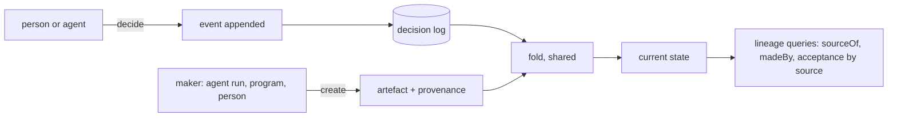

# Chapter 11 · Lineage Ledger

*Every artefact is stamped with what made it, and every decision is an appended event folded into state.*

Rating: ★★ (close to invariant: any system with this problem converges on this shape; see the overview).

## Intent

Make every artefact that agents, programs and people produce answer two questions on its own: what made it, and who
decided what about it. Stamp each artefact at creation with its maker (a program and line, an agent run and step, a
preset, a person, a model version) and its inputs; record each decision as an event appended to a log, never edited,
and derive the current state by folding the log. Then any label, layer or saved result can be traced back, filtered
by origin, measured by source, and corrected without losing history.

## Also known as

Provenance, lineage, audit trail, event-sourced decisions, append-only log.

## Motivation

The dust project's gold labels mix work from a person, from agent suggestions and from detectors. Each gold file
records the annotator, the pass, a timestamp, and for each point its origin: drawn by hand, or accepted from a named
suggestion; rejected suggestions are kept as decisions too. That record made three things possible:

- **Measuring the agents.** Because each accepted point names the suggestion it came from, the project could compute
  how often a person accepted agent suggestions in each confidence band: 81 %, 47 % and 20 %.
- **Controlling the training mix.** Training draws a configured share of each batch's positives from agent-labelled
  tiles (`agent_pos_frac`), which is only possible when every label knows its source.
- **Correcting the yardstick.** When a person re-checked "not dust" controls, the corrections went into a review
  log of decisions; the scoring scripts fold that log over the gold labels, so the corrections apply without editing
  the gold files.

The Editor lab stamps every layer with where it came from (`meta.source`: a preset, a program file and line, a script,
an agent's thread, turn and step) and reads it both ways: `source(id)` says what made a layer, `madeBy(query)` lists
the layers a preset or an agent turn made, and `reveal(id)` opens the preset or the program at the line.

Where lineage was missing, it cost. The gold labels stored a radius without saying it was a fitted radius, about twice
the speck's own; measurements made with it were wrong until someone compared numbers with pictures. goja-cv's saved
files carry no record of the eval, script or inputs that produced them, so a saved table of candidates cannot be
traced to the session that made it.

The same need appears elsewhere:

- **Data pipelines** must say which job, code version and inputs produced a table.
- **Generated code** must say which prompt, model and session wrote it.
- **Machine-learning datasets** must say which annotator, guideline version and tool produced each label.

## Problem

**When artefacts do not record what made them and decisions overwrite one another, nobody can measure a source,
filter by origin, audit a result or undo a decision without losing what came before.**

## Forces

- **Completeness against weight.** Recording every input and step is thorough and heavy; recording too little is
  useless when the question comes.
- **Stamping at creation against reconstructing later.** Stamping costs a little at every creation; reconstructing
  lineage from logs afterwards is expensive and often impossible.
- **Mutable state against history.** Editing a record in place is simple and destroys the history needed for audits
  and undo.
- **Readers against writers.** Many tools read the same records (training, review, scoring); each one that folds the
  log itself is a copy that can drift.
- **Inline against sidecar.** Provenance inside the artefact travels with it and changes its format; a sidecar keeps
  the format and can be separated from it.

## Solution

**Therefore: stamp every artefact when it is created with a provenance record: the kind of maker (person, agent run,
program, preset, detector), its identifiers (run id, step, file and line, model and prompt version, code version),
the inputs it read (with content hashes where they may change), and the time. Keep the field definitions and units of
every stored value in its schema. Record every decision about an artefact (accept, reject, correct, undo) as an event
appended to a log with who, what, when and why; never edit an event. Derive current state by folding the log in one
shared function. Offer the queries both ways: what made this, and what did this source make.**

## Applicability

Use it when:

- artefacts come from several kinds of sources (people, agents, detectors, programs) and will be compared, filtered
  or weighted by source;
- decisions are made over time, by several people or agents, and may be revised;
- results must be auditable or reproducible later.

Do not use it when:

- artefacts are disposable intermediates that nothing will ever question (scratch buffers, cache entries); the cache
  key already identifies them;
- privacy rules forbid recording who did what; record only what the rules allow, and say so;
- the volume of tiny events would cost more than the questions they answer; aggregate first, then record.

## Structure

| Participant | Responsibility |
| --- | --- |
| **Provenance record** | Kind of maker, identifiers, inputs (with hashes), code or model version, time; attached at creation. |
| **Stamper** | Called by every creating path (a save, an agent's add, a preset apply, a person's label) to attach the record. |
| **Schema** | Field names, units and definitions of every stored value (see [Chapter 2](02-units-travel-with-values.md)). |
| **Decision event** | Item id, decision, actor, time, reason; appended, never edited; `undo` is an event too. |
| **Decision log** | Append-only file or table of events per batch or dataset. |
| **Fold** | The one function that turns a log into current state, shared by every reader. |
| **Lineage queries** | `sourceOf(artefact)` and `madeBy(source)`, and their aggregates (acceptance by source, error by source). |

## Collaborations

1. An agent's eval adds a layer, saves a table or proposes a label; the stamper attaches the agent's run, step and
   the program line, plus the inputs it read.
2. A person reviews the suggestion and accepts it; the review tool appends an event (`accept`, item, person, time).
   A later correction appends another event; an undo appends `undo`.
3. Training, scoring and the review tool read current state through the one fold function.
4. A question arrives ("how good are the agent's suggestions?"); the lineage query joins accepted and rejected
   decisions with each suggestion's source and confidence band.
5. A mistake is found in one source (a detector version, a prompt version); `madeBy(source)` lists everything it made,
   to recheck or exclude.



## Sketch

```text
value Provenance: kind (person | agent | program | preset | detector), ids: map, inputs: [(path, hash)],
                  version, at
value Event:      itemId, decision (accept | reject | correct | undo), actor, at, reason?

-- stamping at creation, in every creating path
save(path, data, ctx) → ok
  write(path, data)
  write(path ++ ".provenance.json", Provenance(kind: ctx.kind, ids: {session: ctx.session, eval: ctx.evalNo,
        line: ctx.line, run: ctx.runId, model: ctx.model, prompt: ctx.promptVersion},
        inputs: [(i.path, i.hash) for i in ctx.inputsRead], version: codeVersion(), at: now()))

-- decisions are appended, never edited
decide(log, itemId, decision, actor, reason?) → ok
  append(log, Event(itemId, decision, actor, now(), reason))

-- the one fold, shared by every reader
fold(events) → map itemId → Event
  state = {}
  for e in events:
    if e.decision == undo: delete state[e.itemId]
    else:                  state[e.itemId] = e
  return state

-- lineage queries
madeBy(source) → [a for a in artefacts if matches(a.provenance, source)]
acceptance(bySource) → { band: count(accepted) / count(decided) for band in confidenceBands(bySource) }
```

## Implementation notes

1. **Stamp in every creating path, not in one.** The Editor lab stamps layers added by presets, programs, scripts and
   the agent through one helper called from each path; a path that forgets to stamp produces artefacts with no
   origin, which every later query silently drops.
2. **Record origin per item, not only per file.** The gold files record the annotator once and the origin of each
   point separately; only the per-point origin allowed acceptance rates by suggestion confidence.
3. **Keep rejected suggestions as decisions.** A rejection is information: without it, the acceptance rate of a
   source cannot be computed and the same suggestion may be offered again.
4. **Undo is an event.** The dust review log records `undo` as an event that the fold applies; editing or deleting a
   line would lose the history and break replay.
5. **Write the fold once.** The dust project folds its review log in the review tool (Go) and again in two scoring
   scripts that copied the same function. Three folds can disagree on an edge case (an unknown decision, a malformed
   line); one shared implementation, or one test suite run against all of them, prevents it.
6. **Record who decided.** The dust review events record the item, the decision and the time, but not the reviewer;
   with one reviewer that is enough, with two it is not. Add the actor before it is needed.
7. **Put definitions and units in the schema.** A stored radius that is a fitted radius, not the object's radius, is
   a lineage failure of the data itself (see [Chapter 2](02-units-travel-with-values.md)).
8. **Use a sidecar when the artefact's format must not change.** GCV-006 proposes a provenance sidecar beside every
   file goja-cv saves, because the saved JSON is read as plain rows by other scripts; the sidecar adds lineage without
   breaking readers.
9. **Hash inputs that may change.** A provenance record that names a file by path alone is wrong after the file is
   re-exported; record a content hash, or at least size and modification time, as goja-cv already does for its cache
   keys.
10. **Corrections overlay; they do not rewrite.** The control corrections were applied by folding a review log over the
    gold labels at scoring time. The original labels stay intact, and the correction is itself traceable.

## Variations

- **Event sourcing for everything.** All state, not only decisions, is derived from events. Maximal history and
  replay; more machinery.
- **Inline provenance.** The record lives inside the artefact (image metadata, a JSON field). Travels with the
  artefact; changes its format.
- **External lineage service** (a metadata store fed by every job). Central queries across systems; a dependency that
  every producer must call.
- **Git as the ledger.** Artefacts and decisions are committed files; history and authorship come from the repository.
  Fits small, text-based datasets.

## Consequences

- \+ Every source can be measured: acceptance, error and contribution by origin.
- \+ Results can be audited and reproduced from their records.
- \+ Decisions can be revised and undone without losing what came before.
- \+ Mistakes in one source can be found and excluded wholesale.
- − Every creating path must stamp, and every new path is a chance to forget.
- − Logs grow; folds must be fast, and old logs archived.
- − Provenance can expose who did what; it needs the same care as any personal data.

## Known uses

- **W3C PROV** defines a standard model of entities, activities and agents for provenance records.
- **OpenLineage** is an open standard for recording lineage events from data jobs (runs, inputs, outputs).
- **Event sourcing** (as described by Martin Fowler) stores state changes as an append-only sequence of events and
  derives current state by replaying them.
- **Label Studio** and similar annotation tools record annotator, time and history per annotation.
- **Git** records authorship and history for every change, and is often used as a ledger for small datasets.

## Related chapters

- [Chapter 2 · Units Travel With Values](02-units-travel-with-values.md): definitions and units of stored fields.
- [Chapter 8 · Contained Workspace](08-contained-workspace.md): where stamped artefacts are written.
- [Chapter 9 · Sealed Agent Run](09-sealed-agent-run.md): run ids and prompt versions that stamps refer to.
- [Chapter 10 · Gated, Calibrated Triage](10-gated-calibrated-triage.md): decisions and acceptance by source.
- Classic patterns: **Memento** (the record of a past state), **Command** (a decision as an event), **Observer** is
  not needed: readers fold the log when they need state.
