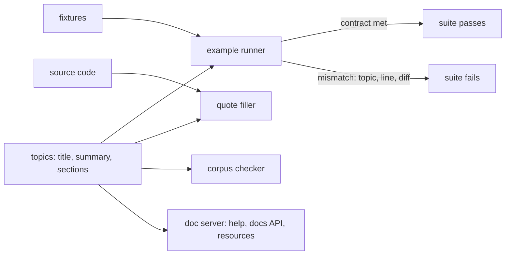

# Chapter 12 · Executable Documentation with Outcome Contracts

*Examples in the documentation run in tests and declare their expected outcome, including errors.*

Rating: ★★ (close to invariant: any system with this problem converges on this shape; see the overview).

## Intent

Keep documentation true by making it executable. Every code example in a guide runs as part of the test suite, and
each one states what it must produce: success, success with a given warning, failure with a given error code, a given
number of pictures, or nothing at all because it is only a fragment. Code quoted in prose is pulled from the running
source, not copied. Documents are also data: structured into topics and sections that people, agents and tools can
list, search and read piece by piece, and checked by rules like any other artefact.

## Also known as

Doc tests, literate testing, runnable examples, living documentation.

## Motivation

Documentation reaches agents mostly second-hand. In goja-cv's annotator study, no agent opened the guides; they
learned from helper libraries written from the guides' examples, from refusals that quote the documented codes, and
from the generated reference. So documentation errors travel: when goja-cv's predecessors were compared, a recurring
failure was documentation that promised what did not exist (error types and functions nobody had built), and agents
called them through code copied from it. An option renamed in the engine leaves an example silently wrong, and every
helper copied from it inherits the mistake.

goja-cv's agent topics answer this with outcome contracts on code blocks. A block fenced as `js` must run without
warnings; `js error=E_ARG_RANGE` must fail with exactly that code; `js warns=RANGE` must succeed with that warning;
`js looks=2` must deliver two pictures; `js fragment` is not run. The test suite runs every block of every topic, in
order, in one session per topic, against a planted test image. A guide that explains an error now proves the error
exists and has that code.

The Editor lab's book does the same for prose about code. Code quotes are written as references
(`{{src:TileCache.prototype.evict}}`) and filled from the running page when the book is built, so a quoted function
cannot drift from the one that runs; a test checks that every quote resolves. Runnable blocks open in the lab's code
view and run against the open document, and a test runs each one. A checker enforces the book's rules (numbered
sections, closing sections, links that exist, captions in order, no banned words).

The problem appears wherever documentation describes behaviour:

- An **SDK's** tutorial shows calls whose parameters were renamed two releases ago.
- An **API reference** lists error codes the server no longer returns.
- A **runbook** tells an operator to run a command whose flags have changed.

## Problem

**Documentation that is not executed drifts from the system it describes, and its readers, agents above all, act on
what it says rather than on what is true.**

## Forces

- **Readable against runnable.** Examples written for readers skip setup and use placeholders; examples that run need
  every line.
- **Showing failure against testing it.** Good guides show what goes wrong; a test runner treats a failing example as
  a failure, unless the example says that failing is its point.
- **Quoting against copying.** Copied code reads well and drifts; generated quotes stay true and need a build step.
- **Whole documents against pieces.** People read a guide top to bottom; agents and tools need one topic or one
  section at a time.
- **Rules against prose.** A checker keeps a corpus consistent, and every rule it enforces is a constraint on the
  writer.

## Solution

**Therefore: treat documentation as executable data. Split it into topics with a title, a summary and sections that
can be listed, searched and read one at a time. Run every code example in the test suite, in order within its topic,
against fixed fixtures, and give each example an outcome contract in its info string: succeed cleanly, succeed with a
named warning, fail with a named error code, produce a stated number of artefacts, or be a fragment that is not run.
Pull every quotation of source code from the source at build time. Check the corpus with rules (structure, links,
references, vocabulary) in the same suite. When the system changes, the documentation fails its tests until it is
updated.**

## Applicability

Use it when:

- the documentation shows code, commands or calls that readers will copy;
- the system changes faster than anyone rereads the documentation;
- agents use the documentation, because they act on it without doubting it.

Do not use it when:

- the documentation is conceptual, with no executable claims; check it by review instead;
- examples depend on external systems that tests cannot reach or reset (live payments, production data); test them
  against recorded fixtures, or mark them as fragments and test the underlying calls elsewhere;
- the cost of a fixture per example exceeds the value of the example; keep fewer, better examples.

Several parts are conditional. Sections that can be read alone, with a declared setup, matter only when readers fetch
pieces; quote references only when prose quotes source code; a corpus checker only when the corpus has rules that
several writers must follow; a doc server only when more than one kind of reader needs the same text.

## Structure

| Participant | Responsibility | Needed |
| --- | --- | --- |
| **Example block** | A code block whose info string names its language and its contract clauses. | Always |
| **Contract** | Owns the clause grammar: accepts exactly the project's declared clauses, refuses any other word, checks an outcome against every clause. | Always (at first: clean, `error=CODE`, `fragment`) |
| **Fixture** | What examples run against: a fixed test input, a fresh session per document. | Always |
| **Example runner** | Part of the test suite: runs blocks in order, checks each against its contract, reports document, line and difference. | Always |
| **Topic structure** | A title, a summary paragraph and named sections, listable and searchable; a `needs=` list per section naming its setup. | Only when readers fetch single topics or sections |
| **Quote reference** | A placeholder naming a source symbol or range, filled at build time; a test checks that each resolves. | Only when prose quotes source code |
| **Corpus checker** | Rules over the whole corpus: structure, links and references that exist, numbering, vocabulary. | Only when several writers must follow shared rules |
| **Doc server** | Serves topics and sections to people (help commands), agents (an in-session docs API) and tools. | Only when more than one kind of reader needs the text |

A participant is a responsibility, not a module. In the smallest form the contract is a small parsing function and
the runner one test that loops over the blocks.

## Collaborations

1. A writer adds a document with examples and marks each example's expected outcome.
2. The test suite builds the fixtures, starts one session per document and runs its examples in order, so later
   examples can use what earlier ones built. *When sections are read alone:* each section runs a second time, alone,
   from its declared setup.
3. Each example's outcome is compared with its contract: clean success, the named warning, the named error code, the
   number of artefacts. A mismatch fails the suite with the document, the block's line and what differed.
4. *When prose quotes source:* at build time, quote references are filled from the source; a missing symbol fails
   the build.
5. *When a corpus checker exists:* it runs its rules; violations fail the suite.
6. *When a doc server exists:* it exposes the same topics to `help`, to agents inside a session and as resources, so
   every reader sees the tested text.



## Sketch

```text
value Block:    doc, section, line, lang, contract: Contract, needs: [setupName]?, code
value Outcome:  ok, errorCode?, warnings: [code], artefacts: n   -- whatever your readers can see; note 4

parseContract(infoString, project.clauses) → Contract | refuse(E_CONTRACT, "unknown clause " ++ word)
  -- project.clauses: the project's own closed list, extended deliberately (note 4); a typo such as eror= fails

runDoc(doc) → [Failure]
  session = freshSession(fixtures)                          -- one per document; blocks share it in order
  failures = []
  for b in blocks(doc):
    if b.contract.fragment: failures ++= syntaxCheck(b); continue   -- not run, but still parsed
    o = session.run(b.code)
    failures ++= b.contract.check(o)                       -- every clause the block declares
  return failures

runSectionAlone(section) → [Failure]          -- only when readers fetch single sections
  session = freshSession(fixtures); session.run(setupFor(section.needs))
  return [f for b in blocks(section) if not b.contract.fragment for f in b.contract.check(session.run(b.code))]

fillQuotes(text, source) → text | BuildError  -- only when prose quotes source code
  for ref in references(text):                              -- {{src:SomeSymbol}}
    body = source.symbol(ref) else return BuildError("unresolved quote " ++ ref)
    text = replace(text, ref, body)
  return text

-- in the test suite
assert all(runDoc(d) == [] for d in docs)
assert all(runSectionAlone(sec) == [] for d in docs for sec in sections(d))   -- only with piecewise readers
assert all(fillQuotes(d, source) is not BuildError for d in docs)             -- only with quotes
assert checkCorpus(docs) == []                                                -- only with a corpus checker
```

## Implementation notes

1. **Make failure an expected outcome.** A guide that explains an error must be able to show it. goja-cv's
   `js error=E_CODE` blocks pass only if they fail with that code; a refusal that changes its code breaks the guide's
   test, so the guide is updated with the code.
2. **Run blocks in order, and make each section's starting state explicit.** Examples build on each other (open an
   image, then crop it), so goja-cv runs a topic's blocks in order in one session. But a reader who fetches only
   section 4 (as `cv.docs.read(id, { section })` invites) cannot see that its first block relies on an image opened
   in section 1. Mark what a section needs with a machine-readable `needs=` list, say it in prose too, and run each
   section a second time alone, from its declared setup, so a piecewise reader's copy works.
3. **Fragments are allowed, marked, parsed and counted.** Some blocks are illustrations (a partial expression, a
   pattern of calls). Marking them `fragment` keeps them out of the runner and visible to reviewers. A fragment is
   still parsed (Rust distinguishes `ignore` from `compile_fail` for the same reason), and the count of fragments per
   topic is reported, so `fragment` does not become the quiet way to turn a failing suite green.
4. **Contracts cover what readers see, and the grammar has one owner.** For an agent-facing engine that includes
   warnings and pictures, not only errors. goja-cv's clauses (goja-cv-specific) are clean, `error=CODE`,
   `warns=CODE`, `looks=N` (pictures delivered to the agent) and `fragment`; `warns=RANGE` and `looks=2` check that
   the guide's explanation of a warning or a picture is still true. Other projects need other clauses (`stdout=…`,
   `exit=N`, `compile_fail`). Declare only the clauses your readers can observe; one parser accepts exactly those and
   refuses any other word, so `eror=E_RANGE` fails loudly instead of running as a plain example.
5. **Quote source, never copy it.** The lab's book fills code quotes from the running page at build time and has a test
   that all 21 quotes resolve. A copied function in a guide is wrong the day after a refactor.
6. **Generate references, write guides.** goja-cv's operation reference is generated from its registry (see
   [Chapter 1](01-self-describing-operation-registry.md)); its guides are written by hand and tested. Generated text
   cannot explain; written text cannot stay current untested. Use both.
7. **Structure topics for piecewise reading.** goja-cv's topic format is fixed: a title line, a summary paragraph, and
   sections that `cv.docs.read(id, { section })` returns one at a time, searchable with `cv.docs.search`. An agent
   can then read the one section it needs, which matters in a limited context.
8. **Put a checker in the suite.** The lab's book checker enforces its handbook's rules (section numbering, closing
   sections, figure captions, links that exist, banned words); rules that are not checked are not followed.
9. **Agents do not read guides unless results point there.** In the annotator study, no agent called `cv.docs` or
   `cv.help`. Tested guides are still worth it: people read them, generated references and refusals point into them,
   and their examples become the helper libraries agents do use. Put the essentials in replies (see
   [Chapter 6](06-repairable-errors.md)).
10. **One corpus, many readers.** goja-cv keeps three documentation layers (a guidebook for people, agent topics, and
    help generated from the registry), while the go-go-goja toolkit it runs on has a documentation hub with providers.
    Serving all of them from one hub, each a provider with the same tested text, avoids three search paths and three
    formats.
11. **Documents can be validated by agents too.** Running examples proves the code in a document; it does not prove a
    reader can apply the document. The pattern-validation playbook gives documents to isolated agents, measures what
    they answer and build, and revises the text from the evidence.

## Variations

- **Smallest form.** Keeps example blocks, a contract with three clauses (clean, `error=CODE`, `fragment`), one fixed
  fixture and a runner that executes each document's blocks in order inside the existing test suite. It gives up
  piecewise reading, source quotes, corpus rules and a doc server. Enough for one or a few guides that people read top
  to bottom; add a clause when readers can observe something new, and section setups when agents start fetching
  sections.
- **Doc tests in the source** (examples in docstrings or comments, run by the test tool). Close to the code, fine for
  references; awkward for long guides. Notebooks executed in CI are a relative: rich output, harder to diff and to read
  piecewise.
- **Recorded outputs** compared with the example's printed output (expected-output contracts). Strong for text
  output; brittle for timestamps and floating point unless normalised.
- **Agent-validated documentation**: isolated agents read the text and do tasks with it; their answers and builds are
  scored (see the validation playbook). Tests whether the document teaches, not only whether its code runs.

## Consequences

- \+ Documentation cannot silently drift: a change that breaks an example fails the suite.
- \+ Documented errors and warnings are guaranteed to exist, with the documented codes.
- \+ Agents and people read the same tested text, piece by piece.
- \+ Writing an example becomes writing a test, so examples get written.
- − Every example needs a fixture; slow or external examples need recordings or must be fragments.
- − Writers must learn the contract syntax and the checker's rules.
- − Executable examples can only prove what they run; conceptual claims still need review, or agent validation.

## Known uses

- **Python's doctest** runs examples written as interactive sessions in docstrings and compares their output.
- **Rust** compiles and runs code blocks in documentation comments as tests, with attributes such as `should_panic`,
  `compile_fail` and `no_run`: outcome contracts in the info string.
- **Go** runs `Example` functions as tests and compares their output with the `// Output:` comment beneath them.
- **Elixir's doctests** run `iex>` examples from documentation in the test suite.
- **mdBook** and similar tools can include source files by reference and test Rust code blocks.

## Related chapters

- [Chapter 1 · Self-Describing Operation Registry](01-self-describing-operation-registry.md): the generated reference
  next to the written guides.
- [Chapter 5 · One Eval Tool over a Scripted Session](05-one-eval-tool-over-a-scripted-session.md): the session that
  examples run in, and the in-session docs API.
- [Chapter 6 · Repairable Errors](06-repairable-errors.md): the codes that `error=` contracts pin down.
- [Chapter 13 · Measured Redesign Loop](13-measured-redesign-loop.md): agents' use of the documentation as evidence.
- Classic patterns: **Template Method** (the runner's fixed sequence), **Interpreter** (contracts in info strings).
