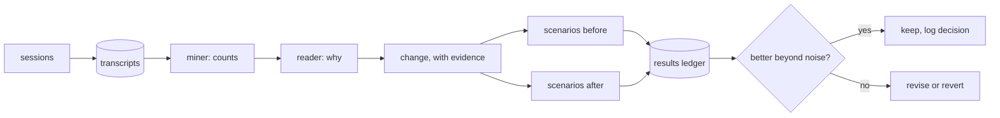

# Chapter 13 · Measured Redesign Loop

*Transcripts of real agent use drive API changes, and every change is judged by rerunning fixed scenarios into a
ledger.*

Rating: ★ (a good form among several; the variations name the others; see the overview).

## Intent

Design an agent-facing system from evidence of how agents use it. Mine the transcripts of real sessions for what agents
called, what they typed that did not exist, what failed and what they never used; turn the counts into design
decisions; and judge every change by running the same scenarios with the same agents before and after, recording each
run as a row in a results ledger. The system, its documentation and its instructions improve by measured steps instead
of by opinion.

## Also known as

Transcript-driven API design, agent-computer interface design, before-and-after evaluation, experiment ledger.

## Motivation

goja-cv's second API was designed from counts. A script over the transcripts of earlier agent runs counted 751 calls:
parameters for interactive sliders had zero uses and were deleted; an option for overriding an image's value space was
used 198 times, which showed that the space belonged on the image itself; agents wanted to run files, which became a
library loader rather than a new tool. A second script collected the method names agents typed that did not exist,
which became redirects with literal fixes (see [Chapter 6](06-repairable-errors.md)).

Every change was then judged by runs. The project keeps a table of agent runs per ticket: the same question file, the
same model, two runs before and two after, with calls, errors, size of the code agents wrote, and results against
gold labels. After the second API landed, median calls per run fell (31.5 to 29, 51 to 39, 45 to 42), and the removed
surface simply disappeared from agents' code (`{ space }` 70 uses to 0, `show(` 99 to 0) without errors. After the
peak-finding change, gold points located within 5 pixels rose from 4 and 5 to 14 and 13 of 53.

The loop also found what reading code never would. Thirty-nine annotator agents' 374 evaluations showed that every
one of them pasted the same 3.2 KB helper file, that no agent ever opened the documentation, and that a lint fired 19
times with one true positive. Each became a change: a library loader, results that carry their own hints, the lint
deleted.

The same loop applies elsewhere:

- A **developer tool** learns from telemetry which commands fail most and which flags nobody uses.
- A **prompt or playbook** for agents improves by running the same tasks with each version.
- A **model training pipeline** keeps every experiment as a row with its configuration and metrics.

## Problem

**An interface for agents designed from the designer's intuition misses what agents actually do, and changes made
without fixed before-and-after runs cannot be told apart from noise, or from regressions.**

## Forces

- **Evidence against effort.** Transcripts hold the answers, and mining them takes scripts, care and time.
- **Counts against meaning.** A count says how often; only reading transcripts says why. A zero count may mean
  "useless" or "never shown in an example".
- **Fixed scenarios against realism.** The same questions make runs comparable, and drift away from what real users
  do.
- **Few runs against noise.** Agent runs vary; two runs per side show large effects and hide small ones.
- **Speed against rigour.** Every change measured is slower than every change shipped.

## Solution

**Therefore: keep the transcripts of every agent session, and mine them with scripts into counts: calls per
operation and option, errors per code, names typed that do not exist, warnings and their true-positive rate, things
pasted, things never used. Read the transcripts behind surprising counts. Turn counts into decisions: delete what is
unused, move what is overridden often into the default or the data, redirect what is mistyped, fix what fails. Judge
every change by running a fixed set of scenarios with the same agents before and after, several runs per side, and
append every run to a results ledger with its configuration, its metrics and the version of everything it used.
Compare only rows that differ in one thing.**

## Applicability

Use it when:

- agents (or people) use the system through an interface whose design is still changing;
- sessions can be recorded and replayed into scenarios;
- changes have measurable outcomes (calls, errors, accuracy against known answers, time).

Do not use it when:

- the interface is fixed by a standard or a contract you cannot change; measure, but redesign elsewhere;
- usage is too rare to count (a handful of sessions a month); read every transcript instead;
- the change is a correctness or security fix; ship it, then measure the side effects.

## Structure

| Participant | Responsibility |
| --- | --- |
| **Transcript store** | Keeps every session's events: calls, arguments, results, errors, timing. |
| **Miner** | Scripts that turn transcripts into counts per operation, option, code, typed name, warning and paste. |
| **Reader** | A person (or agent) who reads the transcripts behind surprising counts and states the reason. |
| **Decision log** | Each count-driven change with its evidence (see [Chapter 11](11-lineage-ledger.md)). |
| **Scenario set** | Fixed tasks with known answers or measurable outcomes, run before and after every change. |
| **Runner** | Sealed agent runs over the scenario set (see [Chapter 9](09-sealed-agent-run.md)). |
| **Results ledger** | One row per run: configuration (system version, model, prompt or chapter version, scenario), metrics, links to the run. |

## Collaborations

1. Sessions run (real work, or scenario runs); their transcripts are stored.
2. The miner counts; the reader explains the outliers; each finding becomes a proposed change with its evidence.
3. Before the change ships, the runner runs the scenario set on the current version; after, on the new one. Each run
   appends a row to the ledger.
4. The comparison uses only rows that differ in the change; differences smaller than the spread between repeated runs
   are treated as noise.
5. Accepted changes and their numbers go into the decision log; the scenario set grows when a new failure is found.



## Sketch

```text
value Row: system, model, variant, scenario, run, metrics: map, at, links

mine(transcripts) → Counts
  calls    = countBy(allCalls(transcripts), c → (c.op, c.options))
  failures = countBy(errors(transcripts), e → e.code)
  typed    = countBy(unknownNames(transcripts), n → n)            -- candidates for redirects
  warnings = [(w.code, truePositives(w) / count(w)) for w in warningsByCode(transcripts)]
  pasted   = [b for b in largeRepeatedBlocks(agentCode(transcripts))]
  unused   = [op for op in registry if calls[op] == 0]
  return Counts(calls, failures, typed, warnings, pasted, unused)

decide(counts) → [Change]
  -- zero uses: delete (after checking it was ever shown); heavy overrides: move into the default or the data;
  -- repeated typed names: redirect with a fix; warnings with low precision: fix or delete; pastes: a loader

compare(change, scenarios, runs: 4)
  for s in scenarios, for v in [before, after], for r in 1..runs:
    ledger.append(Row(system: v, model: M, variant: change.id, scenario: s, run: r, metrics: runScenario(s, v)))
  noise = spread(ledger.rows(system: before, scenario: s))          -- replicate variance
  return [ (metric, median(after) - median(before), noise) for metric in metrics ]
```

## Implementation notes

1. **Count before you design.** goja-cv's second API started from 751 counted calls; three of its largest decisions
   (delete the unused parameter system, put the value space on the image, a loader instead of a new tool) came
   straight from counts.
2. **Fix counts at their source.** A miner that recognised pasted helper files only by their final marker missed ten
   trimmed pastes and reported 29 instead of 39; the wrong number reached a design document before the script was
   fixed. Test the miner on transcripts whose answers you know.
3. **A zero count needs a reason.** Agents never used several documented operations; some were useless, others were
   simply never shown in an example they copied. Read before deleting.
4. **Judge a warning by its true positives.** The unused-node lint fired 19 times in the annotator study with one true
   positive; it was deleted. Every warning's precision on real transcripts is a number worth knowing.
5. **Same scenarios, same model, before and after.** goja-cv's run table uses one question file and one model per
   ticket, two runs per side. Without a fixed scenario set, before and after are different experiments.
6. **Repeat runs and report spread.** In this pattern language's own validation, replicate runs of the same version
   rated it within about one point of each other; a one-point change after a revision is within noise. Use several
   runs per side and medians.
7. **Measure behaviour, not only outcomes.** The ledger rows for goja-cv record calls, errors and code size beside
   accuracy; the counts of removed surface going to zero showed the change landed, independently of accuracy.
8. **Check the yardstick when results surprise.** Judges that "failed" planted controls were right in nine of ten
   checked cases; the reference was wrong (see [Chapter 10](10-gated-calibrated-triage.md)). A ledger compared
   against a flawed key ranks variants wrongly.
9. **Every row records every version.** System commit, model name, prompt or chapter version, scenario version. A row
   that cannot say what produced it cannot be compared later.
10. **Grow the scenario set from failures.** Each new failure found in real use becomes a scenario, so the next change
    is checked against it.

## Variations

- **Telemetry instead of transcripts.** Count calls and errors in production without full transcripts. Cheaper and
  wider; no access to why.
- **A/B tests with real users** instead of fixed scenarios. Realistic; needs volume and time, and mixes in user
  variance.
- **Offline replay.** Replay recorded sessions against the new version and diff the results. Precise for
  deterministic systems; agents do not replay deterministically.
- **Document variants** instead of system variants: the same loop measures guides, playbooks and pattern chapters
  (the validation playbook).

## Consequences

- \+ Design effort goes where agents actually struggle.
- \+ Removing surface becomes safe: counts show what is unused, runs show nothing broke.
- \+ Every change has numbers attached, and the ledger keeps them comparable over time.
- \+ Regressions show up before users meet them.
- − Mining, scenarios and runs cost time before every change.
- − Fixed scenarios drift from real use unless they grow from real failures.
- − Small effects drown in run-to-run noise unless many runs are made.

## Known uses

- **SWE-agent** (Yang et al., 2024) designed its agent-computer interface by observing agents' behaviour and measuring
  each interface change on a benchmark.
- **Anthropic's guidance on writing tools for agents** (2025) recommends evaluating tools by running agents on
  realistic tasks and reading their transcripts.
- **MLflow** and **Weights & Biases** record experiments as runs with parameters, metrics and artefacts for comparison.
- **The dust project's results ledger** (`runs/results.csv` with configuration files per experiment) records every
  detector training run with its metrics.

## Related chapters

- [Chapter 6 · Repairable Errors](06-repairable-errors.md): redirects mined from typed names.
- [Chapter 9 · Sealed Agent Run](09-sealed-agent-run.md): the runs a comparison is made of.
- [Chapter 10 · Gated, Calibrated Triage](10-gated-calibrated-triage.md): controls and scores for agent outcomes.
- [Chapter 11 · Lineage Ledger](11-lineage-ledger.md): the decision log and the version stamps on every row.
- [Chapter 12 · Executable Documentation with Outcome Contracts](12-executable-documentation-with-outcome-contracts.md):
  documentation changes measured the same way.
- Classic patterns: **Observer** (miners watch sessions), **Memento** (each ledger row freezes a configuration).
