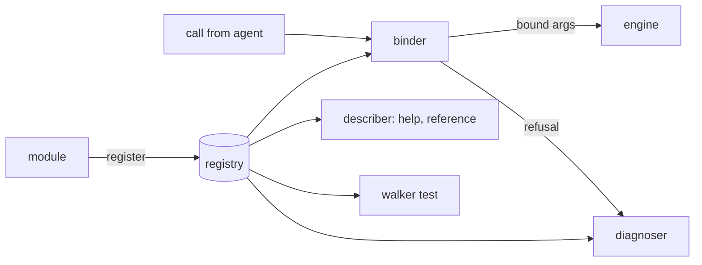

# Chapter 1 · Self-Describing Operation Registry

*One record per operation drives argument checking, units, help, error messages, the agent's context and the tests.*

Rating: ★★

## Intent

Describe every operation of an engine once, as a data record, and make every part of the system that needs to know
about operations read that record. Checking a call, explaining an operation, suggesting a correction and testing the
whole catalogue then cannot disagree, because there is nothing for them to disagree about.

## Also known as

Op table, operation schema, Type Object (for operation kinds), single source of truth for an API.

## Motivation

goja-cv offers agents about sixty image operations: `gaussian`, `levels`, `peaks`, `measure`, `mask.luminance`
and so on. An agent writes `img.gaussian(2).crop([x, y, 64, 64])`. goja-cv was designed after a comparison of nine
prototypes of the same idea, and the prototypes, then goja-cv's own first versions, failed in four ways that all
trace back to operations without one authoritative description:

- **Documentation promised what did not exist.** The prototypes' first-turn documentation advertised functions
  nobody had built; agents called them and got generic failures.
- **Lengths had no stated unit.** Two prototypes did not scale radii and crops when exporting at full size, so the
  exported picture differed from the preview the user had approved.
- **A wrong default was taken silently.** In goja-cv v1, `cv.open(path, { encoding: P.choice(…) })` passed a value
  where a literal was expected; the string accessor read it as empty and the file opened as sRGB instead of linear.
  Nothing failed; every number afterwards was on the wrong scale.
- **Agents typed near-misses.** Transcripts show `look({ box: [...] })` meaning "crop first" and
  `mask.luminance({ min: 0.6 })` meaning "above 0.6". A refusal that only says "unknown option" sends the agent back
  to the documentation; one that names the intended call does not.

The Editor lab, written separately, met the same problem in another form. Its layer kinds need sliders in the user
interface, defaults, a description for the agent (`kinds()`), and validation for presets and for layers whose
operation is user JavaScript. A table of kinds, each with typed parameter specifications, drives all four.

The problem is not specific to images:

- A **command-line framework** needs each flag's type, default and help text for parsing, `--help`, shell completion
  and error messages.
- A **query engine's** function catalogue needs argument types for the planner, the documentation and the "no
  function matches the given argument types" error.
- A **card game's** rules engine needs each card's cost, targets and effects for play legality, tooltips and the
  computer opponent.

## Problem

**When several consumers each keep their own idea of what an operation accepts and returns, they drift apart, and
the caller, often an agent, gets silent wrong behaviour instead of a precise refusal.**

## Forces

- **Fluency against honesty.** A plain method call reads well in a script, but a plain method accepts anything and
  ignores what it does not understand.
- **One source against expressiveness.** A declarative record is easy to read and check, but some rules (two
  arguments that must agree, a result shape that depends on an argument) do not fit in a table.
- **Generated against written documentation.** Help generated from records is always current but flat; prose written
  by hand explains, and drifts.
- **Strictness against forgiveness.** Rejecting an unknown option prevents silent errors, but an agent that typed a
  near-miss deserves to be told what it meant rather than merely refused.
- **Locality against centrality.** Developers want the description next to the kernel; consumers want one place to
  enumerate everything.
- **A small core against a growing type system.** Every new argument type (a box, a colour, a list of points) makes
  the checker more capable and more complicated.

## Solution

**Therefore: give every operation one record: its name, what it applies to, each argument with type, unit, default,
hard limits, usual range and documentation, the kind and fields of its result, the flags that tell the rest of the
system how to treat it, its documentation and its implementation. Validate each record when it is registered. Make
every consumer read the records: the binder checks and converts calls, the describer renders help and the agent's
reference, the diagnoser builds errors with the valid alternatives, and a test walks every record and calls it. No
consumer keeps a list of its own.**

## Applicability

Use it when:

- more than one consumer needs to know an operation's shape (a checker, docs, a UI, an agent's context, tests);
- callers are agents or end users who cannot read the source;
- operations are added often, by several people, or by users at run time.

Do not use it when:

- there are only a handful of operations and one consumer; a function signature is enough;
- the operations are general-purpose code rather than a catalogue (a registry of every function in a program is a
  second type system);
- the host language already gives you the records for free (a typed RPC schema that generates clients, docs and
  validation); use that instead of building a parallel one.

## Structure

| Participant | Responsibility |
| --- | --- |
| **Operation record** | Name, receiver kind, arguments, result kind and fields, flags, documentation, implementation. |
| **Argument spec** | Name, type, unit, default or optional, hard limits, usual range with a hint, allowed option keys, value docs for enumerations, redirects for known near-misses. |
| **Registry** | Validates and stores records; enumerates them by name and receiver kind. |
| **Binder** | Turns a raw call into bound, checked, unit-converted arguments, or a refusal. |
| **Describer** | Renders help for one operation and the reference for all of them. |
| **Diagnoser** | Builds refusals with the valid names, the nearest name and a fix (see [Chapter 6](06-repairable-errors.md)). |
| **Walker** | A test that calls every record with sample arguments and checks results against declared fields. |

## Collaborations

1. At start-up, each module registers its records. The registry rejects a malformed record (no result kind, a
   duplicate argument, a required argument after an optional one) before any call is made.
2. A call arrives. The binder finds the record by receiver kind and name, matches positional and named arguments,
   fills defaults, converts units, and checks types and limits. A value outside the usual range binds with a warning.
3. A failed lookup or check goes to the diagnoser, which reads the same record for the list of valid names and the
   nearest match.
4. The describer renders help on request and the full reference for the agent's context, both from the records.
5. In the test suite, the walker calls every record and compares each result's keys with the declared fields.



The registry sits in the middle; every arrow out of it is a consumer that would otherwise keep its own copy.

## Sketch

```text
-- the records
value ArgSpec:   name, type, unit, default?, optional, min?, max?, usual?, usualHint?, options?, valueDocs?,
                 redirects?, doc
value OpRecord:  name, on: Kind, args: [ArgSpec], returns: Kind, fields(args) → [FieldSpec], flags, doc, run

registry.register(rec) → ok | refuse(E_BAD_RECORD, …)
  -- checks: exactly one implementation, a result kind, unique arg names, required before optional, every arg typed

-- binding a call
bind(on, name, raw) → BoundCall | Refusal
  rec = registry.lookup(on, name)
  if rec is none: return refuse(E_UNKNOWN_METHOD, valid: registry.names(on), nearest: closest(name, …))
  args = {}
  for spec in rec.args:
    v = take(raw, spec) else spec.default else (spec.optional ? none : refuse(E_ARG_MISSING, spec))
    v = convert(v, spec.unit)                                 -- see Chapter 2
    if outside(v, spec.min, spec.max): return refuse(E_ARG_RANGE, spec, fix: clamp(v))
    if outside(v, spec.usual):        warn(RANGE, spec.usualHint)
    args = args ⊕ {spec.name: v}
  for key in unknownKeys(raw, rec):
    match redirectFor(key, rec):
      some(r) → return refuse(E_UNKNOWN_OPTION, key, fix: r.call)   -- a known near-miss
      none    → return refuse(E_UNKNOWN_OPTION, key, valid: optionNames(rec))
  return BoundCall(rec, args)

-- describing
help(name) → text from rec.doc, rec.args (type, unit, default, limits, value docs), rec.fields(defaults)
reference() → help line for every record, grouped by receiver kind

-- the walker test
for rec in registry.all():
  v = run(bind(rec.on, rec.name, sampleArgs(rec)))
  assert keys(v) ⊆ names(rec.fields(sampleArgs(rec)))

-- in use
registry.register(OpRecord(name: "blur", on: Image, returns: Image,
    args: [ArgSpec(name: "sigma", type: number, unit: docPx, default: 2, min: 0, max: 200, usual: [0.5, 20],
                   usualHint: "for structures larger than 20 px, downsample first")],
    doc: "Gaussian blur of sigma document pixels", run: blurKernel))
```

## Implementation notes

1. **Validate the record, not only the call.** goja-cv's `Register` refuses a record with both or neither of an
   implementation and an expansion, with no result kind, with a duplicate argument, with a required positional
   argument after an optional one, or with an untyped argument. Mistakes in records then surface at start-up, not in
   an agent's session.
2. **Separate hard limits from usual ranges.** A value outside `min`/`max` is a refusal; a value outside the usual
   range binds and raises a warning with a hint on what to do instead. goja-cv's `heal` takes a radius from 0 to
   200 but warns outside 0.5 to 20. Agents learn from warnings without being blocked by them.
3. **Nothing falls back to a default silently.** Unknown keys are refusals, and a value of the wrong type is a
   refusal, not a zero. This is the bug goja-cv shipped in v1: an encoding option given as a parameter object was
   read as an empty string and the default (sRGB) applied. Its v2 makes options literals and makes the accessors
   fail loudly on a wrong type. Silent acceptance is the worst outcome for an agent, because the result looks
   plausible.
4. **Keep near-miss redirects in the record.** goja-cv's argument specs carry redirects for names agents
   demonstrably typed (`look({ box })` → use `crop`; `{ min }` → `above`). The project also keeps three more
   redirect tables outside the registry (for methods, for help, for looks). That scattering is debt: a redirect
   added to one table is invisible to the others.
5. **Describe results as well as arguments.** A record's result fields (`id, cx, cy, r, …`) let the describer
   document them and let a property test check them. goja-cv's `TestSchemaProperty` evaluates every operation that
   returns rows and compares the keys with the declared fields. The fields are a function of the bound arguments,
   because some operations add columns depending on their options.
6. **Walk the whole registry in a test.** goja-cv's `TestRegistryWalk` renders help for every record and calls every
   operation on each receiver kind it accepts. A new operation without sample arguments fails the walk, so nothing
   reaches agents untested.
7. **Make argument types pluggable before they multiply.** goja-cv's binder is 1,331 lines, and it mixes generic
   types (numbers, enumerations, objects) with image ones (boxes, points, colour names). A small interface per type
   (parse, check, describe) keeps the core small and lets a domain add types without touching it.
8. **Keep hand-bound exceptions few and visible.** A few operations cannot be described as records: goja-cv binds
   `cv.open` by hand and writes the "Globals" part of its reference as fixed text. List such exceptions in one place
   and test them separately, or they become the part of the API that drifts.
9. **Let user-defined operations describe themselves the same way.** The Editor lab normalises the settings of a
   user's JavaScript layer into the same specification records its built-in kinds use, so sliders, defaults and the
   agent's view treat both alike. goja-cv reads a library function's parameter list and the first comment of its
   body from its source, so a helper written by a user appears in the agent's context with a signature and a doc
   line, as an operation does.
10. **Describe the whole surface, not only the catalogue.** The lab generates its agent's view of layer kinds from
    its table but writes the reference for its own API functions by hand, next to the code that implements them.
    Nothing checks that the two agree. That is the drift the registry exists to prevent, moved one level up.
11. **Composite operations are records too.** goja-cv defines some operations as small graphs of others (a
    difference of Gaussians is two blurs and a subtraction). Each still has one record, so help, errors and the
    reference treat it like any operation (see [Chapter 3](03-content-keyed-lazy-graph.md)).

## Variations

- **Code-first records** derived from annotations, decorators or struct tags. Less boilerplate, but limits, usual
  ranges and redirects fit awkwardly into annotations.
- **Schema-first records** in an external file (YAML, TableGen) with code generation. Language-neutral and reviewable,
  at the cost of a build step and generated code to read.
- **Data-only operations** interpreted by a rules engine: the record is the whole operation, with no implementation
  function. Suits game rules and business rules; not compute kernels.
- **One record per tool** instead of per operation, as in an MCP server's tool schemas. Coarse-grained and simple, but
  the checker sees only one large argument object per tool.

## Consequences

- \+ Checking, help, errors and tests agree by construction.
- \+ An agent's context can be generated, and it grows with the catalogue at no writing cost.
- \+ New operations are cheap to add correctly, and expensive to add incorrectly (the walker fails).
- \+ Users' own operations can join the same machinery.
- − Generated help is flat; good explanation still needs hand-written guides (see
  [Chapter 12](12-executable-documentation-with-outcome-contracts.md)).
- − The binder becomes a small type system that needs its own design and tests.
- − Rules that span arguments still need a validation hook per record, outside the declarative part.
- − A central table makes every new operation touch shared code, which some teams experience as friction.

## Known uses

- **PyTorch** describes its operators once in `native_functions.yaml`; code generation produces the Python bindings,
  dispatch registrations and parts of the documentation from it.
- **ONNX** operator schemas declare inputs, outputs, attributes, type constraints and documentation; validators,
  shape inference and the published operator documentation read them.
- **LLVM TableGen** describes instructions and intrinsics as records from which several back-end tables are
  generated.
- **Kubernetes** publishes OpenAPI schemas for its resources; the API server validates against them and
  `kubectl explain` renders them as help.
- **MCP** servers declare each tool's input as a JSON Schema that clients use for validation and for the model's
  context.
- **Glazed** (go-go-golems) defines command parameters once and derives flags, help and parsing from them.

## Related chapters

- [Chapter 2 · Units Travel With Values](02-units-travel-with-values.md): the units an argument spec carries.
- [Chapter 3 · Content-Keyed Lazy Graph](03-content-keyed-lazy-graph.md): bound calls become graph nodes.
- [Chapter 5 · One Eval Tool over a Scripted Session](05-one-eval-tool-over-a-scripted-session.md): the generated
  reference and context block.
- [Chapter 6 · Repairable Errors](06-repairable-errors.md): refusals built from the record.
- [Chapter 12 · Executable Documentation with Outcome Contracts](12-executable-documentation-with-outcome-contracts.md):
  the prose the registry cannot write.
- [Chapter 13 · Measured Redesign Loop](13-measured-redesign-loop.md): where the redirects come from.
- Classic patterns: **Type Object** (Johnson and Woolf) for operation kinds as objects; **Interpreter** when records
  are interpreted rather than run; **Command** for a bound call as a value.
