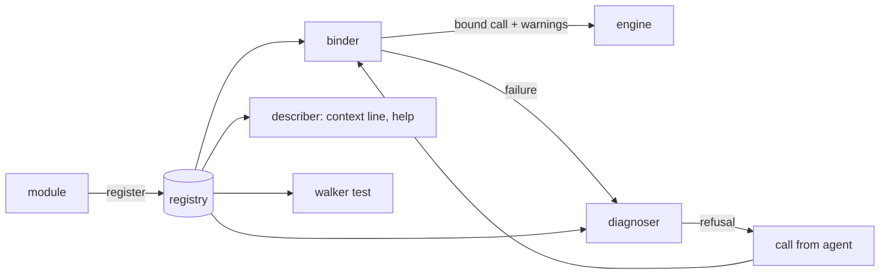

# Chapter 1 · Self-Describing Operation Registry

*One record per operation drives argument checking, help, error messages, the agent's context and the tests.*

Rating: ★★ (close to invariant: any system with this problem converges on this shape; see the overview).

## Intent

Describe every operation of an engine once, as a data record, and make every part of the system that needs to know
about operations read that record. Checking a call, explaining an operation, suggesting a correction and testing the
catalogue then cannot disagree, because there is nothing for them to disagree about.

## Also known as

Op table, operation schema, Type Object (for operation kinds), single source of truth for an API.

## Motivation

goja-cv offers agents about sixty image operations: `gaussian`, `levels`, `peaks`, `measure`, `mask.luminance` and
so on. An agent writes `img.gaussian(2).crop([x, y, 64, 64])`. goja-cv was designed after a comparison of nine
prototypes of the same idea, and the prototypes, then goja-cv's first version, failed in four ways that all trace
back to operations without one authoritative description:

- **Documentation promised what did not exist.** The prototypes' documentation advertised functions nobody had
  built; agents called them and got generic failures.
- **Lengths had no stated unit.** Two prototypes did not scale radii and crops when exporting at full size, so the
  exported picture differed from the preview the user had approved.
- **A wrong default was taken silently.** In goja-cv v1, `cv.open(path, { encoding: P.choice(…) })` passed a value
  where a literal was expected; the accessor read it as an empty string and the file opened as sRGB instead of
  linear. Nothing failed; every number afterwards was on the wrong scale.
- **Agents typed near-misses.** Transcripts show `look({ box: [...] })` meaning "crop first" and
  `mask.luminance({ min: 0.6 })` meaning "above 0.6". A refusal that only says "unknown option" sends the agent back
  to the documentation; one that names the intended call does not.

The Editor lab, written separately, met the same problem in another form. Its table of layer kinds is a set of
operation records, and each kind's parameter specifications (range, default, unit, label) are argument specs. One
table drives the user interface's sliders, the defaults of new layers, the agent's `kinds()` answer and the
validation of presets.

The problem is not specific to images:

- A **command-line framework** needs each flag's type, default and help text for parsing, `--help`, shell completion
  and error messages.
- A **query engine's** function catalogue needs argument types for the planner, the documentation and the "no
  function matches the given argument types" error.
- A **card game's** rules engine needs each card's cost, targets and effects for play legality, tooltips and the
  computer opponent.

## Problem

**When several consumers each keep their own idea of what an operation accepts and returns, they drift apart, and
the caller, often an agent, gets silent wrong behaviour instead of a precise refusal.**

## Forces

- **Fluency against honesty.** A plain method call reads well in a script, but a plain method accepts anything and
  ignores what it does not understand.
- **One source against expressiveness.** A declarative record is easy to read and check, but some rules (two
  arguments that must agree, a result shape that depends on an argument) do not fit in a table.
- **Generated against written documentation.** Help generated from records is always current but flat; prose written
  by hand explains, and drifts.
- **Strictness against forgiveness.** Rejecting an unknown option prevents silent errors, but an agent that typed a
  near-miss deserves to be told what it meant rather than merely refused.
- **Locality against centrality.** Developers want the description next to the kernel; consumers want one place to
  enumerate everything.
- **A small core against a growing type system.** Every new argument type (a box, a colour, a list of points) makes
  the checker more capable and more complicated.

## Solution

**Therefore: give every operation one record: its name, the kind of value it applies to, each argument with type,
unit, default, hard limits, usual range and documentation, a hook for rules that span arguments, the kind and fields
of its result, the flags that tell the rest of the system how to treat it, its documentation and its implementation.
Validate each record when it is registered. Make every consumer read the records: the binder checks calls and
returns warnings with them, the describer renders help and the agent's reference, the diagnoser builds refusals with
the valid alternatives, and a test walks every record and calls it. The few operations that cannot be records are
listed in one place and tested separately; any other list of operations found outside the registry is a bug.**

## Applicability

Use it when:

- more than one consumer needs to know an operation's shape (a checker, docs, a UI, an agent's context, tests);
- callers are agents or end users who cannot read the source;
- operations are added often, by several people, or by users at run time.

Do not use it when:

- there are only a handful of operations and one consumer; a function signature is enough;
- the operations are general-purpose code rather than a catalogue (a registry of every function in a program is a
  second type system);
- the platform already gives you the records (a typed RPC schema that generates clients, docs and validation); use
  that schema as the registry instead of building a parallel one.

## Structure

| Participant | Responsibility |
| --- | --- |
| **Operation record** | Name, receiver kind, arguments, a cross-argument validation hook, result kind and fields (a function of the bound arguments), flags, documentation, implementation. |
| **Argument spec** | Name, type, unit, default or optional, hard limits, usual range with a hint, allowed option keys, value docs for enumerations, redirects for known near-misses. Defaults and limits are in the declared unit. |
| **Flags** | Properties other participants act on. In goja-cv: the class of operation (pixel, geometric, decoration), `global` (needs its whole input), `internal` (not callable by agents), an identity predicate (neutral arguments return the input), a lossless-preview hint. A system with side effects would add `confirm` (ask before running), read by the session, not trusted from a plug-in's own record. |
| **Registry** | Validates and stores records, one per receiver kind and name; enumerates them. |
| **Binder** | Turns a raw call into bound, checked arguments plus warnings, or a failure. |
| **Describer** | Renders a short line per operation for the agent's context and full help on request. |
| **Diagnoser** | Turns a failure into a refusal with the valid names, the nearest name and a fix (see [Chapter 6](06-repairable-errors.md)). |
| **Walker** | A test that calls every record with sample arguments and compares each result with its declared fields. |

## Collaborations

1. At start-up, each module registers its records. The registry rejects a malformed record before any call is made.
2. A call arrives. The binder looks up the record by receiver kind and name, matches positional and named
   arguments, fills defaults, checks types and limits in the declared units, runs the cross-argument hook, and
   returns the bound call with any warnings (a value outside the usual range). Units are converted to the engine's
   working scale later, at evaluation (see [Chapter 2](02-units-travel-with-values.md)).
3. A failure (unknown name, wrong type, out of range, unknown option) goes to the diagnoser, which reads the same
   record for the valid names, the nearest match and a redirect, and returns a refusal.
4. Warnings travel with the bound call and end up in the result the caller reads (see
   [Chapter 5](05-one-eval-tool-over-a-scripted-session.md)); a warning that reaches only a log is no warning.
5. The describer renders the agent's short reference and full help, both from the records.
6. In the test suite, the walker calls every record and compares each result's keys with the declared fields.



The registry sits in the middle; every arrow out of it is a consumer that would otherwise keep its own copy.

## Sketch

```text
-- the records
value ArgSpec:   name, type, unit, default?, optional, min?, max?, usual?, usualHint?, options?, valueDocs?,
                 redirects?, doc                         -- default, min, max, usual are in `unit`
value OpRecord:  name, on: Kind, args: [ArgSpec], validate?(args) → ok | Failure,
                 returns: Kind, fields(boundArgs) → [FieldSpec], flags, doc, run

registry.register(rec) → ok | refuse(E_BAD_RECORD, …)
  -- structural: exactly one implementation, a result kind, unique arg names, required before optional, typed args
  -- semantic:   default within limits, usual range within limits, redirect targets exist, (on, name) unique

-- binding a call
bind(on, name, raw) → BoundCall(rec, args, warnings) | Failure
  rec = registry.lookup(on, name)
  if rec is none: return Failure(UNKNOWN_METHOD, name, on)
  args, warnings = {}, []
  for spec in rec.args:
    v = take(raw, spec) else spec.default else (spec.optional ? none : return Failure(ARG_MISSING, spec))
    if not spec.type.accepts(v):      return Failure(ARG_TYPE, spec, v)        -- never coerce to a zero value
    if outside(v, spec.min, spec.max): return Failure(ARG_RANGE, spec, v)
    if outside(v, spec.usual):         warnings = warnings ++ [Warning(RANGE, spec, spec.usualHint)]
    args = args ⊕ {spec.name: v}
  for key in unknownKeys(raw, rec): return Failure(UNKNOWN_OPTION, key, rec)
  if rec.validate: check = rec.validate(args); if check is Failure: return check
  return BoundCall(rec, args, warnings)

-- the diagnoser: one entry point
explain(failure, registry) → Refusal
  match failure.kind:
    UNKNOWN_METHOD → refuse(E_UNKNOWN_METHOD, valid: registry.names(failure.on), nearest: closest(failure.name, …))
    UNKNOWN_OPTION → r = redirectFor(failure.key, failure.rec)
                     refuse(E_UNKNOWN_OPTION, failure.key, fix: r.call if r else none, valid: optionNames(failure.rec))
    ARG_RANGE      → refuse(E_ARG_RANGE, failure.spec, fix: clamp(failure.value, failure.spec))
    …

-- describing: two renderings of the same records
contextLine(rec) → "name(arg, …) → Kind: first sentence of doc"
help(name)       → doc, every arg (type, unit, default, limits, value docs), fields(defaults)

-- the walker test
for rec in registry.all():
  call = bind(rec.on, rec.name, sampleArgs(rec))                 -- sample args kept per record; missing ones fail
  v = run(call)
  declared = rec.fields(call.args)
  assert keys(v) ⊆ names(declared)                                -- nothing undeclared
  assert required(declared) ⊆ keys(v)                             -- nothing declared and missing

-- in use
registry.register(OpRecord(name: "blur", on: Image, returns: Image,
    args: [ArgSpec(name: "sigma", type: number, unit: docPx, default: 2, min: 0, max: 200, usual: [0.5, 20],
                   usualHint: "for structures larger than 20 px, downsample first")],
    flags: {class: pixel}, doc: "Gaussian blur of sigma document pixels", run: blurKernel))
```

## Implementation notes

1. **Validate the record, not only the call.** goja-cv's `Register` refuses a record with both or neither of an
   implementation and an expansion, with no result kind, with a duplicate argument, with a required positional
   argument after an optional one, or with an untyped argument. Those checks are structural. It does not check that
   a default lies within the limits or that a redirect points at an existing operation; such mistakes surface only
   when an agent hits them. Add the semantic checks to registration.
2. **Separate hard limits from usual ranges, both in the declared unit.** A value outside the hard limits is a
   refusal; a value outside the usual range binds with a warning that says what to do instead. goja-cv's `heal`
   takes a radius from 0 to 200 document pixels but warns outside 0.5 to 20. The check happens on the value as the
   caller wrote it; conversion to the engine's working scale happens at evaluation.
3. **Nothing falls back to a default silently.** Unknown keys are refusals, and a value of the wrong type is a
   refusal, not a zero. This is the bug goja-cv shipped in v1: an encoding given as a parameter object was read as
   an empty string and the default applied. Its v2 makes options literals and makes accessors fail loudly on a wrong
   type. Silent acceptance is the worst outcome for an agent, because the result looks plausible.
4. **Keep near-miss redirects in the record.** goja-cv's argument specs carry redirects for names agents
   demonstrably typed (`look({ box })` → use `crop`; `{ min }` → `above`). The project also keeps three more redirect
   tables outside the registry (for methods, for help, for looks). That scattering is debt: a redirect added to one
   table is invisible to the others, and it breaks the rule that no list of operations lives outside the registry.
5. **Describe results, and check them both ways.** A record's result fields (`id, cx, cy, r, …`) let the describer
   document them and a property test check them. goja-cv's `TestSchemaProperty` evaluates every operation that
   returns rows and requires the keys to be exactly the declared fields, with only optional ones allowed to be
   missing. The fields are a function of the bound arguments, because some operations add columns depending on
   their options.
6. **Walk the whole registry, and know what the walk does not prove.** goja-cv's `TestRegistryWalk` renders help
   for every record and calls every operation on each receiver kind it accepts, from sample arguments kept per
   operation; an operation without samples fails the walk. One happy-path call per record does not exercise limits,
   redirects, warnings or optional arguments; those need their own tests, generated from the records where possible.
7. **Make argument types pluggable before they multiply.** goja-cv's binder is 1,331 lines and mixes generic types
   (numbers, enumerations, objects) with image ones (boxes, points, colour names). A small interface per type
   (accept, check, describe) keeps the core small and lets a domain add types without touching it.
8. **One record per receiver kind and name.** goja-cv keys records by receiver kind and name, so `measure` on an
   image and `measure` on regions are two records with their own arguments. It does not overload one name by
   argument types within a kind; a query engine that needs "no function matches the given argument types" must make
   the lookup return a set of candidate records and let the binder choose (see Variations).
9. **Render the catalogue at two lengths.** goja-cv's 58 records render to a 30,916-character reference, too long to
   put in every turn of an agent's context. Its server instructions, kept under 4,000 characters, carry the eval
   contract and the most important calls; the generated reference (an MCP resource) and per-operation help
   (`cv.help(name)`) are read on demand. A short line per operation is the natural middle form when the catalogue is
   small enough to list. Every rendering comes from the same records.
10. **Enumerate the exceptions and test them separately.** A few parts of an API cannot be records: goja-cv binds
    `cv.open` by hand and writes the "Globals" section of its reference as fixed text. Keep such parts in one visible
    list. The Editor lab shows the cost of not doing this one level up: it generates the agent's view of its layer
    kinds from its table, but writes the reference for its own API functions by hand, next to the code, and nothing
    checks that the two agree.
11. **Composite and user-defined operations are records too.** goja-cv defines some operations as small graphs of
    others (a difference of Gaussians is two blurs and a subtraction); each still has a record, so help, errors and
    the reference treat it like any operation. The Editor lab normalises the settings of a user's JavaScript layer
    into the same specs its built-in kinds use, and goja-cv reads a helper function's parameter list and the first
    comment of its body from its source, so user code appears in the agent's context with a signature and a doc
    line, as an operation does.

## Variations

- **Code-first records** derived from annotations, decorators or struct tags. Less boilerplate, but limits, usual
  ranges and redirects fit awkwardly into annotations.
- **Schema-first records** in an external file (YAML, TableGen, protobuf) with code generation. Language-neutral and
  reviewable, at the cost of a build step and generated code to read.
- **Overload sets.** The lookup returns every record with the name, and the binder picks the one whose argument
  types match, as query engines and many languages do. More flexible; refusals must then explain why each candidate
  failed.
- **One record per tool** instead of per operation, as in an MCP server's tool schemas. Coarse-grained and simple, but
  the checker sees only one large argument object per tool.

## Consequences

- \+ Checking, help and refusals agree by construction; the walker makes sure every record runs at least once.
- \+ An agent's context can be generated, and it grows with the catalogue at no writing cost.
- \+ New operations are cheap to add correctly, and harder to add incorrectly (the walker and registration fail).
- \+ Users' own operations can join the same machinery.
- − Generated help is flat; good explanation still needs hand-written guides (see
  [Chapter 12](12-executable-documentation-with-outcome-contracts.md)).
- − The binder becomes a small type system that needs its own design and tests.
- − The walker proves less than it seems: one call per record is coverage, not correctness.
- − A central table makes every new operation touch shared code, which some teams experience as friction.

## Known uses

- **PyTorch** describes its operators once in `native_functions.yaml`; code generation produces the Python bindings,
  dispatch registrations and parts of the documentation from it.
- **ONNX** operator schemas declare inputs, outputs, attributes, type constraints and documentation; validators,
  shape inference and the published operator documentation read them.
- **LLVM TableGen** describes instructions and intrinsics as records from which several back-end tables are
  generated.
- **Kubernetes** publishes OpenAPI schemas for its resources; the API server validates against them and
  `kubectl explain` renders them as help.
- **MCP** servers declare each tool's input as a JSON Schema that clients use for validation and for the model's
  context.
- **Glazed** (go-go-golems) defines command parameters once and derives flags, help and parsing from them.

## Related chapters

- [Chapter 2 · Units Travel With Values](02-units-travel-with-values.md): the units an argument spec carries and when
  they are converted.
- [Chapter 3 · Content-Keyed Lazy Graph](03-content-keyed-lazy-graph.md): bound calls become graph nodes.
- [Chapter 5 · One Eval Tool over a Scripted Session](05-one-eval-tool-over-a-scripted-session.md): where the context
  line and the warnings reach the agent.
- [Chapter 6 · Repairable Errors](06-repairable-errors.md): the refusals the diagnoser builds.
- [Chapter 12 · Executable Documentation with Outcome Contracts](12-executable-documentation-with-outcome-contracts.md):
  the prose the registry cannot write.
- [Chapter 13 · Measured Redesign Loop](13-measured-redesign-loop.md): where the redirects come from.
- Classic patterns: **Type Object** (Johnson and Woolf) for operation kinds as objects; **Interpreter** when records
  are interpreted rather than run; **Command** for a bound call as a value.
