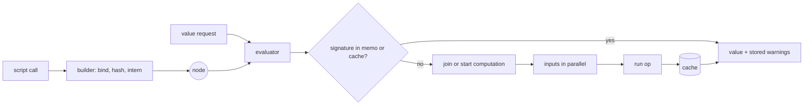

# Chapter 3 · Content-Keyed Lazy Graph

*Calls build hash-consed nodes; values are computed only when needed and cached under a key built from what
produced them.*

Rating: ★★ (close to invariant: any system with this problem converges on this shape; see the overview).

## Intent

Let a script describe a computation as a graph of operation calls without running it, make identical calls share
one node, and compute a node's value only when something asks for it. Cache each value under a key derived from the
operation, its arguments and the keys of its inputs, so that the same computation is never done twice, whoever asks
and however it was written.

## Also known as

Lazy dataflow graph, hash-consing with memoization, content-addressed cache, constructive trace (in the vocabulary
of build systems).

## Motivation

An agent inspecting a film scan works in rounds. In one eval it writes `img.as("linear").view("speck")` and looks
at a crop; in the next it measures twelve points on the same view; in a third it zooms on two of them. Each round is
a separate program, written from scratch, often repeating the chain in slightly different words. On a 24-megapixel
scan the speck view costs about a third of a second; a blur of large radius, several seconds. Naively, every round
recomputes everything it mentions.

The naive alternatives fail in specific ways:

- **Eager evaluation** computes every intermediate as soon as it is written, including the ones the agent then
  abandons, and computes the same chain again in the next round.
- **Caching by variable** (remembering the value of `view`) does not survive a new program, and returns stale values
  when the agent rebinds the variable to something else.
- **Caching by source text** of a function or expression returns stale results when the text refers to a variable
  whose value changed. Several of the nine prototypes that preceded goja-cv keyed functions by their source and did
  exactly that.

goja-cv and the Editor lab both solve this with the same structure. In goja-cv a node is created per distinct call
and a value is cached per signature; the second round's `view("speck")` is the first round's node, and its windows
cost nothing. In the lab, every tile of every layer has a key made of the layer's settings, the pixel revisions it
reads and the keys of the tiles below; moving a slider recomputes only the tiles whose keys changed.

The same structure solves other problems:

- A **build system** must rebuild only what changed, and share results between developers.
- A **spreadsheet** must recompute only the cells that depend on an edited one.
- A **data-analysis notebook** over large tables must not rerun a twenty-minute join because a later cell changed.

## Problem

**When computations are expensive, written repeatedly in different words, and requested piecemeal, recomputing them
on each request wastes most of the work, and caching them by name or by source text returns stale results.**

## Forces

- **Laziness against immediacy.** Deferring work saves what is never needed, but a statement that only builds a
  node does nothing visible, which surprises the person or agent who wrote it.
- **Key precision against key cost.** A key that captures every input exactly is safe; computing it costs time, and
  a key that is too coarse returns wrong values.
- **Structural keys against output keys.** Keys built from inputs need no data to look up; keys built from outputs
  let a rebuild stop early when a value did not change, but cost a hash of every output.
- **Memory against recomputation.** Every cached value is memory; every evicted one is work to redo.
- **Sharing against isolation.** Sharing nodes and values across callers multiplies hits, and makes any mutation of a
  shared value a bug that corrupts other callers' results.
- **Functions as arguments against hashability.** Callers want to pass functions ("apply this inside the mask"), but
  a function's behaviour cannot be hashed from its text.

## Solution

**Therefore: make every operation call return a node instead of a value, and intern nodes by a hash of the
operation, its bound arguments and its input nodes, so that equal calls are one node. Compute a node only when a
value is requested. Give each value a key built from the node's hash, the parameters of the evaluation (such as
scale) and the keys of its inputs, recursively; look the key up in a byte-budgeted cache before computing, share
in-flight computations of the same key, and store with each value everything its computation reported. Never modify
a cached value. Turn functions passed as arguments into graph nodes when the call is built, so that keys never depend
on a function's text.**

## Applicability

Use it when:

- operations are deterministic functions of their inputs and arguments;
- the same computations recur, across requests or within one;
- computations are expensive compared with hashing their descriptions;
- callers ask for parts of results at different times (a crop, a measurement, a look).

Do not use it when:

- operations have side effects or depend on hidden state (time, randomness without a seed, a mutable global); their
  keys would lie;
- every computation is cheap and requested once; the graph and the cache cost more than they save;
- inputs change constantly at fine grain and outputs rarely depend on the change; consider dirty-bit invalidation
  or verifying keys instead (see Variations).

## Structure

| Participant | Responsibility |
| --- | --- |
| **Node** | An operation, its bound arguments and its input nodes; immutable; identified by a structural hash. |
| **Builder** | Interns nodes by hash (equal calls return the existing node); turns function arguments into subgraphs. |
| **Source** | A leaf whose identity includes what it reads (file location, size and modification time, or content revisions). |
| **Signature** | The cache key: the node's hash, the evaluation parameters and the input signatures. |
| **Evaluator** | Computes a requested node: memo, cache, shared in-flight work, parallel inputs, identity short-cut. |
| **Value cache** | Stores values with their side information (warnings) under signatures, within a byte budget and an eviction policy. |

## Collaborations

1. The script calls operations. The builder binds each call against its record (see
   [Chapter 1](01-self-describing-operation-registry.md)), hashes it with its inputs and returns the existing node
   if there is one.
2. The script asks for a value (by awaiting it, saving it or looking at it). The evaluator computes the node's
   signature from its hash and the signatures of its inputs.
3. If the signature is in the run's memo or the cache, the value is returned and its stored warnings are reported
   again.
4. Otherwise the evaluator joins any computation of the same signature already in flight, or starts one: it
   evaluates the inputs in parallel, applies the operation, stores the value and its warnings in the cache, and
   returns it.
5. When memory runs short, the cache evicts entries by its policy; an evicted value is recomputed on the next
   request, from inputs that are probably still cached.



## Sketch

```text
value Node:   op, args, inputs: [Node], hash
value Entry:  value, warnings, bytes, cost

-- building
intern(op, args, inputs) → Node
  h = hash(op.name, canonical(args), [i.hash for i in inputs])
  return nodes.get(h) else nodes.put(h, Node(op, args, inputs, h))

-- functions as arguments: run once at build time against a placeholder, keep the subgraph
withinMask(img, mask, f) → Node
  hole = placeholder(kind: Image)
  inner = f(hole)                              -- e.g. hole.exposure(-0.4); builds nodes, computes nothing
  return intern(op: within, args: {}, inputs: [img, mask, subgraph(inner, hole)])

-- evaluating
signature(n, params) → Key
  return hash(n.hash, quantize(params), [signature(i, params) for i in n.inputs])

evaluate(n, params) → Value
  k = signature(n, params)
  if memo has k:  return memo[k]
  if cache has k: report(cache[k].warnings); return cache[k].value
  return inflight.once(k, () →
    ins = parallel([evaluate(i, params) for i in n.inputs])
    if n.op.identity(n.args): return ins[0]                     -- neutral args: the input itself, not a copy in cache
    t0 = now(); warnings = []
    v = n.op.run(ins, n.args, warn: w → warnings = warnings ++ [w])
    cache.put(k, Entry(v, warnings, bytes(v), cost: now() - t0))
    report(warnings)
    return v)

-- in use
a = img.as("linear").view("speck")             -- round 1: builds nodes
b = img.as("linear").view("speck")             -- round 2, new program: a and b are the same node
await a.crop(w1).stats()                        -- computes the view once
await b.crop(w2).stats()                        -- cache hit for the view; only the crop is new
```

## Implementation notes

1. **Intern at build time.** goja-cv's builder returns the existing node for an equal call, so common subexpressions
   cost nothing and the graph an agent inspects has no duplicates. Hash the bound arguments in canonical form
   (defaults filled, units declared), or two spellings of the same call become two nodes.
2. **Put the evaluation parameters in the key, quantized.** goja-cv's signature includes the evaluation scale,
   rounded to 10⁻⁴ so that nearly equal scales share entries and produce identical buffer sizes. Any parameter that
   changes the value (scale, precision, device) belongs in the key; any parameter that does not, does not.
3. **Make the key wide enough.** A collision returns a wrong value and nothing reports it. The lab's book applies the
   birthday bound: a long session creates about 10⁵ tile keys; at 32 bits that gives about 1.2 expected collisions,
   at its 52-bit keys about 10⁻⁶. goja-cv uses 256-bit SHA-256 signatures per node, which costs little because there
   are far fewer nodes than tiles.
4. **Leave out of the key what cannot affect the value.** The lab's key for an opaque fill that covers the whole
   tile ignores the layers below it; a hidden layer takes the key of what is below it; a pass-through group at full
   opacity takes the key of its top child. Each rule raises the hit rate, and each is a correctness obligation: a
   rule that is wrong in one case returns a stale picture in that case.
5. **Never key a function by its text.** Prototypes that keyed functions by source returned stale results when a
   captured variable changed. goja-cv runs a function argument once, when the call is built, against a placeholder
   node, and keeps the subgraph it builds; evaluating the placeholder anywhere else is an error (`E_PLACEHOLDER`).
   Values the function needs become explicit arguments, which are hashed.
6. **Share in-flight work and evaluate inputs in parallel.** goja-cv wraps each computation in a single-flight
   group keyed by signature, so two requests for the same value compute it once, and evaluates a node's inputs
   concurrently. It counts runs per node, so a test can assert what was recomputed and what was not.
7. **Never modify a cached value.** goja-cv's identity short-cut returns the input's value for neutral arguments, and
   the evaluator then sets the node's own metadata (frame, encoding) on the result. It copies the value first when
   the value belongs to an input, because writing to it would change another node's cached result.
8. **Store what the computation reported with the value.** goja-cv keeps the warnings raised while computing a
   value in the cache entry and reports them whenever the value is served, once per evaluation. Without this, a
   warning appears on the first request and silently disappears on every cached one. A value too large to cache
   reports its warnings immediately, since nothing will replay them.
9. **Budget the cache and treat the eviction policy as a setting.** goja-cv caps its value cache at 2 GiB with LRU
   eviction and keeps decoded sources outside the cap. The lab offers LRU and GreedyDual-Size (priority =
   clock + cost / size). On its bench with a 32 MB budget, ten edits, ten undos and ten redos recomputed 10,560 tiles
   under LRU and 2,662 under GreedyDual-Size, while a brush stroke went the other way, with GreedyDual-Size
   recomputing a third more. Measure the policy on your workloads.
10. **Know what keys built from inputs cannot do.** They cannot stop a rebuild early when an operation's output did
    not change. The lab measured this: after editing a masked layer, 16 to 26 of its 40 output tiles were
    bit-identical, so 33 % to 52 % of the recomputation above it was avoidable; a global edit avoided none. Hashing
    outputs to enable early cutoff cost 0.093 ms per 128-pixel float tile, 15 % to 22 % of a cheap layer's tile.
    goja-cv's sources do not change during a session, so the waste is rare there; an editor should weigh it.
11. **Make evaluation points explicit.** Laziness means a statement that only builds a node does nothing. goja-cv
    computes on `await`, `look()` and `cv.save`, and refuses to read a property of an unevaluated node
    (`E_NOT_AWAITED`). Its first version also dropped bare `x.look()` statements silently; the second delivers every
    look created in an eval. A lint for "node built but never used" was tried and deleted, because it fired on
    legitimate code more than on mistakes.

## Variations

- **Dirty bits instead of keys.** Each node is marked dirty when an input changes and recomputed on demand, as
  spreadsheets do. Cheap to maintain in place; no sharing across sessions or users.
- **Verifying keys with early cutoff.** Record the hashes of each computation's inputs and output; after a change,
  recompute bottom-up and stop where an output hash is unchanged. Saves the waste of note 10; costs an output hash
  per computation.
- **Persistent and shared caches.** Store values by key on disk or on a server so that later sessions and other
  users hit them, as build systems' remote caches do. Needs keys that include every environmental input.
- **Call-level memoization without a graph.** Memoize each function by its arguments. Much simpler, no laziness or
  inspection; good when calls are coarse and few.

## Consequences

- \+ Repeated and overlapping requests cost almost nothing after the first.
- \+ Programs can be written naively (rebuilding chains each round) without paying for it.
- \+ The graph is inspectable: what will be computed, from what, and what was cached.
- \+ Parallelism comes for free across independent inputs.
- − Memory is spent on values that may never be asked for again; the budget and policy need tuning.
- − Laziness confuses authors who expect a statement to act; evaluation points must be explicit.
- − Every operation must be deterministic and every relevant input must reach the key; one hidden input (a global, a
  clock, a mutable buffer) produces silently stale results.
- − Keys built from inputs waste work when a change does not change an output.

## Known uses

- **Nix** names every build output by a hash of its inputs (its derivation), and reuses any output whose hash exists.
- **Bazel** keys actions by digests of their inputs and command line, and shares results through local and remote
  caches.
- **Shake** and **Salsa** (the incremental engine behind rust-analyzer) record dependencies and support early
  cutoff when a recomputed value is unchanged.
- **Dask** builds task graphs whose keys are derived from the operation and its arguments (`tokenize`), and computes
  them on demand.
- **darktable** keys its pixel-pipeline cache by a hash chained through the modules of the pipeline.
- **Excel** recalculates only cells marked dirty by a change, the dirty-bit variation.

## Related chapters

- [Chapter 1 · Self-Describing Operation Registry](01-self-describing-operation-registry.md): the records that bind
  calls before they are hashed.
- [Chapter 2 · Units Travel With Values](02-units-travel-with-values.md): inserted conversions are ordinary cached
  nodes.
- [Chapter 4 · Reach-Declared Region Evaluation](04-reach-declared-region-evaluation.md): keys for parts of values.
- [Chapter 6 · Repairable Errors](06-repairable-errors.md): warnings stored with cached values reach the caller.
- [Chapter 13 · Measured Redesign Loop](13-measured-redesign-loop.md): measuring the cache policy.
- Classic patterns: **Flyweight** (shared immutable nodes), **Proxy** (a node stands for a value not yet computed),
  **Memento** is not needed, because values are never modified.
