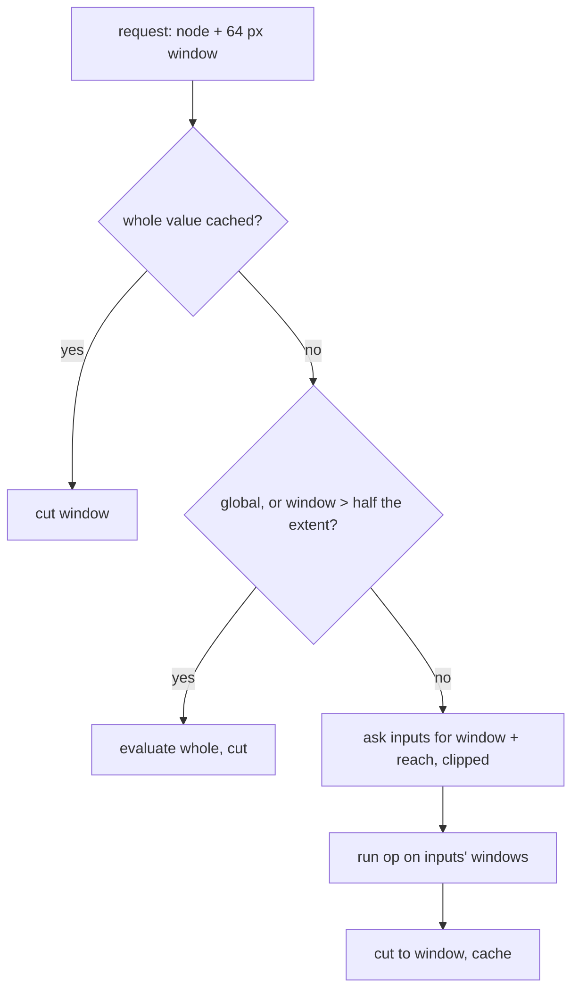

# Chapter 4 · Reach-Declared Region Evaluation

*Every operation declares how far it reads; a request for a small area computes only that area and its margin.*

Rating: ★★ (close to invariant: any system with this problem converges on this shape; see the overview).

## Intent

Let an engine compute part of a large result correctly without computing all of it. Each operation declares its
reach, the distance it reads beyond the output it writes; a request for a window travels down the graph, widened at
each operation by that operation's reach, and every node computes only the area its consumer needs. The answer for
the window is exactly what a whole-image computation would have given there.

## Also known as

Demand-driven evaluation, partial images (libvips), regions of interest, tiles with aprons (halos, overlap), windowed
evaluation.

## Motivation

An agent checks a dust candidate on a 6,000 × 4,000 scan: it crops a 64-pixel window around the point from a heavily
blurred version of the scan and measures it. goja-cv computes every operation over its whole frame and cuts the
window at the end. On that image, a 64-pixel window of a Gaussian blur cost 161 ms at σ 2, 662 ms at σ 8 and 3.1 s at
σ 32, because all 24 million pixels were blurred first; the window and the blur's margin are at most 0.3 % of them.
One short script peaked at 3.6 GB of memory. The cost grows with the scan, not with what the agent looks at, and
agents look at many small windows.

The Editor lab does not have this problem. Every layer kind declares a `reach`, the engine computes the picture in
tiles, and a request for one tile pulls from the layer below only that tile widened by the reach. Moving a slider on
a large picture recomputes only the tiles that change, each from a small neighbourhood.

The naive fixes fail:

- **Cropping the input first** (open only a window of the file) gives wrong results near the window's edge, because
  a blur there needs pixels outside the window, and it changes every whole-image statistic.
- **Computing at lower resolution** is fast but cannot find a three-pixel speck.
- **Caching whole results** helps the second window, not the first, and spends memory on pixels nobody asked for.

Other domains have the same problem:

- A **map server** renders tiles of a world map from layers with blurs, hillshading and label collision.
- A **video filter chain** processes regions of interest of 8K frames.
- A **scientific array library** applies stencil computations (finite differences, convolutions) to arrays larger
  than memory, chunk by chunk.

## Problem

**When an engine computes every operation over the whole input, the cost of a small request is the cost of the whole
input, and the only safe way to compute less is to know exactly what each operation reads.**

## Forces

- **Exactness against economy.** Computing less is only acceptable if the window comes out exactly as in a
  whole-image computation; any shortcut that changes values near the edge is a bug.
- **Small requests against shared work.** Computing exactly the requested window is cheapest once, but overlapping
  windows then compute their overlap twice; tiles share work at the cost of rounding requests up.
- **Tile size against reach.** Small tiles waste little on small requests; large reaches make small tiles read many
  times their own area.
- **Local against global.** Statistics over the whole image (percentiles, histograms, connected components) cannot
  be computed from a window, and they sit inside otherwise local chains.
- **Declared against discovered reach.** A declared reach is cheap to use and easy to get wrong; measuring what an
  operation reads is safe and expensive.

## Solution

**Therefore: give every operation a declared reach: zero for operations that read one input pixel per output pixel,
a finite distance for neighbourhood operations, and a global flag for operations that need their whole input. Let an
evaluation carry a window. When a node is asked for a window, it asks each input for that window widened by its own
reach and clipped to the input's extent, computes on what it receives, and returns only the window. Global operations
stop the request and read their whole input; split an operation whose parameters are global but whose application is
local into a global statistic and a local application, so windows pass through the application. Prefer an existing
whole result when one is cached, and evaluate whole when the window covers most of the extent. Prove the scheme with
one test: for every operation, the window computed this way equals the same window cut from a whole computation.**

## Applicability

Use it when:

- inputs are large compared with what a typical request needs;
- most operations read a bounded neighbourhood of each output position;
- requests arrive as windows: crops, zoomed views, measurements around points, tiles of a display.

Do not use it when:

- most operations are global (sorting, global optimisation, connected components over everything); windows would
  stop at the first operation;
- inputs comfortably fit in memory and whole computation is fast enough; the machinery costs more than it saves;
- the reach of an operation cannot be bounded or stated (iterative algorithms that propagate across the whole image);
  treat those as global.

## Structure

| Participant | Responsibility |
| --- | --- |
| **Reach** | Per operation, a function of its arguments and the evaluation scale: how far it reads beyond an output position. Zero, a distance, or global. |
| **Window** | A rectangle in the shared coordinate system that a request asks for. |
| **Region evaluator** | Propagates windows down the graph, widened by reach and clipped to each input's extent; computes each node on its window; cuts results back. |
| **Global barrier** | Where a global operation stops a window request and evaluates its input whole. |
| **Statistic node** | The global half of a split operation (a percentile, a histogram) whose value parameterises a local half. |
| **Tile grid** (optional) | Rounds windows to fixed tiles so overlapping requests share computed tiles. |
| **Invariance test** | Checks, for every non-global operation, that windowed and whole-then-cut results agree. |

## Collaborations

1. A request names a node and a window (a crop's box, a zoomed look's view, the neighbourhoods of measured items).
2. The evaluator checks the cache for the node's whole value; if present, it cuts the window from it and stops.
3. If the node is global, or the window covers more than a set fraction of its extent, the node is evaluated whole and
   the window cut from it.
4. Otherwise the evaluator asks each input for the window grown by the node's reach and clipped to the input's
   extent. Point operations pass the window through unchanged.
5. The operation runs on the inputs' windows. Its result is exact inside the requested window, because every output
   position there read only computed inputs; positions in the margin may not be exact and are discarded.
6. The windowed value is cached under the node's key plus the window (or per tile, with a grid).



## Sketch

```text
value Window: x, y, w, h                                     -- in the shared (document) coordinate system
value Reach:  zero | distance(d) | global

reach(op, args, scale) → Reach                               -- declared in the operation's record (Chapter 1)
  -- gaussian(σ): distance(ceil(3σ))   erode(r): distance(r)   exposure: zero   stats: global

evaluate(n, window, scale) → Value
  if window is none: return evaluateWhole(n, scale)
  if cache.has(key(n, scale)): return cut(cache.get(key(n, scale)), window)
  r = reach(n.op, n.args, scale)
  if r is global or area(window) > 0.5 × area(n.extent):
    return cut(evaluateWhole(n, scale), window)
  margin = (r is zero) ? 0 : r.d / scale                      -- reach in buffer px → document px
  inputWindows = [clip(grow(window, margin), i.extent) for i in n.inputs]
  ins = parallel([evaluate(i, w, scale) for (i, w) in zip(n.inputs, inputWindows)])
  v = n.op.run(ins, n.args, origin: inputWindows[0].origin)   -- kernels read their buffer's origin
  return cache.put(key(n, scale, window), cut(v, window))

-- splitting an operation with global parameters
stretch(img)  →  levels(img, black: 0, white: 5 × p99(img))
  becomes: s = statistic("p99", img)                          -- global: evaluated whole, cached once
           levels(img, black: 0, white: 5 × s)                -- local: windows pass through

-- the invariance test, for every non-global operation
for op in registry.nonGlobal():
  full = evaluate(chain(op), none, 1)
  for w in [interior, each edge, each corner, 1 × 1, the whole extent]:
    assert close(evaluate(chain(op), w, 1), cut(full, w))

-- in use
spot = img.as("linear").gaussian(32).crop([3000, 2000, 64, 64])
await spot.stats()          -- reads (64 + 2·96)² = 65,536 input pixels instead of 24 million
```

## Implementation notes

1. **The reach must be exact, and only a test can say so.** If an operation reads one pixel further than it declares,
   the outermost ring of every window differs slightly from the whole-image result, and no visual check notices.
   Test every operation, at the largest arguments agents use, on windows at the interior, edges and corners.
2. **Border rules apply only at the real border.** goja-cv mirrors the image at its edge; the lab extends the edge
   pixel. Either works with windows, because a window grown by the reach and clipped to the extent meets the real
   border exactly where a whole computation would. An operation that applies its border rule at the edge of its
   buffer, whatever that buffer is, breaks this; such kernels must be told where the real border is.
3. **Reaches add up along a chain.** A blur of reach 6 feeding an erosion of reach 4 needs inputs within 10 pixels.
   The evaluator gets this for free by widening at each node; a planner that computes the total ahead of time must
   sum the reaches itself.
4. **Reach scales with the evaluation.** A blur of σ 8 document pixels has reach 24 at full scale and 12 at half scale.
   Declare reach as a function of the arguments and the scale (see [Chapter 2](02-units-travel-with-values.md)).
5. **Find the hidden global operations.** goja-cv marks `stats`, `histogram` and connected components as global, but
   its speck view hides one inside a local chain: its display stretch is five times the 99th percentile of the
   whole residual. An unmarked global operation evaluated on a window silently uses the window's percentile, so the
   same speck looks different in two zooms. Audit every operation; split global parameters from local application.
6. **Keep the best case: cut from what is cached.** Today, goja-cv's second window of the same view costs nothing,
   because the whole view is cached. A window design that recomputes from inputs every time would make that case
   slower. Check the cache for the whole value first.
7. **Windows first, tiles second.** A window request computes exactly the window plus margins and is the smaller
   change; it already needs reach, propagation and the invariance test. Tiles add a grid, per-tile keys and assembly,
   and pay off once overlapping requests are common (sheets of nearby items, repeated zooms).
8. **Choose the tile size by measuring.** Each tile of an operation with reach `m` reads `(T + 2m)²` pixels to write
   `T²`: at reach 16, 64-pixel tiles read 2.25 times their area and 256-pixel tiles 1.27 times. The lab's bench found
   that small brush strokes favour small tiles (1 : 2.4 : 5.8 at 64, 128 and 256 pixels) while a large blur ran 3.5
   times slower at 64 pixels than at 256. No size wins every workload.
9. **Align tiles to the source, not to each node.** If the grid follows each node's own extent, two crops of one scan
   that start at different offsets never share a tile. A grid in the source's coordinates makes them meet.
10. **Measurements around items are window requests too.** goja-cv's `measure` reads a core and a ring around each
    item. The union of the items' neighbourhoods is the request; for probes on a large scan that is almost the whole
    saving.
11. **Decide which global statistics may be approximated.** A percentile for a display stretch can come from a coarse
    level of the image pyramid at a fraction of the cost, but its value changes slightly. Keeping it exact (computed
    once, whole, and cached) preserves every existing result; approximating it needs its own validation.

## Variations

- **Tiled demand-driven evaluation** (the lab, libvips): every request is rounded to tiles; tiles are the unit of
  work, caching and parallelism.
- **Scheduled fusion** (Halide): a compiler chooses, per stage, whether to store intermediates, recompute them per
  output, or tile with overlap, from the declared footprints of each stage.
- **Chunked arrays with overlap** (Dask's `map_overlap`): the array is split into chunks once; each chunk is extended
  by a declared depth from its neighbours before a function is applied.
- **Region of interest only at the source**: read a window of the input with a margin chosen by hand. Cheap and
  error-prone; the margin is the caller's guess, and global statistics change.

## Consequences

- \+ The cost of a request follows its size, not the size of the input.
- \+ Memory use drops with it; large inputs no longer need to fit whole.
- \+ Results are exact, because the scheme is a statement about what each operation reads.
- \+ Parallelism by region becomes available alongside parallelism by input.
- − Every operation needs a correct reach, and a wrong one fails silently at window edges.
- − Global operations and hidden global parameters must be found and split.
- − Overlapping requests repeat work until tiles are added, and tiles waste work on margins.
- − Kernels that convert indices to coordinates must read their buffer's origin, which whole-image code never needed.

## Known uses

- **libvips** represents images as partial images that compute any requested region on demand, in threads, with
  small intermediate buffers.
- **Halide** (Ragan-Kelley et al., PLDI 2013) schedules image pipelines by trading off storage, recomputation and
  tiling, using each stage's declared footprint.
- **GEGL** (GIMP's engine) and **darktable** compute their pipelines on regions of interest, with tiling and overlap
  when memory is short.
- **Dask** arrays apply stencil functions chunk by chunk with `map_overlap` and a declared depth.
- **Web map tile servers** render map tiles on demand, each with a buffer around it for features that cross tile
  edges.

## Related chapters

- [Chapter 1 · Self-Describing Operation Registry](01-self-describing-operation-registry.md): where reach and the
  global flag are declared.
- [Chapter 2 · Units Travel With Values](02-units-travel-with-values.md): reach is a length and scales like one.
- [Chapter 3 · Content-Keyed Lazy Graph](03-content-keyed-lazy-graph.md): windows and tiles extend the cache key.
- [Chapter 7 · Numbered, Budgeted Evidence](07-numbered-budgeted-evidence.md): zoomed looks and sheets are the
  window requests agents make.
- [Chapter 13 · Measured Redesign Loop](13-measured-redesign-loop.md): measuring tile size and the windowing threshold.
- Classic patterns: **Proxy** (a partial image stands for pixels not yet computed); **Pipes and Filters** (Buschmann
  et al.), here pulled by demand instead of pushed.
