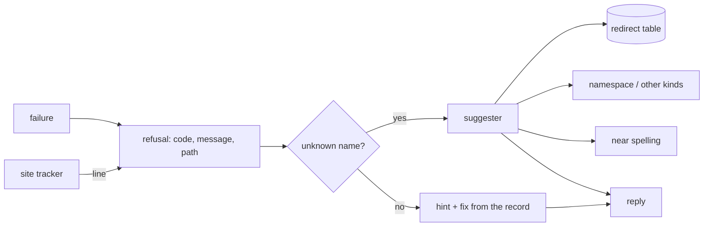

# Chapter 6 · Repairable Errors

*Every failure carries a code, where it happened, why, the valid alternatives and a fix written as code.*

Rating: ★★ (close to invariant: any system with this problem converges on this shape; see the overview).

## Intent

Turn every failure an agent can cause into a structured refusal that is enough to repair the call without reading
documentation: a stable code, a message, the chain of operations that led to it, the line in the agent's program,
the valid alternatives, a hint that explains the concept, and a fix written in the agent's own language. Raise
warnings the same way, at the line that caused them, and fold repeats.

## Also known as

Actionable diagnostics, did-you-mean errors, fix-its, compiler-style errors for agents.

## Motivation

An agent writes `img.zoom(4)`. goja-cv has no `zoom` method: zooming is an option of a look, applied after a crop.
A generic error ("TypeError: Object has no member 'zoom'") tells the agent only that something failed. It then
searches its context, guesses again (`img.resize`, `img.scale`), or gives up on the step. Each guess costs a round
trip and context.

goja-cv's reply to the same call (captured from the installed binary) is:

```yaml
error:
  code: E_UNKNOWN_METHOD
  message: Image has no method "zoom".
  where: 'line 2: return img.zoom(4)'
  path: open(016ea3c2858fb626_1536_0.tif) → ✗ zoom
  hint: 'Zoom is a look option, not a node: crop the window, then look at it zoomed.'
  fix: 'node.crop([x, y, w, h]).look({ zoom: 8 })'
```

The agent repairs the call in its next eval. That hint and fix exist because transcripts of earlier agent runs showed
`zoom`, `resample`, `export` and `save` being typed again and again; goja-cv keeps those names as redirects with
literal fixes. The Editor lab does the same in a simpler form: an unknown layer id fails with "no layer 'X'; layers
are L1 Sky, L2 Glow, …", so the valid choices arrive with the refusal.

The pattern is not specific to agents:

- A **compiler** reports the source span, the rule broken and a suggested edit that a tool can apply.
- An **HTTP API** returns a machine-readable error type, the invalid field, the allowed values and a link.
- A **command-line tool** answers an unknown subcommand with the nearest valid one.

## Problem

**When a failure says only that something went wrong, the caller has to rediscover the API to recover, and an agent
pays for each guess with a round trip and part of its context.**

## Forces

- **Precision against noise.** A rich error repairs the call; a long one buries the important line.
- **Suggestion against misdirection.** A nearest-name suggestion helps when it is right and costs more than silence
  when it is confidently wrong.
- **Generic against mined.** Edit distance works for any name; the near-misses that matter most are conceptual
  ("zoom" for a look option) and only transcripts reveal them.
- **Errors against warnings.** Refusing is safe and blocks work; warning lets work continue and is easily ignored.
- **One place against many.** Errors arise in the binder, the evaluator, the kernels and the host language; repair
  information wants one shape and one vocabulary.

## Solution

**Therefore: give every failure one structured shape: a stable code from a closed list, a one-sentence message, the
path of operations from the source to the failing one, the line in the agent's program, the valid alternatives, a
hint that explains the concept behind the refusal, and a fix written as code the agent can paste, using the agent's
own names where possible. Build suggestions in a fixed order: names agents demonstrably typed (mined from
transcripts) with their literal fixes, then structural relatives (the same name in a namespace or on another kind of
value), then a near spelling within an edit budget. Translate failures from the host language into the same shape.
Raise warnings with the same fields at the line that caused them, fold repeats into one with a count, and deliver
everything that was produced before a failure.**

## Applicability

Use it when:

- callers are agents or people who cannot easily read the implementation;
- each failed attempt is expensive (a model round trip, a slow build, a support ticket);
- the API has many names, options and kinds of values that are easy to confuse.

Do not use it when:

- the caller is code that branches on errors and never retries with different input; a code and a message suffice;
- revealing the alternatives would leak information (authentication failures, access control: "no such user" versus
  "wrong password"); refuse uniformly there;
- the error space is open-ended (arbitrary validation from user plug-ins); give the shape, but do not promise fixes
  the system cannot compute.

## Structure

| Participant | Responsibility |
| --- | --- |
| **Refusal** | Code, message, path, where (the line and its source), valid alternatives, hint, fix. Crosses into the agent's language as an error object with those fields. |
| **Code list** | The closed vocabulary of error and warning codes, each documented once (and tested in the documentation; see [Chapter 12](12-executable-documentation-with-outcome-contracts.md)). |
| **Suggester** | Produces a hint and a fix for a name that does not exist: redirects first, then structural relatives, then a near spelling. |
| **Redirect table** | Names agents demonstrably typed, each with a hint and a literal fix; mined from transcripts. |
| **Translator** | Turns host-language failures (a type error from calling a method on plain data) into refusals. |
| **Site tracker** | Records the line in the agent's program for every call, so refusals and warnings point at it. |
| **Warning folder** | Collects warnings with their lines and folds identical ones raised in a loop. |

## Collaborations

1. The binder or evaluator detects a failure and builds a refusal with its code, message and path; the site tracker
   adds the line.
2. For an unknown name, the suggester consults, in order: the redirect table (a typed name with a literal fix), a
   namespaced member of the same name (`img.luminance` → `img.mask.luminance`), a near spelling within an edit budget
   that grows with the name's length, and the same name on another kind of value.
3. For a failure raised by the host language, the translator matches its message, finds the receiver in the source
   line, and adds a hint that explains the concept and a fix that uses the agent's variable, keeping the host's
   code: `rows.count()` on an awaited array becomes `TypeError` with the hint "rows is plain data here (awaited
   regions are an array), so it has no count(); its length is the count" and the fix `rows.length`.
4. Warnings raised during the program are folded by line and appended to the reply; on failure, the reply still
   carries the warnings and pictures produced before it.
5. Refusal shapes and codes are documented once, in pages whose examples are tested to raise exactly those codes.



## Sketch

```text
value Refusal: code, message, path: [label], line?, valid: [name], hint?, fix?

suggest(kind, name, registry, redirects) → (hint, fix) | none
  if redirects has name:                     return redirects[name]                    -- mined: literal fix
  for m in registry.names(kind): if m ends with "." ++ name:
                                              return ("it lives in the " ++ ns(m) ++ " namespace", recv ++ "." ++ m ++ "(…)")
  c = closest(name, registry.names(kind), budget: max(1, min(3, len(name) / 3)))
  if c:                                       return ("did you mean " ++ c ++ "?", recv ++ "." ++ c ++ "(…)")
  for k in otherKinds(kind): if registry.has(k, name):
                                              return explainCrossKind(kind, k, name)  -- "await the regions first"
  return none

unknownMethod(kind, name, path, line) → Refusal
  s = suggest(kind, name, registry, redirects)
  return Refusal(E_UNKNOWN_METHOD, kind ++ " has no method " ++ name, path ++ ["✗ " ++ name], line,
                 valid: s ? [] : registry.names(kind), hint: s.hint, fix: s.fix)

translate(hostError, sourceLine) → Refusal
  r = Refusal(code: hostError.name, message: hostError.message, line: hostError.line)   -- the host's own code
  match hostError:
    TypeError("no member m") →
      recv = receiverOf(sourceLine, m)                        -- "rows" in "return rows.count()"
      if recv and m == "count": r = copy(r, hint: recv ++ " is plain data here; its length is the count",
                                         fix: recv ++ ".length")
      elif recv and registry.isMethodOfNodes(m):
        r = copy(r, hint: recv ++ " is plain data here, not a node", fix: "img." ++ m ++ "(" ++ recv ++ ", …)")
  return r

foldWarnings(ws) → [Warning]                                  -- a call in a loop warns once, with a count
  return [w with count = n for (w, n) in groupBy(ws, (code, line, message))]

-- in use
img.zoom(4)                → E_UNKNOWN_METHOD, hint: "Zoom is a look option…", fix: "node.crop([x, y, w, h]).look({ zoom: 8 })"
img.luminance({above: .5}) → E_NAMESPACE, fix: "img.mask.luminance(…)"
rows.count()               → TypeError, hint: "rows is plain data here…", fix: "rows.length"
```

## Implementation notes

1. **Mine redirects from transcripts.** goja-cv's method redirects are "the wrong method names agents demonstrably
   typed", collected by a script over pi transcripts (`zoom`, `resample`, `meta`, eight names for saving). Each has a
   hint that names the concept and a literal fix. No edit-distance rule would map `zoom` to `crop(…).look({ zoom })`.
2. **Suggest in a fixed order, from most to least certain.** Redirects are known answers; namespace and cross-kind
   matches are structural facts; spelling distance is a guess. goja-cv's edit budget is `max(1, min(3, len/3))`: a
   short name gets one edit, so `crop` does not suggest `drop`.
3. **Fixes are code, in the agent's names.** A fix the agent can paste beats prose. goja-cv's translator finds the
   variable a failing method was called on in the source line, so the fix for `rows.count()` is `rows.length`, not a
   generic template.
4. **Keep one shape for every layer.** Binding errors, evaluation errors, kernel failures, timeouts and host-language
   errors all become the same record. goja-cv's `E_INTERNAL` marks a panicking operation as a bug, with the path, so
   even a crash is reported in the shape the agent already reads.
5. **The path is part of the message.** `open(scan.tif) → exposure → ✗ gaussian` tells the agent which step of a long
   chain failed. goja-cv leaves conversions it inserted itself out of the path, because the agent did not write them.
6. **The line is in the agent's program, not the engine's.** goja-cv's site tracker records the first stack frame
   outside the engine for every call and quotes the source line (`where: 'line 2: return img.zoom(4)'`); a line
   inside a loaded script is named by file and line. A refusal then points at what the agent can edit.
7. **Warn at the line, and fold repeats.** A range warning inside a loop over 500 candidates is one warning with a
   count, not 500 lines. Every warning carries its line and, where possible, a hint.
8. **A warning that is usually wrong is worse than none.** goja-cv deleted its unused-node lint after it fired 19
   times in an annotator study, 18 of them on correct code. Each warning should be measured on real transcripts
   before it ships (see [Chapter 13](13-measured-redesign-loop.md)).
9. **Deliver what was produced before the failure.** goja-cv's failure reply still carries the pictures and warnings
   created before the exception; they are often what the agent needs to see why it failed.
10. **Keep redirect tables in one place.** goja-cv has method redirects in its graph package, help redirects and member
    fixes in its module, and look redirects among its operations. A redirect added to one table is invisible to the
    others; one table, owned by the registry, avoids it (see [Chapter 1](01-self-describing-operation-registry.md)).
11. **Test that every code is raised where documented.** goja-cv's documentation marks examples that must fail with a
    given code (`js error=E_CODE`) and runs them; a code that no example raises is probably dead, and a refusal that
    changes code breaks a test.

## Variations

- **Fix-its applied by tools.** Compilers attach machine-applicable edits to diagnostics; editors apply them on
  request. Stronger than a pasteable fix; needs a structured edit format.
- **Errors with links.** HTTP APIs include a documentation URL per error type. Cheap; useful only if the caller follows
  links, which agents in a sandbox often cannot.
- **Uniform refusals** for security-sensitive failures: one code and message for every reason, logged in detail on the
  server side only.
- **Ask-back errors.** The engine returns a question with choices ("did you mean A or B?") and continues with the
  answer. Suits interactive callers; adds a round trip.

## Consequences

- \+ Most failed calls are repaired in the next attempt without reading documentation.
- \+ Transcripts become a source of API improvements: every repeated near-miss becomes a redirect.
- \+ One error shape makes failures from every layer equally legible.
- \+ Warnings at the right line, folded, are actually read.
- − Building good hints and fixes is work per error, and they drift as the API changes unless tested.
- − A wrong suggestion, stated confidently, misleads; suggestion budgets and ordering need care.
- − Rich errors take context; the reply must stay short when nothing is wrong.

## Known uses

- **Elm's** compiler error messages (Czaplicki, "Compiler Errors for Humans", 2015) state the problem, show the code
  and suggest a fix in plain words.
- **rustc** attaches suggestions to diagnostics, some marked machine-applicable so that tools can apply them.
- **Clang** emits fix-it hints that IDEs apply.
- **Git** suggests the nearest command for a mistyped one ("The most similar command is …").
- **Stripe's API** returns errors with a type, a code, the offending parameter and a documentation URL.

## Related chapters

- [Chapter 1 · Self-Describing Operation Registry](01-self-describing-operation-registry.md): valid names, limits and
  redirects come from the records.
- [Chapter 5 · One Eval Tool over a Scripted Session](05-one-eval-tool-over-a-scripted-session.md): where refusals
  and warnings reach the agent.
- [Chapter 12 · Executable Documentation with Outcome Contracts](12-executable-documentation-with-outcome-contracts.md):
  testing that documented codes are raised.
- [Chapter 13 · Measured Redesign Loop](13-measured-redesign-loop.md): mining redirects and measuring warnings.
- Classic patterns: **Null Object** is the opposite of this pattern (silent defaults); **Chain of Responsibility**
  for the ordered suggesters.
