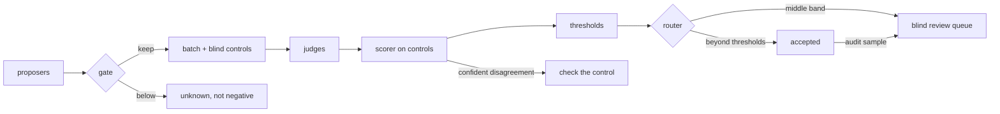

# Chapter 10 · Gated, Calibrated Triage

*A deterministic gate filters agent proposals, planted controls measure the judges, and people review only the
uncertain middle.*

Rating: ★ (a good form among several; the variations name the others; see the overview).

## Intent

Use agents to produce or judge many items, and decide with evidence which of their answers to trust. Filter what
agents propose with a measured, deterministic criterion where one exists; mix items with known answers into every
batch, blind, to measure each judge's accuracy and calibration on the same kind of item; set thresholds from those
controls; accept only the answers beyond them; and send the uncertain middle, plus a random sample of the confident
ones, to a person who reviews them without seeing the agent's verdict.

## Also known as

Gold questions (crowdsourcing), planted controls, LLM-as-a-judge with calibration, uncertainty sampling, human in the
loop for the middle band.

## Motivation

The dust project needed thousands of labels to train a detector, and people could label only hundreds. Agents
labelled train tiles and judged detector candidates. Three problems appeared:

- **Agents over-kept.** One annotator agent found more real dust than another, and also kept grain bumps and sky gaps
  between branches. A deterministic number separated them: `iso`, a speck's peak divided by the 95th percentile of
  the grain peaks around it. Gold dust sat at iso 2 to 16, the over-eager keeps at 0.9 to 2.3. Gating small spots at
  iso ≥ 2 made one annotator plus the gate (recall 75 %, precision 71 % against a person's 150 points) better than a
  two-agent annotator-and-validator pipeline (64 %, 70 %). Gated-out points became "ignore" for training, not
  negatives, because the gate removes doubtful positives, not certain negatives.
- **Judges had to be compared, and could not be trusted blindly.** Each judge saw 360 candidates per variant with 60
  controls mixed in, blind. The controls gave each model and prompt version an AUC, an accuracy and a calibration
  score on the same items. Thresholds where the controls reached 85 % precision decided which answers were usable.
  Even the best judge was usable only at its extremes, about 40 % of items.
- **The yardstick was wrong.** The person checked the "not dust" controls, taken from detections the gold set did not
  match. Nine of the first ten were dust the gold set had missed. The judges that had "failed" those controls had been
  right. The ranking of prompt versions changed once the controls were corrected.

The same structure fits other labour:

- **Content moderation** routes posts that a classifier or a model is unsure about to moderators, and checks
  moderators with known items.
- **Medical pre-screening** reads scans with a model, calls the confident normal ones, and sends the rest to
  radiologists, with audits of the confident calls.
- **Code-review bots** gate patches with tests and linters, then judge the rest, and send risky ones to people.

## Problem

**Agent labels and verdicts are plentiful and of unknown quality; trusting them all poisons the data, checking them
all wastes the people the agents were meant to save, and measuring them against a flawed reference misleads both.**

## Forces

- **Recall against precision.** Agents that propose generously find more, and add noise; strict agents miss things.
- **Measurement against cost.** Controls cost slots in every batch and need known answers; without them, no number
  says whether a judge is good.
- **Automation against oversight.** Every item a person reviews costs time; every item no one reviews can carry an
  undetected error.
- **One metric against judgement.** A deterministic gate is cheap, repeatable and blind to context; a judge sees
  context and is noisy.
- **Truth against the yardstick.** Controls come from earlier labels, which can be wrong; treating them as truth
  rewards judges for repeating the old mistakes.

## Solution

**Therefore: run the work in stages. Where a cheap measured criterion separates good proposals from bad ones,
calibrate it on labelled data and apply it as a deterministic gate; what it removes becomes "unknown", not "no".
Mix controls with known answers into every judging batch, with every item given a blind id, and score each judge,
model and prompt version on the same controls: ranking quality, accuracy and calibration. Set acceptance thresholds
where the controls reach the precision you need; accept answers beyond them, and send the middle band, plus a random
audit sample of the accepted ones, to a person who sees the item but not the verdict. When judges agree confidently
against a control, have a person check the control.**

## Applicability

Use it when:

- many items need a label or verdict and people can review only a fraction;
- some items with known answers exist or can be made;
- wrong labels have a cost (training data, decisions), so quality must be measured, not assumed.

Do not use it when:

- every item must be checked by a person anyway (legal or safety requirements); the agent is then an assistant to
  each review, not a triage stage;
- no known answers exist and none can be produced; without controls there is nothing to calibrate against;
- the items are so few that a person can label them faster than the pipeline can be built.

## Structure

| Participant | Responsibility |
| --- | --- |
| **Proposer** | An agent or detector that produces candidate items (positions, labels, verdicts). |
| **Gate** | A deterministic criterion calibrated on labelled data; keeps, or marks as unknown. |
| **Judge** | An agent run (see [Chapter 9](09-sealed-agent-run.md)) that answers per item with a verdict and a probability. |
| **Controls** | Items with known answers, mixed in blind, from both sides of the decision. |
| **Scorer** | Per judge and variant: ranking quality (AUC), accuracy, calibration (Brier), thresholds at the target precision, the share of real items they make usable. |
| **Router** | Accepts answers beyond the thresholds; sends the middle band and an audit sample to review. |
| **Review queue** | Items for a person, shown without the agent's verdict; decisions go to the ledger (see [Chapter 11](11-lineage-ledger.md)). |

## Collaborations

1. Proposers produce candidates. The gate scores each; small spots below the threshold are marked unknown.
2. A batch is built: real items plus controls, shuffled, each with a blind id; runs of a few items each go to judges.
3. The scorer compares the judges' answers on the controls with the known answers, per model and prompt version.
4. Thresholds are set where the controls reach the required precision, at the high and the low end.
5. The router accepts real items beyond the thresholds; the middle band and a random sample of accepted items go to
   the review queue, blind.
6. Review decisions are recorded; controls on which judges agree confidently against the known answer go to a person
   too, and corrected controls update the scores.



## Sketch

```text
value Item:     id (blind), payload, truth?                    -- truth only for controls, never shown
value Verdict:  itemId, label, p                               -- p = the judge's probability

-- 1. gate: calibrated on labelled data, applied deterministically
gate(c) → keep | unknown
  if c.kind == smallSpot and isolation(c) < 2.0: return unknown  -- threshold chosen on gold, then frozen
  return keep

-- 2. batches with controls
batch = shuffle(realItems ++ sample(controlsPositive, 30) ++ sample(controlsNegative, 30))
runs  = chunks(batch, 6)                                       -- one sealed run per chunk (Chapter 9)

-- 3. score each variant on the controls
score(verdicts, controls) → { auc, accuracyAt05, brier, hi, lo, usableShare }
  hi = lowest p where precision(label = yes | p ≥ hi) on controls ≥ 0.85
  lo = highest p where precision(label = no | p ≤ lo) on controls ≥ 0.85

-- 4. route
for v in verdicts of real items:
  if v.p ≥ hi:  accept(v.itemId, yes)
  elif v.p ≤ lo: accept(v.itemId, no)
  else:          review.enqueue(v.itemId, showVerdict: false)
for v in randomSample(accepted, 0.10): review.enqueue(v.itemId, showVerdict: false)   -- the audit

-- 5. check the yardstick
for c in controls where agreeCount(judges, against: c.truth, p > 0.8) ≥ 2:
  review.enqueue(c.id, showVerdict: false, reason: "control under doubt")
```

## Implementation notes

1. **What the gate removes is unknown, not negative.** The dust gate removes doubtful small positives; marking them as
   negatives would teach a detector that faint dust is clean film. They become "ignore" regions in training.
2. **Calibrate the gate on data it will not be scored on.** The dust gate's threshold (iso 2.0) was chosen on the same
   six tiles it was then scored on; the project recorded this as needing a held-out check. A gate tuned and scored on
   the same items overstates itself.
3. **A cue that helps one stage may not help another.** The isolation number gated annotator over-keeps well, but as
   a cue for judges it separated the judge controls poorly (AUC 0.63), and a prompt that taught it lowered the
   judge's AUC from 0.78 to 0.71. Measure every cue on the controls of the stage that will use it.
4. **Controls must be blind and alike.** Controls get the same kind of blind ids as real items and come from the same
   source (detections of the same detector), or judges learn to tell them apart and the scores measure that instead.
5. **Score calibration, not only ranking.** AUC says whether a judge ranks well; the Brier score and accuracy at 0.5 say
   whether its probabilities can be used as thresholds. Overconfident models scored worst on calibration.
6. **The usable share is the number that saves people time.** A judge's value is how many real items fall beyond the
   thresholds at the required precision; in the dust project the best judge made about 40 % usable.
7. **Expect the yardstick to be wrong, and check it.** Nine of the first ten "not dust" controls a person checked were
   unlabelled dust; judges that disagreed with them had been right. When several judges disagree confidently with a
   control, a person checks the control.
8. **Review blind, and audit the confident.** The review queue shows the item, not the agent's verdict, so the review
   measures the agent rather than echoing it; a random sample of accepted items goes to review too, or the accepted
   band is never checked.
9. **Small control sets are noisy.** Sixty controls gave AUC values with an uncertainty of about ±0.06; differences
   smaller than that between judges are suggestive at best. Compare variants on identical items.
10. **Rank review queues by uncertainty.** The project's review queue for detector output ranked candidates by their
    distance from the decision threshold, so a person's time goes to the items whose label changes the most.
11. **Define each metric once.** The dust project computed its isolation metric in two Python scripts and once more in
    JavaScript for the judges, and copied its control-scoring code between two scripts. Three definitions of the
    gate's metric can drift apart; keep one implementation and test the others against it.

## Variations

- **Validator stage instead of a gate.** A second agent reviews the first agent's proposals. More context-aware and
  more expensive; in the dust project a single annotator plus a deterministic gate beat it.
- **Consensus of judges.** Several models or prompts judge each item; agreement raises confidence. Costs a multiple of
  the runs and still needs controls to know whether the consensus is right.
- **Active learning loop.** Reviewed items retrain the proposer; the next batch's uncertain middle moves. Suits
  long-running labelling projects.
- **No gate.** When no cheap criterion exists, the controls and thresholds carry the whole weight.

## Consequences

- \+ Agent labour is accepted where it is measured to be good enough, and only there.
- \+ People's time goes to the items where it changes the outcome.
- \+ Models and prompt versions can be compared on equal terms, with numbers.
- \+ Errors in the reference data surface instead of hiding inside the scores.
- − Controls cost batch slots and need known answers, which are themselves imperfect.
- − Thresholds tuned on small control sets move with every correction.
- − A gate encodes one criterion; spots that fail it for the wrong reason are lost to training as "unknown".

## Known uses

- **Crowdsourcing platforms** (Amazon Mechanical Turk, Figure Eight / CrowdFlower) embed gold questions with known
  answers in task batches to measure and screen workers.
- **LLM-as-a-judge** studies (Zheng et al., 2023, "Judging LLM-as-a-Judge with MT-Bench and Chatbot Arena") measure
  judges against human labels and report their biases.
- **Uncertainty sampling** (Lewis and Gale, 1994) sends to annotation the items a classifier is least sure about.
- **Snorkel** combines programmatic labelling functions (deterministic gates) with a model of their accuracies.

## Related chapters

- [Chapter 7 · Numbered, Budgeted Evidence](07-numbered-budgeted-evidence.md): verdicts by id on numbered items.
- [Chapter 9 · Sealed Agent Run](09-sealed-agent-run.md): the judge runs.
- [Chapter 11 · Lineage Ledger](11-lineage-ledger.md): decisions and the origin of every label.
- [Chapter 13 · Measured Redesign Loop](13-measured-redesign-loop.md): prompt versions compared on the controls.
- Classic patterns: **Chain of Responsibility** (gate, judge, person), **Strategy** (interchangeable judges).
