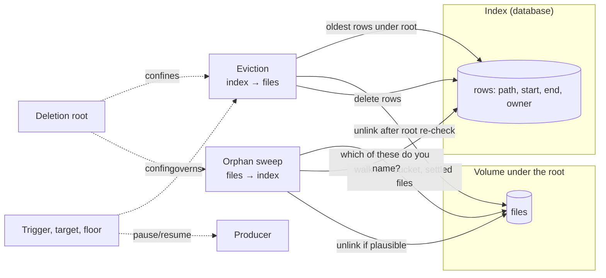
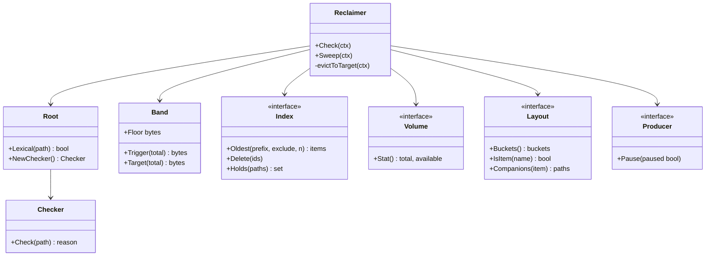

# Index-Governed Reclamation - A Bounded Store Deletes Only What Its Index Names Under Its Root

A recorder that writes continuously into a volume of fixed size will fill it. Every system of this kind therefore carries a second, quieter program whose only output is deletion: it removes the oldest recordings when space runs short, and it removes files that nothing refers to any more. That program is the most dangerous code in the system. It is the only part whose mistakes cannot be repaired by a restart, because what it deletes is gone, and it works against two records of the same facts — a database index that names every recording, and a filesystem that holds the bytes — which disagree in predictable ways after crashes, restores, manual intervention, and configuration changes.

The load-bearing rule: **deletion is decided by the index, confined by a root, and bounded by evidence.** Eviction removes the oldest *indexed* items whose paths lie under the store's *own* root, and only while usage is above a trigger, down to a target below it. The orphan sweep removes *unindexed* files only when they are old enough to be settled and few enough to be plausible; when the evidence looks wrong, it refuses and says so.

> [!summary]
> - Two programs reclaim space, in opposite directions: **eviction** walks the index and deletes files the index names; the **orphan sweep** walks the files and deletes those the index does not name. Each needs its own safety law.
> - A **deletion root** confines both: an index row or a file outside the store's resolved root is never deleted, however old, because a database can describe more than one volume.
> - Eviction runs between two thresholds — a **trigger** and a lower **target** — and the trigger is capped by a **free-space floor**, so a large volume cannot fill to its last few gigabytes before eviction starts. The producer is paused only at the floor, not for the duration of an eviction pass.
> - The sweep's verdict is **refused when implausible**: too large a fraction of orphans in one bucket means the index is wrong, not the disk, and deleting would destroy what the index forgot.
> - One reclaimer owns a volume. Two reclaimers on one volume double-delete, and their pause decisions fight.

## Why this note exists

The pattern was extracted from the housekeeping subsystem of the Playback network video recorder (NVR): a TypeScript implementation (`disk-manager.ts`, `orphan-sweeper.ts`) and its Go port (`services/nvr-go/internal/housekeeping`). The question that triggered it was how much of that subsystem is general-purpose media and storage management rather than Playback's own. The answer is that roughly a third of its 1,640 lines is a reusable core — the deletion root, the watermark arithmetic, the eviction loop, and the plausibility brake — while the rest binds that core to Playback's schema, directory layout, and companion files. The core is worth naming before anyone extracts it, because each of its rules was paid for by an incident.

The two implementations are one lineage, not two independent confirmations: the Go code is a port that keeps the TypeScript behaviour, with fixes. Independent evidence for parts of the pattern comes from Moonfire NVR, Prometheus TSDB, and Apache Kafka, compared in [[#Known uses]].

## Motivation

The pattern rests on eight principles. Each is stated, defined, and shown with the smallest example that makes it concrete.

**1. A bounded store.** A *store* is a directory tree on one filesystem into which a *producer* writes items continuously. The filesystem reports a total size $T$ and the bytes available to the producer's user, $f$; usage is $u = T - f$. *Example:* a 100 GiB volume with 20 GiB available has $u = 80$ GiB. The available count must be the one the producer can actually write (`statfs`'s `f_bavail`), not the free count including blocks reserved for the superuser (`f_bfree`): a reclaimer that reads the second believes there is space the producer cannot use.

**2. Two records of one fact.** Each item exists twice: as a *file* under the store and as a *row* in an index (a database table) that names the file's path, its time span, and its owner. Four combinations are possible:

| File | Row | Name | How it arises |
|---|---|---|---|
| present | present | normal item | the producer wrote the file, then indexed it |
| absent | present | *dangling row* | the file was deleted and the row was not (a crash between the two steps, a manual `rm`) |
| present | absent | *orphan* | the row was deleted and the file was not (an unlink that failed, a database restored to an older point), or the file was written and never indexed |
| absent | absent | nothing | — |

*Example:* the producer writes `seg_1793660379.ts`, renames it into place, and then inserts its row. Between the rename and the insert — which may be retried for minutes while the database is unavailable — the file is, by the table above, an orphan.

**3. A deletion root.** A store owns one directory, its *root*. An index can hold rows for files under other roots: a second recorder pointed at another volume, a development instance sharing a database, rows restored from another host. Whether a path is under the root is decided twice:

- *lexically*: the path is absolute, already clean (no `..`, no `.`, no doubled or trailing separator), and begins with the root followed by a separator, so that `/data/recordings2/x` is not under `/data/recordings`;
- *resolved*: the path's directory, with every symbolic link followed, lies inside the root with every symbolic link followed.

A path that is not clean is refused rather than cleaned, because the kernel resolves `link/..` through the link's target, so the cleaned spelling can name a different file from the one the row names. *Example:* for root `/data/recordings`, the row path `/data/recordings/cam1/../../etc/x` fails the lexical test; `/data/recordings/cam1/high/x.ts` where `cam1` is a symbolic link to `/mnt/other` passes the lexical test and fails the resolved one.

**4. A band between two thresholds.** Eviction starts when usage reaches a *trigger* $\tau$ and stops when usage falls to a *target* $\sigma < \tau$. A single threshold would make the reclaimer delete one item, fall just under the threshold, let the producer cross it again a second later, and repeat: a deletion per item written. The gap between the two thresholds is *hysteresis*: once started, a pass makes enough room that the next one is far away. *Example:* with a high watermark of 90 % and a low watermark of 80 % on 100 GiB, eviction starts at 90 GiB used and stops at 80 GiB used.

**5. A floor.** The watermarks are fractions, and fractions of a large volume are large. A floor $m$ is an absolute amount of space that must remain available. The trigger is the *smaller* of the watermark and the total minus twice the floor:

$$\tau(T) = \min(h\,T,\; T - 2m), \qquad \sigma(T) = \tau(T) - (h - l)\,T.$$

*Example:* with $h = 0.9$, $l = 0.8$, $m = 2$ GiB, an 8 TB volume has $\tau = \min(7.2\text{ TB}, 8\text{ TB} - 4\text{ GiB}) = 7.2$ TB, so eviction starts with 800 GB still available. Taking the *larger* of the two instead gives $\tau = 8\text{ TB} - 4\text{ GiB}$: eviction starts with 4 GiB available, which a few cameras fill in minutes. That inversion is a recorded incident ([[#What goes wrong]]).

**6. Back-pressure at the floor, not during the pass.** When the available space reaches the floor, the producer must stop writing, because the next write may fail half-way and corrupt an item. That is *back-pressure*: the reclaimer tells the producer to pause. It is a different decision from eviction and has its own two thresholds: pause when $f \le m$, resume when $f > 2m$. Pausing for the whole of an eviction pass instead — the obvious coupling — stops recording for as long as the pass takes, which on a large volume is most of an hour.

**7. Settled and in-flight files.** A file is *in flight* while the producer may still index it, and *settled* afterwards. A sweep can only judge settled files. The simplest settledness test is age: a file whose modification time is older than every plausible index retry window. *Example:* with a one-hour age threshold, the segment renamed into place at 12:00 and indexed at 12:07 after a database outage is never a sweep candidate before 13:00.

**8. Plausibility of a deletion set.** A sweep computes a set of orphans and could delete it all. Before deleting, it asks whether the set is plausible. In a healthy store orphans are rare — a crashed write here, a failed unlink there. A bucket in which most settled files are orphans means that the index has lost rows (a restore to an older backup, rows deleted by hand, a schema mistake), and deleting those files would destroy recordings the index merely forgot. *Example:* 3 orphans among 2,000 files are plausible; 1,900 among 2,000 are not, and the sweep should refuse and report rather than act. Small samples carry no information about a ratio, so a bucket with very few orphans is always swept, and the ratio is applied only once the tree as a whole has enough candidates to judge.

## The pattern in Alexander's form

**INDEX-GOVERNED RECLAMATION** ★

*…within a BOUNDED RECORDING VOLUME, where a producer writes items continuously and an index names each of them, this pattern keeps the volume from filling without ever deleting what the store does not own.*

◆ ◆ ◆

**A store that only grows will fill; a reclaimer that deletes by the filesystem's own view will eventually delete what another system owns or what the index merely forgot, and a reclaimer that deletes by the index alone will never remove the files the index lost.**

The forces are these. The producer must keep running: stopping it loses data as surely as deleting it does, so the reclaimer must act early, while there is still room, and pause the producer only when there is no room at all. Deletion is irreversible, so every rule that decides what to delete must fail closed: an unreadable root, a failed index query, or an implausible verdict must mean *keep*. The index and the files diverge in exactly two ways, dangling rows and orphans, and the two need opposite traversals: the first is found by walking the index, the second only by walking the disk. The disk walk is expensive — trees of millions of files are normal for a recorder that keeps weeks of footage — so it must be bounded in memory and spread over time. And the database is not owned by the volume: it may describe other roots, other hosts, other eras.

**Therefore:**

**Reclaim in two directions, each governed by the index and confined by the store's root. Evict by asking the index for its oldest rows under the root, re-checking each path against the resolved root, deleting the file and everything that belongs to it, then the row; run only between a trigger capped by a free-space floor and a lower target, and pause the producer only at the floor. Sweep by walking the store one bucket at a time, taking only settled files, asking the index which of them it names, and deleting the rest only when their number is plausible; refuse and report otherwise. Let exactly one reclaimer own a volume.**



◆ ◆ ◆

The pattern is completed by smaller ones. **CONFINED DELETION ROOT** gives both directions the same answer to "may I delete this path?". **WATERMARK BAND WITH A FLOOR** decides when eviction runs. **PAUSED PRODUCER AT THE FLOOR** separates back-pressure from eviction. **OLDEST-FIRST EVICTION BY INDEX** decides what goes, and **COMPANIONS FOLLOW THE PRIMARY** decides what goes with it. **ORPHAN SWEEP WITH A PLAUSIBILITY BRAKE** removes what the index lost. **BUCKET-AT-A-TIME WALK** keeps the sweep's memory bounded by the largest bucket instead of the tree. **ONE RECLAIMER PER VOLUME** keeps the whole arrangement from running twice. A store whose deletions must also survive a crash with neither dangling rows nor orphans adds **TWO-PHASE DELETION THROUGH A GARBAGE LIST** ([[#Known uses|Moonfire NVR]]).

The single star follows Alexander's convention: it marks a pattern that makes progress toward an invariant but whose solution could, with care, be improved. One lineage of code establishes it here, and the comparisons below support its parts rather than the whole.

## The pattern in the Gang of Four form

### Intent

Keep a bounded, continuously written store from filling, by deleting the oldest items the index names under the store's own root and the unindexed files that are settled and plausible, without ever deleting outside the root or on implausible evidence.

### Also known as

Disk manager and orphan sweeper (Playback); retention (Prometheus, Kafka); garbage collection of sample files (Moonfire NVR).

### Motivation

A Playback NVR records each camera stream into MPEG-TS segments (six seconds by default), under `<root>/<source>/<quality>/YYYY/MM/DD/HH/seg_<epoch>.ts` in UTC, and inserts one row per segment into `nvr.recording_segments`. Each segment can carry companion files: a redaction manifest, a redacted copy, and redacted thumbnails for every ten-second bucket it spans. A site keeps footage until the disk forces it out, so a volume of several terabytes holds millions of segment files and sits near its watermark for its whole life.

Three things go wrong without the pattern, and each did ([[#What goes wrong]]): the volume fills before eviction starts; eviction deletes rows and files belonging to another root that shares the database; and a full-tree orphan inventory exhausts the process's memory. The pattern's parts are the answers.

### Applicability

Use Index-Governed Reclamation when:

- a producer writes items continuously into a filesystem of bounded size;
- an index outside the filesystem names the items and is the authority on what exists (for playback, export, search, or billing);
- old items may be deleted to make room, and the oldest are the least valuable;
- the index and the files can diverge (crashes between the two writes, restores, manual intervention);
- more than one store, host, or environment can share the index.

### Structure



### Participants

- **Reclaimer** (Playback: `DiskManager` and `Sweeper`) — runs both directions on a schedule (eviction every 30 s and on demand; the sweep 30 s after start, then every 5 min) and owns the pause decision.
- **Root** and **Checker** (`rootguard.go`) — the deletion root's lexical test and a per-pass checker that resolves the root once and caches a verdict per directory.
- **Band** (`TriggerBytes`, `TargetBytes`, `MinFreeBytes`) — the watermark arithmetic and the floor.
- **Index** (`SegmentIndex`, `PathIndex`, implemented by `*db.DB`) — oldest rows under a prefix, deletion by id, and membership of a batch of paths.
- **Volume** (`StatFunc`, default `Statfs` reading `f_bavail`) — total and available bytes.
- **Layout** (Playback's `layout` package) — the bucket tree, the item file-name grammar, and an item's companions. This is the participant that binds the pattern to one product.
- **Producer** (the recorder, through `OnPauseChange`) — stops and resumes writing.

### Collaborations

An eviction pass, as Playback runs it:

```mermaid
sequenceDiagram
    participant R as Reclaimer
    participant V as Volume
    participant I as Index
    participant C as Checker
    participant F as Files
    R->>V: Stat (f_bavail)
    Note over R: above trigger? else stop.<br/>free ≤ floor? pause producer
    R->>C: resolve root once (fail → evict nothing)
    loop while usage > target
        R->>I: 50 oldest rows under root/, excluding refused ids
        alt no rows
            Note over R: report "ran out"; stop
        end
        loop each row
            R->>C: Check(path)
            alt refused
                Note over R: exclude id from later batches
            else allowed
                R->>F: unlink item, companions, thumbnails
            end
        end
        R->>I: delete the batch's allowed rows
        R->>V: Stat again (pause or resume producer)
        Note over R: ≥ 1000 refused → stop the pass
    end
    R->>I: count rows outside the root (report, never delete)
```

A sweep pass walks one `<source>/<quality>` bucket at a time: list its files; keep those with an item's name and a modification time older than one hour; ask the index which it names; delete the rest unless the plausibility brake refuses the bucket. A failed index lookup keeps every file for the rest of the pass, and a bucket whose walk was incomplete is skipped. The same pass reaps hour directories past the retention horizon and temporary files older than the settledness age.

### Consequences

Benefits:

1. **Confinement is structural.** The query asks only for rows under the root's prefix, and the checker re-verifies every path before unlink, so a shared database cannot make one store delete another's files. The prefix filter keeps the query efficient; the re-check catches `..`, symbolic links, and anything the SQL predicate missed.
2. **Large volumes keep headroom.** The floor caps the trigger in absolute terms, so the space held back does not shrink to a few gigabytes as volumes grow.
3. **Recording continues during eviction.** Because the pause is tied to the floor, a pass that drains a terabyte runs while the producer keeps writing.
4. **Index damage is visible, not destructive.** The brake converts "the index lost a camera's rows" from a mass deletion into a logged refusal with a break-glass setting.
5. **Memory is bounded by the largest bucket**, not by the tree.

Liabilities:

1. **The pattern does not make deletion atomic.** Playback unlinks files first and deletes rows after each batch. A crash between the two leaves dangling rows, which the next pass resolves (the unlink finds nothing and the row is deleted). An unlink that *fails* (permissions, an I/O error) is counted, but its row is still deleted, so the file becomes an orphan and is left to the sweep, under its brake. Stores that need neither outcome use a garbage list ([[#Known uses|Moonfire NVR]]).
2. **Settledness by age is a heuristic.** A file the producer indexes after the age threshold has passed (an outage longer than an hour) is swept before it is indexed.
3. **The brake can keep real orphans.** A genuinely orphaned camera — rows hard-deleted on purpose — stays on disk until an operator raises the ratio.
4. **Nothing here bounds a hung filesystem.** `statfs` and directory reads on a dead network mount block indefinitely, and with them the reclaimer.

### Implementation

1. **Read available, not free.** Use `f_bavail × f_bsize`. A process that is not the superuser cannot use the reserved blocks that `f_bfree` counts.
2. **Refuse a target that is not positive.** On a volume too small for its floor plus the band, $\sigma(T) \le 0$; eviction would drain the index to nothing. Log an error and do not evict.
3. **Never act on an inconsistent reading.** A `statfs` result that is not finite, has no positive total, or reports available space below zero or above the total is discarded; the pass waits for the next one.
4. **Filter in the query, re-check in the process.** The database narrows the candidates cheaply by prefix (`OldestRecordingSegmentsUnder`, which also validates that the prefix is absolute and ends in a separator); the resolved check decides. Exclude refused ids from the next batch and stop the pass after a bounded number of refusals, so a pathological tree cannot make eviction loop.
5. **Count, do not delete, what lies outside.** When a pass evicts, runs out, or refuses, count the index rows outside the root and log them: they are another store's, and an operator should see why this volume's index does not account for its usage.
6. **Companions follow the primary.** Derive an item's companion paths from its own path and time span, and unlink them in the same step; a companion left behind is an orphan the sweep does not recognise.
7. **Bucket the walk and decide the ratio floor tree-wide.** Walk, grade, look up, and act on one bucket before reading the next. The ratio is meaningless for a small sample, so verdicts are held until the tree-wide candidate count passes a floor (100 in Playback), then acted on with the ratio applied; a tree that never passes the floor is acted on at the end without it. A bucket with no more than a handful of orphans (5) is always swept.
8. **Fail closed everywhere.** An unresolvable root evicts nothing. A failed index query ends the eviction pass or keeps every sweep candidate. An incomplete bucket walk skips the bucket.
9. **Own the volume once.** Run the reclaimer only in the process that holds the volume's ownership lock, and move it together with the producer: the reclaimer pauses the producer, and two eviction owners delete twice. Playback takes a Postgres advisory lock per subsystem (`recorder` and `housekeeping` together).

### Sample code

A generic core in Go, written for this note: Playback's binding adds its schema, layout, companions, metrics, and logging around the same shape.

```go
// Item is one indexed file.
type Item struct {
	ID    string
	Path  string // absolute and clean
	Start time.Time
}

// Index is the authority on what the store holds.
type Index interface {
	Oldest(ctx context.Context, prefix string, exclude []string, n int) ([]Item, error)
	Delete(ctx context.Context, ids []string) error
	Holds(ctx context.Context, paths []string) (map[string]bool, error)
}

type Band struct {
	High, Low float64 // fractions of total, Low < High
	Floor     int64   // bytes that must stay available
}

func (b Band) Trigger(total int64) int64 {
	return min(int64(b.High*float64(total)), total-2*b.Floor)
}

func (b Band) Target(total int64) int64 {
	return b.Trigger(total) - int64((b.High-b.Low)*float64(total))
}

// Evict deletes the oldest items under root until usage reaches the target.
func (r *Reclaimer) Evict(ctx context.Context) error {
	total, avail, err := r.Volume.Stat()
	if err != nil || avail > total || total <= 0 {
		return err // inconsistent reading: act on none of it
	}
	r.notePressure(avail) // pause at Floor, resume above 2·Floor
	if total-avail < r.Band.Trigger(total) || r.Band.Target(total) <= 0 {
		return nil
	}
	chk, err := r.Root.NewChecker() // resolves the root's symlinks once
	if err != nil {
		return err // no root, no deletion
	}
	var refused []string
	for total-avail > r.Band.Target(total) && len(refused) < maxRefused {
		batch, err := r.Index.Oldest(ctx, r.Root.Prefix(), refused, 50)
		if err != nil || len(batch) == 0 {
			return err
		}
		var gone []string
		for _, it := range batch {
			if reason := chk.Check(it.Path); reason != "" {
				refused = append(refused, it.ID)
				continue
			}
			for _, p := range append([]string{it.Path}, r.Layout.Companions(it)...) {
				removeObserved(p) // ENOENT counts as gone
			}
			gone = append(gone, it.ID)
		}
		if err := r.Index.Delete(ctx, gone); err != nil {
			return err
		}
		if total, avail, err = r.Volume.Stat(); err != nil {
			return err
		}
		r.notePressure(avail)
	}
	return nil
}

// sweepBucket deletes the settled files of one bucket the index does not name,
// unless their number is implausible.
func (r *Reclaimer) sweepBucket(ctx context.Context, files []string, now time.Time) error {
	var cands []string
	for _, f := range files {
		if r.Layout.IsItem(f) && settled(f, now, time.Hour) {
			cands = append(cands, f)
		}
	}
	held, err := r.Index.Holds(ctx, cands)
	if err != nil {
		return err // the caller keeps every file for this pass
	}
	var orphans []string
	for _, f := range cands {
		if !held[f] {
			orphans = append(orphans, f)
		}
	}
	if len(orphans) > 5 && float64(len(orphans)) > r.MaxFraction*float64(len(cands)) {
		return refuse(orphans, cands) // log with the break-glass setting; delete nothing
	}
	for _, f := range orphans { // files come from a walk under the root that follows no links
		removeObserved(f)
	}
	return nil
}
```

The sketch leaves out the tree-wide ratio floor, retention by hour directory, temporary-file cleanup, metrics, and the out-of-root report; [[#Implementation]] lists them.

### Known uses

| System | When it evicts | What goes first | Deletion order and crash story | Orphan criterion | Brake | Correspondence |
|---|---|---|---|---|---|---|
| Playback NVR housekeeping (TypeScript original and Go port: one lineage) | usage ≥ $\min(hT, T-2m)$, down to $\tau - (h-l)T$; producer paused at $f \le m$, resumed at $f > 2m$ | oldest indexed segment under the root, re-checked | files and companions, then the batch's rows; crash leaves dangling rows, failed unlink leaves an orphan | item-named file, older than 1 h, not in the index | per bucket: more than 5 orphans and above 5 % (once the tree has more than 100 candidates) | the source |
| [Moonfire NVR](https://github.com/scottlamb/moonfire-nvr/blob/master/design/schema.md) | retention limits per stream (not re-verified for this note) | oldest recordings | the recording row is replaced by a `garbage` row; the file is unlinked (`ENOENT` warns); the directory is `fsync`ed; the garbage row is deleted | exact: at startup, files of garbage rows and files whose recording id is at or beyond the stream's committed counter are unlinked | none needed: the criterion is exact | partial — the same two records and the same need, solved by write-ahead intent and committed identifiers instead of age and a ratio |
| [Prometheus TSDB](https://github.com/prometheus/prometheus/blob/main/tsdb/db.go) | total block size above the retention size, or blocks older than the retention time | oldest blocks ("This ensures that the retentions will remove the oldest blocks") | the block directory is renamed with `.tmp-for-deletion` before removal, to avoid a partial block after a crash | temporary directories are removed when the database opens | — | partial — the oldest-first size retention corresponds; the directory is its own index, so there are no orphans in this pattern's sense |
| [Apache Kafka](https://kafka.apache.org/documentation/#brokerconfigs_log.segment.delete.delay.ms) | per partition, by `retention.bytes` or `retention.ms` | oldest closed segments; the active segment is never deleted | a segment removed from the log is deleted from disk only after `log.segment.delete.delay.ms` | — | — | adjacent — retention by size and age over a log, with no external index to disagree with |

The comparison sharpens the pattern's boundary. Where the files are their own index (Prometheus blocks, Kafka segments), only the eviction half applies. Where identifiers are allocated from a committed counter (Moonfire), the orphan test is exact and needs no brake. The brake exists because Playback's index and files are independent writes with no shared transaction, and its orphan test is therefore a judgement.

### Related patterns

- **Mark-and-sweep garbage collection.** The sweep is a sweep phase whose mark set is the index's answer to `Holds`. It differs in one way that matters: a collector's mark set is authoritative by construction, while an index can be wrong, which is why the sweep needs a brake and a collector does not.
- **Reconciliation loop.** Both directions compare a recorded state (the index) with an actual state (the files) and act on the difference, as a controller does; unlike most controllers, the only action available is irreversible.
- **Hysteresis control.** The band and the pause thresholds are two independent instances: two thresholds per decision so that the decision does not oscillate.
- **Back-pressure.** The pause is the reclaimer pushing back on the producer, at one point only.
- **Write-ahead intent.** Moonfire's garbage list records a deletion before performing it, so a crash is resolved by replaying the list; it removes Playback's liability 1 at the cost of a third record.
- **Circuit breaker.** The brake opens on implausible evidence as a breaker opens on a failure rate; it stays open until an operator changes its setting, not on a timer.
- **[[Research/Software Architecture Garden/general/databases/01 - Bounded Correction Lookback for Incremental Materializations|Bounded Correction Lookback]].** Another pattern that trades completeness for a bound and makes the bound an explicit, documented parameter.

## The model

Let $P$ be the set of absolute, clean paths, and $\mathrm{under}_R \subseteq P$ the paths that pass both tests of principle 3 for root $R$. At a moment, let $F \subseteq P$ be the files that exist and $I$ the index rows, with $\mathrm{path}: I \to P$ and $\mathrm{start}: I \to \text{Time}$.

**Owned rows.** $I_R = \{\, i \in I \mid \mathrm{path}(i) \in \mathrm{under}_R \,\}$. Eviction draws only from $I_R$, in increasing $\mathrm{start}$.

**Orphans.** For an age $a$ and the item name grammar $L$:

$$O_R = \{\, p \in F \cap \mathrm{under}_R \mid p \notin \mathrm{path}(I),\ \mathrm{name}(p) \in L,\ \mathrm{age}(p) \ge a \,\}.$$

**The laws**, each a sentence an implementation can be tested against:

1. *Confinement.* No path outside $\mathrm{under}_R$ is ever unlinked, by either direction.
2. *Index authority for eviction.* Eviction unlinks only paths of rows in $I_R$.
3. *Oldest first.* Within one pass, no row is deleted while an older row of $I_R$ that the checker allows remains.
4. *Hysteresis.* Eviction starts only at $u \ge \tau(T)$ and continues only while $u > \sigma(T)$; because $\sigma(T) = \tau(T) - (h-l)T$ with $h > l$, the band has width $(h-l)T > 0$.
5. *Floor.* $T - \tau(T) \ge 2m$: at the trigger, at least twice the floor is still available, whatever $T$ is.
6. *Plausibility.* A bucket $b$ with candidate set $C_b$ and orphan set $O_b$ is swept only if $|O_b| \le k$ or $|O_b| \le \varphi\,|C_b|$ (Playback: $k = 5$, $\varphi = 0.05$), once the tree's total candidate count exceeds $n_0 = 100$.
7. *Single owner.* At most one process runs the reclaimer for a volume.

Law 5 is the one the incident violated: with $\max$ in place of $\min$, $T - \tau(T) = 2m$ for every large $T$, which is the same 4 GiB on 100 GiB and on 8 TB.

**Crash ordering.** Deleting an item means two writes, to $F$ and to $I$. The three orders and what a crash between the writes leaves:

| Order | State after a crash | Recovery |
|---|---|---|
| files, then rows (Playback) | dangling rows | the next eviction pass selects them again; the unlink finds nothing; the rows are deleted |
| rows, then files | orphans | only the sweep, after the age threshold, under the brake |
| intent row, then files, then intent row (Moonfire) | a garbage row naming a file that may or may not exist | replay the garbage list at startup |

The first order is self-healing for crashes but not for failed unlinks; the second relies on the sweep; the third needs a third record and is exact.

## What goes wrong

From the source system's history:

- **The volume filled before eviction started.** The TypeScript trigger used `Math.max(total × high, total − 2 × minFree)`. On an 8 TB recordings volume that put the trigger at about 4 GiB available; the volume filled to its last 2 GiB before eviction made room, and every camera stopped recording. The fix (Playback #961) took the minimum, drained to a band below the trigger, refused a non-positive target, and ignored inconsistent `statfs` readings.
- **Recording paused for whole eviction passes.** Before the same fix, recorders paused from the start of a pass until usage reached the low watermark — on a large volume, most of an hour. Pausing became a floor decision with its own resume threshold, re-checked after every batch.
- **Eviction would delete another root's rows.** The TypeScript disk manager selects the oldest rows of the whole segment table. With a second NVR, or a local run on another volume, sharing the database, that deletes rows and files the store does not own; the defect was found while porting the subsystem to Go, not in production. The Go port asks only for rows under the root's prefix and re-checks each path against the resolved root (`rootguard.go`, `TestEvictionRootGuardAgainstPostgres`).
- **The sweep exhausted memory.** The TypeScript sweeper inventoried every bucket and asked the index about every candidate in one list before acting on any. At about 716 bytes of heap per walked path, a tree of 3.5 million segment files exhausted the heap and the NVR crashed three times on a live machine, twice within 45 s of restarting. The fix (Playback #1083) walks, grades, looks up, and acts on one bucket before reading the next; the ratio floor stayed tree-wide.

Risks the design addresses but that are not, in this lineage, recorded incidents:

- **A database restored to an older point** makes every newer file an orphan. The brake refuses those buckets and logs a break-glass setting (`NVR_ORPHAN_SWEEP_MAX_FRACTION`) for an operator who has confirmed a genuine mass-orphan event.
- **Symbolic links inside the tree** that lead elsewhere are refused by the resolved check and skipped by the sweep's walk.

Open risks:

- **A hung mount** blocks `statfs` and directory reads with no deadline, so the reclaimer stops making progress without failing. Nothing in the pattern as implemented bounds it.
- **Late indexing.** An index outage longer than the settledness age turns not-yet-indexed segments into sweep candidates.

## What is generic and what is binding

| Part | Generic | Bound to Playback |
|---|---|---|
| Deletion root (`rootguard.go`, 117 lines) | all of it | nothing |
| Eviction (`disk.go`, 525 lines) | the band and floor, the pause thresholds, the batched oldest-first loop, the re-check, the refusal budget, the out-of-root count | the segment row type and identifiers, companion files, redacted thumbnails per ten-second bucket, the snapshot cache, the metrics types |
| Orphan sweep (`sweeper.go`, 706 lines) | settledness by age, the bucket-at-a-time walk, the index membership query, the brake, temporary-file and retention reaping | the `<source>/<quality>/YYYY/MM/DD/HH` grammar, segment file names, the clip-store janitor, reserved directory names |
| Storage observation (`storage.go`, 161 lines) | — | per-camera database aggregates for metrics |

The cut runs along the participants: `Index`, `Volume`, `Layout`, and `Producer` are interfaces the product implements; `Root`, `Band`, and the two loops are the pattern. In the source repository only the deletion root has a clear second consumer today (any code that deletes under a configured directory). The rest passes the second-consumer test only when a second store needs size-based eviction or an orphan sweep, and extracting it before then would risk weakening a guard that came from an incident.

## When to use it, and when not

Use it when an external index is the authority on a bounded, continuously written store, the oldest items are the least valuable, and the index can diverge from the files.

Do not use it, or use only part of it, when:

- **the files are their own index** — a directory of immutable blocks or log segments whose names carry their order. Eviction applies; the orphan sweep and its brake do not (Prometheus, Kafka).
- **identifiers come from a committed counter or deletion goes through an intent record.** The orphan criterion is then exact, and the age heuristic and brake add only risk (Moonfire).
- **value is not monotone in age** — footage pinned as evidence, items under legal hold. Oldest-first eviction must then skip pinned items, which turns law 3 into "oldest unpinned first" and needs its own refusal accounting.
- **the store is not bounded by one filesystem** — object storage billed per byte has no floor; the band becomes a budget and the pause a policy decision.

## Candidate ecosystem guidance

1. Decide deletion from the authority, never from the filesystem's own listing alone.
2. Confine every deletion to a root, checked lexically and after resolving links, and refuse unclean paths rather than cleaning them.
3. Cap a fractional trigger with an absolute floor, and keep a band between trigger and target.
4. Pause the producer only at the floor, with its own resume threshold.
5. Read the space the producer can actually use.
6. Judge only settled files, and refuse an implausible deletion set with a named break-glass setting.
7. Bound the walk's memory by the bucket, not the tree.
8. Fail closed on every unreadable input.
9. Let one owner reclaim a volume.
10. Write down the crash ordering, and what it leaves behind, next to the code that performs it.

## Open questions

- Should the read side gain a mount-health signal, so that a hung volume fails fast for the reclaimer and for every reader rather than blocking them? (Playback ticket PB-NVR-GO-004, task `nyho`.)
- Is the files-then-rows order worth replacing with a garbage list, given that failed unlinks already leave orphans for a heuristic sweep?
- Which second store would justify extracting the eviction loop and the sweep behind the four interfaces above?

## Evidence and references

Source, at `da3597a1b` (branch `docs/pb-nvr-go-002-implementation-guide`; the repository is internal to Tulip, so paths are given for provenance):

- `services/nvr-go/internal/housekeeping/rootguard.go:50` (`Root.Lexical`), `:87` (`Checker.Check`).
- `services/nvr-go/internal/housekeeping/disk.go:239` (`ObserveStats`: pause at the floor, resume above twice it), `:280` (`TriggerBytes`), `:285` (`TargetBytes`), `:303` (`Check`), `:340` (`evictToTarget`: batch of 50 at `:370`, unlink at `:394`, row deletion at `:417`), `:65` (`MaxRefusedPerPass = 1000`).
- `services/nvr-go/internal/housekeeping/sweeper.go:25`–`:28` (age 1 h, fraction 0.05, tree floor 100, unconditional 5), `:407` (`sweepBucket`), `:471` (`act`: the brake), `:510` (`reapOldDirectories`).
- `services/nvr-go/internal/db/eviction.go:61` (`OldestRecordingSegmentsUnder`, prefix-validated).
- Tests: `rootguard_integration_test.go` (`TestEvictionRootGuardAgainstPostgres`), `housekeeping_integration_test.go` (`TestHousekeepingAgainstPostgres`), `sweeper_test.go` (`TestSweepDeletesPlausibleOrphans`, `TestSmallTreeIgnoresRatioAndSmallBucketNeverAborts`).
- History: Playback #961 (watermark, floor, and pause), Playback #1083 (bucket-at-a-time sweep).

External:

- Moonfire NVR, [design/schema.md](https://github.com/scottlamb/moonfire-nvr/blob/master/design/schema.md): the steps for deleting a recording and for startup recovery through the `garbage` table.
- Prometheus, [tsdb/db.go](https://github.com/prometheus/prometheus/blob/main/tsdb/db.go): `BeyondSizeRetention`, `deleteBlocks`, `tmpForDeletionBlockDirSuffix`.
- Apache Kafka, [broker configuration](https://kafka.apache.org/documentation/#brokerconfigs_log.segment.delete.delay.ms): `log.segment.delete.delay.ms`, `log.retention.bytes`.
- Christopher Alexander et al., *A Pattern Language* (1977), for the form of the problem–forces–therefore statement and the asterisk convention.
- Erich Gamma, Richard Helm, Ralph Johnson, John Vlissides, *Design Patterns* (1994), for the Intent through Related Patterns sections.
