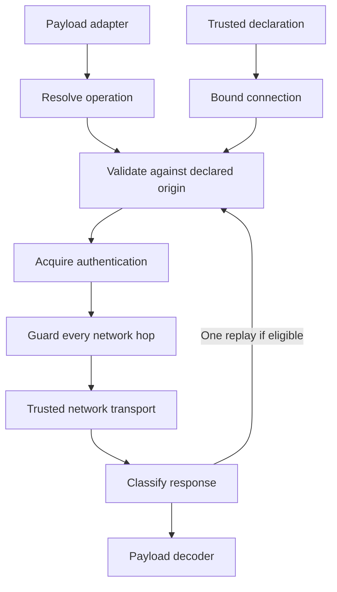

# Chapter 1 · Bound API Connection

*Bind credentials to declared request authority before payload code can send them.*

**★** · Architecture · Authenticated external effects

## Intent

Give application components one executable API connection that owns its destination, authentication, routes, headers, and request lifecycle. Components encode operations without independently selecting credentials or granting authority to a destination.

The pattern is for systems integrating multiple authenticated services, especially when several services implement the same protocol. Its essential boundary separates declaring permission to contact a service from constructing the request that exercises that permission.

## Also known as

This entry uses **Bound API Connection** as its pattern name. **Atomic Request Authority** describes the property it establishes. An authenticated client, parameter object, or transport decorator can participate in an implementation, but those names alone do not imply the authority rules described here.

## Motivation

Consider an application that sends inference requests to a gateway implementing an OpenAI-compatible protocol. It has a gateway credential and a configured gateway endpoint. A chat adapter honors both. An embedding adapter accepts the same credential but constructs its SDK client with the protocol vendor's default endpoint. A valid gateway key is now sent to a service for which it was never declared.

Geppetto encountered this class of error in several forms. Provider identity was confused with protocol identity, so an unfamiliar provider could inherit OpenAI or Anthropic's endpoint. Responses could choose a credential slot independently from the endpoint slot. Configuration overlays could combine a local key with an inherited URL. Redirects introduced a further destination after the initial request had passed its checks.

These failures share an ownership problem: many callers each possess enough pieces to assemble a network effect, while none has to preserve the declaration that originally related those pieces. Adding checks to factories helps only while every constructor and SDK service uses those factories.

The same decision appears in payment systems supporting multiple processors, deployment systems supporting multiple control planes, and document services supporting several customer-specific gateways. Each needs protocol reuse without allowing a reusable protocol implementation to choose where another service's credential may travel.

## Problem

**How can many API adapters share flexible authentication and transport behavior while making destination authority a single explicit construction decision?**

## Forces

- **Protocol reuse against provider identity.** A common protocol reduces adapter code, but its vendor default need not be the credential issuer's endpoint.
- **Configuration inheritance against provenance.** Layered configuration is convenient, but independent field merging can create a credential binding no layer actually declared.
- **Renewal against stable authority.** Tokens must change during execution, while their permitted destination must remain fixed.
- **SDK convenience against lifecycle ownership.** SDKs encode useful payloads, but may install their own keys, clients, retries, and redirects.
- **Extensibility against constrained mutation.** Providers need custom headers and routing, while extensions must not silently widen destination authority.
- **Useful diagnostics against secret containment.** Observers need enough information to explain failures without receiving authentication values.

## Solution

Origin means scheme, hostname, and normalized port; paths are excluded. Authority in this pattern is permission to send the declared authentication to that origin.

**Therefore: resolve a complete credential declaration at a trusted boundary and construct an opaque connection that owns its declared origin, authentication, routes, default headers, URL policy, and executor. Give payload adapters that connection instead of its constituent secrets and client. Validate each actual destination against the original declaration before credential acquisition and before every network hop; allow renewal to replace authentication without changing authority.**

## Applicability

Use it when several components call authenticated APIs, credentials can originate from different configuration sources, or protocol-compatible providers have distinct endpoints. It is particularly useful when direct constructors and SDK subservices would otherwise bypass factory-level protection.

Do not use it when the abstraction would hide a requirement for genuinely different authorization units. A single origin binding cannot express tenant isolation by URL path, arbitrary delegated audiences, or independent authorization for each object. Define those policies explicitly, possibly inside a narrower connection type. For a single anonymous public request, the ownership machinery may offer little benefit.

## Structure

| Participant | Responsibility |
|---|---|
| Declaration resolver | Select one provider and one complete credential/endpoint declaration, retaining source provenance. |
| Bound connection | Retain immutable authority and expose request creation and execution. |
| Route resolver | Choose an operation's URL within already granted authority. |
| Authentication source | Supply current credentials for the declaration; optionally refresh after rejection. |
| Payload adapter | Encode and decode protocol data without owning credential selection. |
| Guarded executor | Check actual destination and Host authority before handing each hop to trusted network code. |
| SDK facade | Adapt SDK HTTP calls into the connection's executor without exposing its underlying client. |
| Observer | Inspect redacted request metadata without controlling authority. |

The architecture is completed by four mechanisms: atomic declaration overlays, per-hop destination checks, invocation-local authentication attempts, and an SDK execution facade. They belong in this chapter because their combined ownership contract is the reason to introduce them here.

## Collaborations

1. The declaration resolver selects a provider binding. Defaults belong to the provider declaration, rather than the wire protocol.
2. The constructor validates the declaration, computes its origin, and snapshots caller-owned configuration containers.
3. A payload adapter asks for a named operation and encodes its body. The selected route is checked against the declaration's existing authority.
4. The executor validates the actual request before asking the authentication source for credentials.
5. Restricted authentication hooks modify declared headers on a private request copy. An observer receives a redacted copy.
6. The guarded network layer checks each outgoing hop, including redirects produced after callbacks run.
7. An authentication rejection may cause one replay when renewal is supported and the body can be reproduced. Decoding starts only after this decision.



Read the diagram as an execution sequence. The declaration supplies authority to validation; neither route resolution nor authentication renewal creates a new destination grant.

## Sketch

This is language-neutral pseudocode, not the originating project's API. `value` denotes an immutable record, `copy` produces a replacement, `→` denotes a result or function, and `refuse` returns a structured failure.

```text
-- Declaration authority is established before any operation is routed.
value Declaration:
    provider
    endpoint
    routes
    authentication
    defaultHeaders
    outboundPolicy

bind(declaration, trustedNetwork) → BoundConnection:
    validateDeclaration(declaration)
    authority = origin(declaration.endpoint)
    config = snapshotContainers(declaration)
    return private BoundConnection(config, authority, trustedNetwork)

-- The adapter owns payload semantics, not credential selection.
BoundConnection.request(context, method, operation, body) → Request:
    url = config.routes.resolve(config.endpoint, operation)
    validateTarget(url, authority, config.outboundPolicy)
    return Request(context, method, url, body)

BoundConnection.execute(request) → Response:
    validateTarget(request.url, authority, config.outboundPolicy)
    validateHost(request, authority)
    attempt = freshAttemptState()
    repeat:
        outgoing = copyForAttempt(request)
        applyDefaults(outgoing, config.defaultHeaders)
        token = config.authentication.acquire(config.provider,
                                               config.endpoint, attempt)
        installDeclaredAuthentication(outgoing, token)
        observe(redacted(outgoing))
        response = sendWithHopGuard(outgoing,
            hop → validateTargetAndHost(hop, authority), trustedNetwork)
        if not eligibleForOneAuthenticationReplay(response, request, attempt):
            return redactRequestMetadata(response)
        close(response.body)
        attempt = nextAuthenticationAttempt(attempt)

-- One declaration can support multiple payload adapters.
connection = bind(gatewayDeclaration, hostNetwork)
chat = ChatPayloadAdapter(connection)
embeddings = EmbeddingPayloadAdapter(connection)
result = embeddings.encodeExecuteDecode(context, input)
```

A real implementation also needs cancellation, body replay errors, response cleanup, header validation, and precise redirect ownership. The sketch exposes those responsibilities without pretending they are a complete HTTP implementation.

## Implementation notes

1. **Bind before routing.** Deriving a pin from the route's final URL authorizes whatever the route chose. Geppetto's Responses path previously had this ordering problem. The declared endpoint must establish authority first; a route can only exercise it.

2. **Keep pairs atomic before provenance disappears.** A runtime guard cannot detect that a key and URL were accidentally merged upstream. Geppetto's embedding and profile overlays now reject partial replacements of authenticated bindings. Model-only overlays can still inherit an intact pair. Already flattened input remains a trusted declaration.

3. **Separate provider from protocol.** The originating project's Pi fallback could send a foreign provider's key to a protocol vendor's endpoint. Its provider-keyed default table makes defaults a source decision. An unknown compatible provider must declare its endpoint explicitly.

4. **Validate before acquiring credentials.** Refusing a foreign request after looking up a token still permits unintended source access and complicates audit behavior. Geppetto checks URL and Host first, then provides the source with the originally declared provider and endpoint rather than a routed SDK URL.

5. **Guard the last controlled hop.** An initial URL check does not cover redirect callbacks. Validate every actual outgoing request immediately before the trusted transport. Refuse a foreign destination instead of stripping selected headers; stripping is incomplete for custom headers and changes the operation's meaning.

6. **Constrain extensions by interface.** Route extensions choose paths under a fixed origin. Authentication extensions receive a writer limited to declared headers. In-process custom Go transports and middleware remain trusted code; the interface is not an execution sandbox.

7. **Snapshot containers and name remaining sharing.** Geppetto copies headers, route maps, and the HTTP client struct, and captures the default transport at construction. Sources, transport objects, callback closures, and other injected code can still have mutable internals. They need their own concurrency contracts.

8. **Own replay state per invocation.** A shared connection may serve concurrent requests. One request's refresh state must not change another's replay budget. Geppetto allows at most one unauthorized replay before decoding and only with a replayable body. This does not authorize general retries of effectful operations after ambiguous network failures.

9. **Test SDK service paths directly.** A configured SDK constructor does not prove its file, cache, or embedding service uses that client. Geppetto exercises modern Gemini generation, caches, counting, embeddings, and files with recording transports. OpenAI receives no real constructor token; Gemini receives an inert placeholder where required.

10. **Redact secondary copies too.** Request observers are only one exposure. Returned response metadata, errors, string formatting, and SDK constructor state can retain credentials. Geppetto redacts declared sensitive headers in observed and returned request copies and uses safe opaque diagnostics. Payload data and arbitrary trusted extension output require separate treatment.

## Variations

**Origin-bound connection.** Bind scheme, normalized host, and port. This supports changing paths within a service and is the implemented Geppetto policy. It does not isolate two tenants sharing an origin.

**Operation-bound capability.** Expose specific methods such as `CreatePayment` instead of a general request executor. This narrows caller authority further, at the cost of coupling the capability to a domain protocol.

**Issuer connection plus resource connection.** Give OAuth grants a separate binding from resource requests. Geppetto uses this distinction and rejects grant redirects. The token issuer and the API need not have the same origin; each declaration must be explicit.

**Strict no-redirect connection.** Reject even same-origin redirects for protocols requiring an exact route contract. This simplifies reasoning but can reject otherwise operational server migrations or canonicalization responses.

## Consequences

- + Payload implementations have fewer security decisions and can share one established connection across API families.
- + Misrouting fails at a common execution boundary, including SDK-generated requests and redirects.
- + Credential renewal preserves destination authority and has a bounded, testable lifecycle.
- + Configuration ownership becomes explicit enough to reject partial authenticated replacements.
- − Construction and source resolution become more consequential; a false declaration is still false after binding.
- − Opaque connections complicate callers that previously mutated raw SDK clients or credential maps.
- − Correctness depends on every path using the executor and on trusted injected code respecting its contract.
- − Origin authority is deliberately coarser than object, tenant, DNS, or cryptographic audience policy.

## Known uses

The concrete implementation is Geppetto's local branch `task/geppetto-bound-connections-001` at `b8566b6e`, built on the credential scoping work in PR #445. Its OpenAI, Anthropic, Gemini, embedding, reranking, decision, transcription, and OAuth adapters provide several integrations of one implementation. They are not evidence of independent adoption in unrelated systems.

The key source files are `pkg/steps/ai/connection/connection.go`, `pkg/steps/ai/connection/auth.go`, `pkg/steps/ai/settings/connection.go`, `pkg/steps/ai/settings/credential_slots.go`, `pkg/steps/ai/providers/openaisdk/client.go`, and `pkg/steps/ai/providers/geminisdk/client.go`, relative to the repository named in frontmatter. The detailed report records the exact validation limits. This remains a candidate garden pattern because independent implementations have not been established here.

## Related chapters

[[Research/Software Architecture Garden/geppetto/README|Geppetto architecture study]] provides the larger runtime context. [[Projects/2026/11/06/PROJ - Geppetto - Bound API Connections and Credential Authority|The project report]] explains the migration and its evidence.

The GoF **Facade** describes the simpler client surface, **Strategy** describes replaceable routing and authentication, and **Decorator** describes transport wrapping. None alone establishes that configuration selection, credential acquisition, and every network hop obey the same original authority. That cross-component invariant is the architectural content of this entry.
