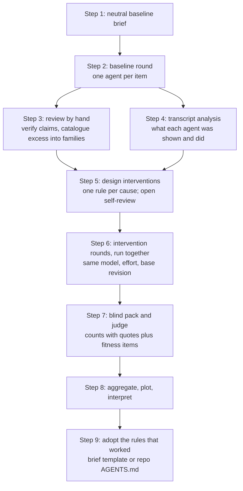

# Playbook: Measuring and Reducing Over-Engineering in Agent-Written Designs

This playbook is for one situation: a coding agent writes designs, specifications or code that are heavier than the task needs, and you want two things:
1. **Measure** how much heavier, and why.
2. **Find** an instruction change that removes the excess without removing what the task does need.

The method runs several agents in parallel, in rounds that differ only in their instructions. It reads the agents' native transcripts to find what produced the excess. Then it scores every round's output with a blind judge whose rubric counts both the excess and the fitness for purpose.

It was developed on IRWB-018, where six Codex agents (`gpt-6.2-sol`, medium effort) designed six compiler-corpus programs. The full analysis is in [[PROJECT REPORT - IR Workbench - Codex Agents as Designers - Where the Over-Engineering Comes From, and What a Revised Brief and a Self-Review Change - A Technical Deep Dive]]. Parameterized scripts for every step live in `Research/playbooks/agents/scripts/agent-design-review/`; its `README.md` has a command sequence.

> [!summary]
> - **Measure before you prompt.** Run a neutral baseline, catalogue the excess into countable families, and read the transcripts to tie each family to the instruction text that produced it.
> - **Test two kinds of intervention side by side:** a brief with one rule per cause, and an open-ended self-review. In IRWB-018 the rules lowered the blind over-engineering score from 6.33 to 1.00 and raised fitness from 6.67 to 8.67. The self-review reached 3.17 and 7.33.
> - **Make the judge count the excess and score fitness.** A design simplified too far shows up as lost fitness, and every count carries a verbatim quote that a script checks.

## 1. Decide whether this playbook applies

Use it when all of the following hold:
- **The task can be split into several comparable items** (several programs, modules or documents), so that each round produces one output per item. Three items is the minimum for a useful comparison, and six worked well.
- **The agent can run unattended in parallel,** each instance in its own git worktree. The scripts target the Codex CLI (`codex exec`, `codex exec resume`).
- **You can read the agent's native transcripts.** For Codex these are the rollouts under `~/.codex/sessions/`. For Claude Code and Pi, see Section 12.
- **"Too heavy" can be stated as features someone could count:** error interfaces, unrequested options, tests of the design's own guards, and so on. If the complaint is only "too long", start with the review in Step 3 and see whether countable families appear.

Do not use it for single, one-off tasks. A single output cannot separate the model's tendency from the instructions it was given.

## 2. The method



The terms used below:
- **Round:** one set of agent runs, one per item, that share a brief. Rounds differ only in their instructions; model, reasoning effort and base revision stay fixed.
- **Item:** one unit of work, such as one program to design. Each item has a short specification that stays the same in every round.
- **Brief:** the common prompt shared by all items in a round. The prompt an agent receives is the brief followed by its item's specification.
- **Rollout:** Codex's native transcript, one JSON record per line. It contains the system prompt, the skills catalogue, AGENTS.md, every tool call and its output, and token counts. Reasoning is stored encrypted.
- **Approval sidecar:** a separate rollout in which Codex's automatic approval reviewer decides on an escalated command. It shares the working directory of the session it serves.
- **Blind pack:** the documents of all rounds, stripped of anything that names their round and shuffled under neutral names. The **key** that maps names back is kept where the judge cannot read it.
- **Rubric:** the judge's instructions. Its **R items** count over-engineering; its **A items** score fitness.

## 3. Prerequisites and setup

| Need | Check |
|---|---|
| Codex CLI | `codex --version` (the scripts were tested with 0.172.0) |
| A model id | `codex exec -m <model> -c model_reasoning_effort=medium -s read-only "Reply with exactly: OK"` |
| node 20+ and python3 with matplotlib | `node --version; python3 -c "import matplotlib"` |
| A place for results | a docmgr ticket's `various/` directory works well; commit everything except the judge directory |

Copy `00-env.example.sh` to `env.sh` and set the variables:
- `REPO`, and `BASE`, pinned to a hash so every round starts from the same tree;
- `OUT` and `WORKTREES`;
- `MODEL` and `EFFORT`.

Then `source env.sh`. Each round creates one worktree per item at `$WORKTREES/<round>-<item>` on a branch `<round>/<item>`. The launcher records each worktree, base and resulting head revision in `$OUT/<round>/heads.json`. The later steps read revisions from there, never from a worktree's current state.

If `$OUT` lies inside a docmgr ticket, `docmgr doctor` will reject the raw material the scripts write (prompts, `*.last-message.md`, and the extracts `system-prompt.md`, `skills-catalogue.md`, `agents-md.md`, `multi-agent.md`, `messages.md`), because none of it has frontmatter. `.docmgrignore` matches file and directory *names*, not paths, so add name globs to `ttmp/.docmgrignore`: those names, `*.last-message.md`, your prompt file names, and `*judge-rubric*.md`. IRWB-018's commit `230fec2` in the compiler-workbench repository is an example.

## 4. Step 1: write a neutral baseline brief

Start from `templates/baseline-brief-skeleton.md`. The baseline must measure the model's own tendency, so it should contain no instruction about simplicity in either direction. Three properties of the brief turned out to shape the output directly. Decide each one deliberately.

- **Every item the brief lists is covered at full depth.** IRWB-018's brief listed eight sections and six related tickets. Every document had all eight sections, and a six-row table with one row per ticket, even where a ticket was irrelevant.
- **Naming skills selects skills.** The brief said "use your docmgr and diary skills". All six agents loaded exactly those two, and none loaded the installed writing-guidance skills, although one is described for "intern guides".
- **Instructions about form become design decisions.** "Constants worth specializing on … live in input buffers" produced one-cell configuration buffers for single numbers.

Write one specification file per item: purpose, why the item is interesting, how results are checked. Keep these files unchanged across rounds.

## 5. Step 2: run the baseline round

```bash
bash $K/01-launch-codex-round.sh baseline prompts/baseline ITEM-1 ITEM-2 ITEM-3 ITEM-4 ITEM-5 ITEM-6
```

The launcher runs all agents in parallel and waits for them. In IRWB-018 each took 5.7 to 8.6 minutes. Afterwards:
- `cat $OUT/baseline/logs/exits.txt` should show every agent exiting 0;
- `git -C <worktree> log --oneline <base>..HEAD` should show the expected commit;
- `git -C <worktree> diff --name-only <base>..HEAD` should touch only the agent's own ticket;
- `git status --short` should be clean.

## 6. Step 3: review the baseline by hand

Read every document in full. Do two things at once.

**Verify the claims against the code.** Agents make specific claims about the system they design for: which language features exist, which loader options are passed through, what a limit is. Check each one, and reproduce any claimed blocker with a minimal probe. In IRWB-018 the claims were accurate. One agent's claim was a real blocker that three others had missed: default ingest fails on frame arrays with `unknown tape opcode 252`.

**Catalogue the excess into families someone could count.** A family is a kind of design element that the purpose does not need and that costs implementation or checking effort. Name it so that another reader can count instances and quote them. The six families IRWB-018 found are a reasonable starting list for design documents:
1. invented error interfaces (status codes, error precedence, guarantees about state on error);
2. input domains wider than the purpose;
3. tests of the design's own guards;
4. plans for features that do not exist;
5. self-defeating choices;
6. workarounds for small infrastructure gaps.

Trace one example through all its consequences. It is the most persuasive evidence of what the family costs. In IRWB-018, each of a VM design's nine error statuses required four things:
- a detection branch in the program;
- the same detection, in the same order, in the independent oracle;
- directed tests;
- room in the step budget.

The families become the rubric's R items in Step 7. Record also what the baseline got right, so that fitness can be scored against it.

## 7. Step 4: analyse what the agents were shown and did

```bash
node $K/03-collect-rollouts.mjs $OUT baseline
node $K/04-extract-codex-sessions.mjs $OUT/baseline/rollouts/sessions.tsv $OUT/baseline/extract
```

`03` finds each agent's rollout by the session id in its log, and finds the approval sidecars that ran in the same worktree during the same turn. `04` writes the four shared context pieces once (`system-prompt.md`, `skills-catalogue.md`, `agents-md.md`, `multi-agent.md`) and reports any difference beyond worktree paths. Per agent it writes the commands, the files read, and the assistant's commentary. `summary.json` adds per agent:
- minutes;
- tool calls and commands;
- interpreter runs;
- skill files read;
- token totals. The total includes cached input; output and reasoning tokens are the generated part.

Then answer four questions, in this order.

1. **Which instruction text corresponds to each family?** Search the system prompt for wording about completeness, inputs, failure, testing, alternatives and style. In the Codex system prompt (27,750 characters in IRWB-018), these passages matched the families:
   - **Coding Style (a):** "Handle the full range of supported inputs … If an operation can fail partway, be retried, or run concurrently, keep the resulting state consistent." This matched the wide domains and the guarantees about state on error, because the agents applied a rule written for code to the code they were specifying.
   - **The writing rules:** "NEVER use contrastive framing such as 'X, not Y' … Do not compare to an unsolicited alternative", together with "Carefully follow these instructions when writing in documents". A design document that may not compare alternatives cannot argue for the smaller design. The documents had 0 to 0.9 contrast markers per 1,000 words, against 1.28 to 2.22 in comparable Claude-written guides.
   - **Completion pressure:** "Make sure that you have accounted for every part of the user's request".
2. **Which skills were loaded, and which were available but not loaded?** Compare `skillReads` with the skills catalogue.
3. **Did the agents probe before relying on features?** Look at `interpreterRuns`, then read the commands. The count includes scripts that edit files, so it is a candidate list, not a probe count. In IRWB-018 the agents that ran code found the two most consequential facts, and three of six ran no `node` command at all.
4. **What did they read, and how deeply?** Long reference documents that were only grepped cannot be the source of a style.

Separate these causes from pressures the system under study creates. Several IRWB-018 "over-engineering" features were rational responses to the compiler framework's checker:
- it treats any two traps as equal;
- it compares every byte;
- it checks every function on independently generated inputs.

Record those separately. They are fixes to the system, and no brief can remove them.

## 8. Step 5: design the interventions

Run at least two interventions. They answer different questions.

**A revised brief (compliance).** Insert `templates/policy-brief-section.md` into the common brief, with one rule per cause found in Step 4. Delete rules whose cause you did not observe. Three rules did most of the work in IRWB-018:
- **"Design for valid inputs only … Do not define status codes, error precedence, or guarantees about state on error unless the problem itself has a natural failure result."** The error-value count went from 16 to 0, and the state-on-error count from 12 to 0.
- **"For each significant design decision, name the simplest alternative … and say … why you chose it or why it falls short."** The system prompt forbids *unsolicited* comparison; a user instruction makes the comparison solicited. Round 2 averaged 1.37 "would … but" weighings per 1,000 words, where the baseline had none. Contrast markers stayed near zero, because the agents weighed alternatives in a form the writing rules allow ("Inserting only token starts is simpler but omits valid candidates").
- **"Before relying on a … feature, run a minimal probe and state the result."** Every design that needed tape ingest found that requirement: four of four, against one of four in the baseline.

**An open-ended self-review (self-detection).** Resume each baseline session with `templates/self-review-prompt.md`, which names no categories. It shows how much excess the model finds on its own. In IRWB-018 it shortened the documents most (mean 1,657 words, against 3,419 for the baseline), but it kept every structure it could justify: a fuel counter, an escape token, a per-function fixture regime.

**Optional: a facts brief.** Give the agents the system-specific facts that Step 4 found they lacked, without any simplicity rules. This separates missing information from disposition.

Two controls apply to every intervention round:
- **Same model, effort and base revision as the baseline,** and a base revision that does not contain the baseline's prompt files, which the agents would otherwise find and read.
- **"Work only from the files in your worktree. Do not read other git branches, other worktrees, or other agents' tickets."** All worktrees share one `.git`. One IRWB-018 baseline agent read other agents' unmerged branches with `git show`.

## 9. Step 6: run the intervention rounds

Start both rounds together. They are independent, and the self-review round runs in the baseline worktrees.

```bash
bash $K/01-launch-codex-round.sh revised prompts/revised ITEM-1 … &
bash $K/02-resume-codex-round.sh selfreview baseline $K/templates/self-review-prompt.md ITEM-1 … &
wait
node $K/03-collect-rollouts.mjs $OUT revised
node $K/03-collect-rollouts.mjs $OUT selfreview --turn 2
bash $K/10-check-contamination.sh $OUT revised baseline selfreview
```

`codex exec resume` appends its turn to the original rollout, so the self-review is turn 2 of the baseline's file, and the baseline itself must be analysed as turn 1. `03` cuts every rollout to the requested turn; it defaults to turn 1. The resume takes no `-s` or `--add-dir` flags, so `02` passes the sandbox settings as `-c` overrides.

The contamination check lists commands that touch other rounds' branches or enumerate refs. Read each hit: `git branch --show-current` names the agent's own branch and is harmless.

## 10. Step 7: blind pack and judge

```bash
node $K/06-blind-pack.mjs $OUT $JUDGE --rounds baseline,revised,selfreview --doc-regex 'design-doc/.*\.md$'
```

The pack reads each round's document at the revision recorded in `heads.json`, which keeps the baseline's documents intact after the self-review rewrote them in place. It removes frontmatter and the last heading that names cuts, simplification or a self-review, together with everything after it. That section would reveal the round. The script warns when stripping removes more than half of a document: a substring pattern once matched "cut" inside "Exe*cut*ive summary" and cut a 3,398-word document to ten words.

Fill `templates/rubric.template.md`:
- **the R items** are the families from Step 3;
- **the A items** stay, because they catch over-simplification:
  - implementability;
  - an independent check;
  - resource sizing;
  - whether the design still exercises what it was meant to.

Copy the rubric to `$JUDGE/RUBRIC.md`, put the item specifications in `$JUDGE/specs/`, and give a fresh agent the filled `templates/judge-prompt.template.md`. It must not see the key, the rounds, or your hypothesis.

Then verify the judge's work:

```bash
node $K/07-verify-quotes.mjs $JUDGE
```

Every count carries quotes, and the script checks each quote verbatim, ignoring whitespace and the judge's bracketed annotations. In IRWB-018, 183 of 183 quotes were found. Spot-check a few counts against your own review as well. The judge counted 9 error values in the baseline VM; the review had counted ten statuses, one of them success.

## 11. Step 8: aggregate, plot and interpret

```bash
node $K/08-aggregate.mjs $JUDGE/scores.json $OUT/results/blind-key.json --order baseline,revised,selfreview --md $OUT/results/summary.md
python3 $K/09-figures.py $JUDGE/scores.json $OUT/results/blind-key.json $OUT/results/rounds.png --order baseline,revised,selfreview
```

For IRWB-018 the aggregate was:

| Round | Mean words | Over-engineering | Fitness | R1 error values | R2 state on error | R4 self-guard tests | A4 purpose value |
|---|---:|---:|---:|---:|---:|---:|---:|
| Baseline | 3,419 | 6.33 | 6.67 | 16 | 12 | 61 | 4.50 |
| Revised brief | 2,064 | 1.00 | 8.67 | 0 | 0 | 0 | 4.67 |
| Self-review | 1,657 | 3.17 | 7.33 | 3 | 4 | 23 | 4.67 |

Interpret the aggregate with three caveats in mind.
- **The R items are partly circular.** They come from your review, and the revised brief states rules covering the same families, so the revised round's low counts are partly built in. The less circular evidence is:
  - fitness and the A items, which a design simplified too far would lose;
  - discoveries outside the rubric, such as blockers found or infrastructure changes proposed.
- **The judge is not fully blind.** Revised-brief documents tend to have recognizable sections, such as a "Later" list, and similar lengths. If the judge is the same model family as the reviewer, it may share the reviewer's judgments.
- **Keyword metrics select candidates.** `05-content-metrics.mjs` gives cheap signals (error-contract sentence share, contrast markers, "would … but" weighings). They are useful for finding where to look and for showing style effects, but the judge's quoted counts are the measurement.

## 12. Step 9: adopt what worked

Fold the rules that changed the outcome into the place every future agent will read. Of the channels available, a repository-level `AGENTS.md` is the one that Codex, Claude Code and Pi all read without being told. Every IRWB-018 agent searched for one as its second command, and found none. Rules that are specific to the task type go into the brief template instead.

Then re-measure on the next real tasks. The test is that the excess families stay low while fitness holds.

## 13. Adapting to other agents

- **Claude Code:** the session transcript is `~/.claude/projects/<project>/<session>.jsonl`, and each subagent has its own `~/.claude/projects/<project>/<session>/subagents/agent-<id>.jsonl` with a `.meta.json` beside it. The system prompt is not part of the transcript, so Step 4 analyses skills, reads and commands. Convert with `go-minitrace convert claude-code` (see [[ARTICLE - Playbook - Efficient Past Transcript Analysis with go-minitrace]]).
- **Pi:** see [[pi-coding-subagents-handbook]] for running Pi as measured subagents with controls. Skill files arrive through its `read` tool.
- **The scripts:** only `01` to `04` are Codex-specific. Steps 7 and 8 (`05` to `09`) work on any documents in git, given a `heads.json` per round mapping each item to `{worktree, rev}`.

## 14. Failure modes and lessons

| Symptom | Cause | Fix |
|---|---|---|
| A baseline agent shows extra tool calls and minutes after a self-review | `codex exec resume` appended its turn to the same rollout | `03` cuts every rollout to one turn (default 1; the first resume is `--turn 2`) |
| More sidecars attributed to a round than it ran | Rounds in the same worktree start within the same minute | `03` keeps only sidecars that start inside the turn's time window |
| A packed document is a few words long | A strip pattern matched inside a word ("Executive") | Whole-word pattern, last matching heading only; `06` warns on large strips |
| The docmetrics verbs fail with `Object has no member 'RuntimeArchives'` | The installed go-minitrace moved to a source and query builder | Read the rollouts directly (`04`), or port the verbs |
| `node script.mjs $args` sees one argument | zsh does not split an unquoted variable into words | Use an array: `args+=(…)`, then `"${args[@]}"` |
| A round-2 agent could have read the baseline designs | All worktrees share one `.git` | The worktree-only rule in the brief, plus `10-check-contamination.sh` |
| "Interpreter runs" overstate probing | Agents also use `python3` heredocs to edit files | Read the commands before calling them probes |
| Tokens look like millions per run | `total_tokens` includes cached input | Report output and reasoning tokens, or the `tokens used` line of the `exec` log |
| A concern that `approval: on-request` would block commits in `exec` mode | Codex's automatic reviewer (`approvals_reviewer = auto_review`) decides | Read the sidecars. In IRWB-018 all three escalations were allowed, with rationales |
| Reasoning cannot be read | Rollouts store it encrypted, without summaries | Infer causes from instruction text and from the interventions' effect, and say so |

## 15. Working rules to carry forward

1. Measure a neutral baseline before writing any rule.
2. Name families of excess that someone else can count and quote, and trace one instance through all its consequences.
3. Read the system prompt the agent actually received, and look for rules written for code being applied to designs.
4. Write one rule per observed cause, and solicit the comparison with the simplest alternative explicitly.
5. Require a probe before any design relies on a feature.
6. Keep rounds identical except for the instructions, and check that they were.
7. Judge blind, with counts backed by quotes, and with fitness items that would expose over-simplification.
8. Treat counts in the categories the brief named as partly circular, and look for evidence outside the rubric.
9. Prefer rules up front to a review afterwards. The self-review shortens the document, but keeps every structure it can justify.
10. Move the rules that worked into the repository's `AGENTS.md` or the brief template, and re-measure.

## Evidence and implementation references

- **Scripts:** `Research/playbooks/agents/scripts/agent-design-review/`. Each was run against the IRWB-018 data and reproduces its numbers. The two launchers were also tested with a stub `codex`.
- **IRWB-018 ticket:** `/home/manuel/code/wesen/2026-11-24--compiler-workbench/ttmp/2026/11/26/IRWB-018--codex-subagents-as-designers-where-the-over-engineering-comes-from-and-whether-a-brief-can-reduce-it/`, with the diary, prompts, logs, extracts, judge scores and blind key.
- **The first application's baseline review:** `/home/manuel/code/wesen/2026-11-24--compiler-workbench/ttmp/2026/11/24/IRWB-001--ir-workbench/various/codex-playground/02-review.md`.
