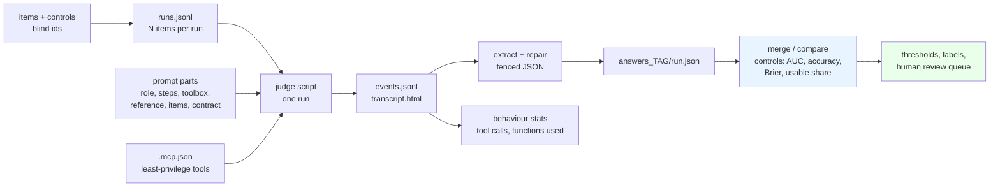

# Handbook: running pi coding agents as measured subagents

This handbook explains how to run the `pi` coding agent as a batch subagent: one isolated, non-interactive run per
unit of work, with tools only through MCP, a fixed JSON output contract, many runs in parallel, and every variant
(model, prompt version) scored on blind controls. It comes from DUST-003 in the film-dust project, where pi judged
360 dust candidates per variant through goja-cv, but the method is general. It applies to any task where agents
produce verdicts, edits or documentation and you want to improve the *instructions* rather than guess.

> [!summary]
> - Isolate pi completely (`--no-builtin-tools --no-context-files --no-skills --no-prompt-templates`), give it tools
>   only through a per-run `.mcp.json`, and put everything it needs into one saved prompt.
> - Fix the output contract (one fenced JSON block) and extract it defensively: models slip in predictable ways.
> - Mix **blind controls with known answers** into every batch and score every variant on the same items. Without
>   controls you cannot tell a better instruction from a different one.
> - Agents follow the prompt closely. Adding tools or cues changes behaviour immediately — and a plausible cue that
>   is not predictive makes answers *worse*. Measure every instruction change.

## When to use this

Use it when a task is too large or too repetitive to do in your own context, and when quality has to be measured:

- labelling or judging many items (images, diffs, log excerpts, search results);
- refining instructions, playbooks or documentation by watching how agents behave with them;
- comparing models for a task on equal terms;
- producing candidate outputs that a human then reviews only where the agent is unsure.

Do not use it for a handful of items you can check yourself, or when you cannot write down what a correct answer
looks like (then you have nothing to put in the controls).

## Core mental model

A pi subagent here is a pure function: `prompt + tools → events.jsonl → one JSON answer`. Everything that varies
between runs (items, model, thinking level, prompt version) is an argument; everything else is fixed. That makes runs
reproducible, comparable and cheap to retry.



Two things are measured separately and both matter: **what the agent answered** (against controls) and **what the
agent did** (tool calls, which functions, how much it inspected). The second explains the first.

## Pattern shape

### 1. One run, fully isolated

```bash
pi -p --mode json -a --mcp-project-servers allow \
   --no-builtin-tools --no-context-files --no-skills --no-prompt-templates \
   --session-dir "$OUT/session" --model "$MODEL" --thinking "$THINK" \
   "$(cat "$OUT/prompt.md")" < /dev/null > "$OUT/events.jsonl" 2> "$OUT/stderr.log"
```

- `-p` (`--print`): non-interactive; `--mode json`: an event stream you can parse; `< /dev/null`: never waits.
- `--no-builtin-tools` removes file and shell tools but keeps MCP tools; `--no-context-files` stops it reading
  `AGENTS.md`/`CLAUDE.md`; `--no-skills`, `--no-prompt-templates`: nothing from your global setup leaks in.
- `-a` (`--approve`) trusts project-local files and `--mcp-project-servers allow` starts the run directory's MCP
  servers without asking — both only for this process.
- Run from a per-run directory (`cd "$OUT"`) so the project-local `.mcp.json` is the one it picks up.
- Model ids are `provider/id` (`lunaroute/deepseek-4.1-flash`, `openai-codex/gpt-6-luna`); find them with
  `pi --list-models <search>`. The same model can exist under several providers — pick the one the user named.

### 2. Tools only through MCP, least privilege

```json
{ "mcpServers": { "cv": {
    "command": "/Users/manuel/go/bin/goja-cv",
    "args": ["mcp", "--root", "<run>/ws", "--read", "<data dir>", "--read", "<helpers dir>",
             "--prelude", "<helpers dir>/84-cv-helpers.js", "--prelude", "<helpers dir>/12-judge-helpers.js"],
    "lifecycle": "keep-alive", "directTools": ["eval"] } } }
```

Read-only data directories, a scratch workspace as the only writable place, and helper libraries preloaded as
preludes. The agent cannot see anything you did not mount — including the answers of the controls.

### 3. The prompt is assembled and saved

Build `prompt.md` from parts, in this order: role and task; how to work (what the tools are, what they can do);
required steps; known mistakes of earlier agents; the items; the output contract; reference material (playbook
sections). Save it in the run directory: when a result surprises you, the exact prompt is the first thing to read.
Keep prompt versions as separate files (`13-judge-prompt-v2.md`, `14-judge-prompt-v3.md`) behind a switch
(`JUDGE_PROMPT=v3`), never edited in place.

### 4. Output contract and defensive extraction

Ask for exactly one JSON object in a ```` ```json ```` fenced block as the final message, with a literal example of
the schema. Then extract it from the event stream:

```python
texts = [c["text"] for every assistant message in events.jsonl for c in its content if c["type"] == "text"]
for t in reversed(texts):
    m = re.findall(r"```json\s*(\{.*?\})\s*```", t, re.S)
    if m:
        txt = m[-1]
        try:
            json.loads(txt)
        except json.JSONDecodeError:
            txt = re.sub(r'\{\s*"(q\d{3})"\s*,', r'{"qid": "\1",', txt)   # dropped key: {"q003", ...}
            txt = json.dumps(json.loads(txt, strict=False))              # raw newline inside a string
        write(answer_path, txt); break
```

Both repairs fixed real failures; without them a whole run of six answers is lost to one typo. Keep
`events.jsonl` and export a readable transcript with `pi --export session/<file>.jsonl transcript.html`.

### 5. Batches, tags and retries

```bash
# 08-batch.sh BATCH PARALLEL MODEL THINKING TAG
list runs | skip those with answers_TAG/<run>.json | xargs -0 -n 1 -P "$PAR" sh -c '07-judge.sh ... "$0" ...'
```

- One script per run with explicit arguments, one batch runner on top; log start/end per run.
- Skip runs that already have an answer, so a re-run retries only failures.
- Every variant writes to its own `answers_TAG/`, `pi_TAG/`, `batch_TAG.log`; variants never overwrite each other.
- Six in parallel was comfortable on a laptop; a run of six items took 1–4 minutes depending on the model.

### 6. Controls, blind ids and comparison

Mix items with known answers into the batch (we used 60: 30 positive, 30 negative, from a human-labelled set),
shuffle everything, and give all items anonymous ids (`q000`…). Never mount the truth. Score each variant on the
controls with one comparison script:

- **AUC** of the agent's probability vs truth (ranking quality);
- **accuracy at 0.5** and the **Brier score** (calibration: overconfident models score badly here);
- **usable share**: thresholds where the controls reach the precision you need (we used 85 %), and how many real
  items fall beyond them — this is what actually saves human time;
- pairwise agreement between variants on the real items.

Items between the thresholds go to a short, **blind** human review queue (the human does not see the agent's
verdict), plus a random audit sample of the confident ones.

### 7. Measure behaviour, not just answers

Count from `events.jsonl`: tool calls per run, which helper functions and operations appear in the code the agent
sent, images requested, errors. In DUST-003 this explained every accuracy difference:

| model (thinking high), prompt v1 | control AUC | Brier | tool calls / 6 items | inspection beyond the recipe |
|---|---|---|---|---|
| deepseek-4.1-flash | **0.78** | **0.195** | 23 | colour checks, own contrast, re-crops |
| glm-5.3-flash | 0.67 | 0.253 | 16.5 | profiles, stats, peaks |
| gpt-6-luna | 0.71 | 0.279 | 12 | none: recipe only, then confident answers |

## What we learned about instructions

- **The prompt is the behaviour.** A three-step recipe in the prompt became exactly the three steps the agents
  took. The agents knew about more helpers (the tool results listed them) but did not use them unless told why.
- **More tools and checks are not automatically better.** Prompt v2 described the whole toolbox and required four
  checks; tool use rose sharply (isolation 347×, colour checks 183×, profiles 118× over 360 items) and accuracy fell
  (AUC 0.78 → 0.71), because v2 also framed a cue ("stands out from the grain") that every item already satisfied.
  The agent leaned on it and called more things positive.
- **Check every cue against the controls before you teach it.** The isolation number alone had AUC 0.63 on the
  controls — barely a cue. Plain chroma rose with brightness, so "low chroma means dust" would have misled; relative
  chroma worked. Ten minutes of measuring each heuristic would have avoided a wasted batch.
- **Run every example call in the prompt yourself.** Two of ours failed (non-numeric ids in a sheet; drawing marks
  before adjusting contrast). An example that errors teaches the agent to stop using that tool.
- **Frame the real question.** For items a detector already picked, the question was "on the film or in the
  picture", not "does it stand out". Prompt v3 rewrote the cues around that question.
- **The yardstick can be wrong too.** Controls come from human labels that can miss things; when several models
  "fail" the same control confidently, have a human look at it.
- **Precision of inputs matters for VLM tasks.** Several small, magnified looks beat one large composite; APIs
  downscale large images and lose small detail.

## Applying this to documentation and instruction refinement

The same loop works when subagents are used to improve docs, playbooks or skills:

1. **Controls are tasks with known outcomes.** Pick tasks where you know what a correct result looks like (a
   command that must be run, a file that must be produced, a question with a known answer), and score them
   automatically where possible.
2. **The variant is the document.** Keep doc versions as separate files behind a switch; run the same tasks with
   each version; compare on the controls.
3. **Read the behaviour.** From the transcripts, count which sections the agent consulted, which commands it tried,
   where it erred and recovered. A doc change that does not change behaviour did not land; one that changes
   behaviour in the wrong direction is worse than none.
4. **Change one thing at a time** and keep the item set fixed, or differences are noise. Expect noticeable noise
   with small control sets (60 controls gave AUC ± ~0.06).
5. **Verify every example and command in the doc** by running it before the agents do.

## Common failure modes

- Editing a script while a batch is using it: in-flight runs pick up the half-edited file. Edit copies, or wait.
- `[ cond ] && cmd` as the last command of a brace group under `set -e` aborts the script when the condition is
  false; use `if … fi`.
- In zsh, a variable holding `ssh -o …` does not word-split; write the command out or use an array.
- Image-heavy runs: some APIs reject a conversation with more than 100 images and the run ends with nothing; state
  a budget in the prompt.
- Cost: `usage.cost` in `events.jsonl` reads $0 for some routed providers; that is not a cost figure.
- A quick finish is not a failure: check the answer file, not the duration.

## Working rules

- Isolate the agent; mount only what it needs; never mount the truth.
- One run = one script call with explicit arguments; one directory per variant (`TAG`).
- Fenced JSON out; defensive extraction; keep `prompt.md`, `events.jsonl`, `transcript.html` per run.
- Blind controls in every batch; one comparison script; compare variants on identical items.
- Measure what agents did as well as what they answered.
- Validate every cue and every example before putting it in a prompt.
- Humans review the agent's uncertain middle, blind, plus an audit sample.

## Source files (DUST-003)

In `/Users/manuel/code/wesen/2026-11-07--dust-scanning/ttmp/2026/11/10/DUST-003--detector-round-2-precision-on-scene-structure-and-faint-dust/`:

- `scripts/06-prereview-build.py` — items, blind ids, controls, tiles, runs
- `scripts/07-pi-judge.sh` — one isolated pi run, prompt assembly, extraction with repairs
- `scripts/08-prereview-batch.sh` — parallel batch runner with tags
- `scripts/09-prereview-merge.py`, `scripts/11-judge-compare.py` — thresholds from controls, comparison of variants
- `scripts/12-judge-helpers.js`, `scripts/13-judge-prompt-v2.md`, `scripts/14-judge-prompt-v3.md` — helper and prompt versions
- `reference/01-diary.md` steps 5–8 — the full story, including the numbers above

## Related notes

- [[loading-pinocchio-geppetto-profiles-for-llm-and-embeddings-inference]]
- [[extracting-tribal-knowledge-into-kb-entries]]
