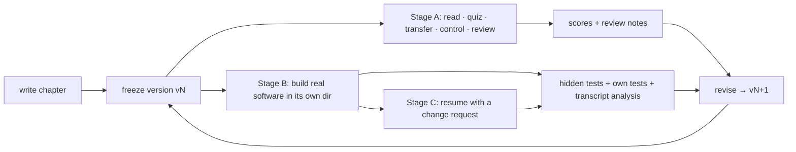

# Playbook: validating design patterns by engineering with agents

A design-pattern write-up is a set of instructions: it claims that a reader who follows it can recognise a problem,
build a solution and avoid known mistakes in a domain the author never saw. This playbook tests that claim the only
way that counts: give the write-up to agents that have seen nothing else, and measure what they understand, what they
build, and what they cannot build. Their answers, code and transcripts drive the next revision. Agents are cheap
enough (a free route such as lunaroute) to run many per pattern, in parallel, on every revision.

It extends the [[Research/playbooks/pi-coding-subagents-handbook|pi subagents handbook]], which covers the mechanics
of sealed runs (isolation, output contracts, defensive extraction, tags, controls). Read that first; this playbook
adds what is specific to documents and to engineering tasks. It is meant to run inside the pattern-extraction
workflow: after each chapter is written, before it is called done.

> [!summary]
> - Treat each chapter version as a frozen variant and test it with three stages: **read** (quiz, transfer, a
>   not-fit control, review notes), **build** (real software from the chapter alone, scored by hidden tests),
>   **extend** (resume the builder with a change request that tests the pattern's own claims).
> - Score what can be scored automatically; read the rest. The review notes are the revision list; the builds show
>   whether the knowledge transfers; transcripts show *how* it was used.
> - Verify every yardstick (quiz keys, hidden tests) against your own reference before an agent sees it. Twice in the
>   first run, the yardstick was wrong, not the agent.
> - Stop when ratings reach 4, no high-severity "wrong" notes remain, and builds pass their hidden tests; otherwise
>   revise and rerun the same scenarios.

## When to use this

Use it when you write patterns, playbooks, design guides or skills that other people or agents will act on:

- a pattern language extracted from a codebase (the pattern-extraction workflow);
- an architecture guide for an intern or a new team;
- a skill or playbook that agents will follow.

Do not use it for prose that nobody acts on, or when you cannot state what a correct use of the document looks like
(then there is nothing to test against).

## Core mental model

A chapter version is a variant, like a prompt version in the handbook. An agent run is a function
`chapter + task → answer + transcript`. Everything else is fixed per comparison: the scenarios, the tasks, the model
and the hidden keys.

## Stage A — read, answer, transfer, review

One isolated run per scenario, with no tools and no files: the prompt holds the chapter version, the language's
notation table, the tasks, and a JSON output contract. Each scenario contains:

1. **A quiz** of four questions answerable from the chapter, with a hidden key of keyword groups. It checks that the
   chapter says what you think it says.
2. **A transfer task**: a situation in a domain the chapter does not mention, where the pattern fits. The agent maps
   the chapter's participants to the situation, sketches the solution and names the implementation notes that
   matter most there, and the most likely mistake.
3. **A not-fit control**: a situation the chapter's "do not use it when" should reject. A good chapter makes the agent
   say no, for the right reason, and propose what fits instead.
4. **Review notes**: at least five, each with a section, a kind (unclear, wrong, missing, too-specific, too-long), a
   severity and a suggested fix; and ratings for clarity, reusability and whether the reviewer would apply it.

Run several scenarios per chapter with different domains, and several agents per scenario: agents vary, and a defect
two runs find independently is real. With a free route, eight or more runs per chapter version are affordable.

What to read, in this order:

- **Fit verdicts and quiz** (automatic). A wrong verdict on a control means the applicability section is unclear;
  a missed quiz question means the chapter does not say it clearly, or the key is too narrow (check by hand).
- **Transfer answers** (by hand, with a rubric: every participant mapped; the sketch implements the solution's
  mechanism, not a paraphrase; the chosen notes are the ones that matter in that domain; the risk is specific).
  The best transfers find limits of the pattern; those become notes or variations.
- **Review notes** (by hand). High-severity "wrong" notes are usually real defects: contradictions between sections,
  pseudocode that cannot work, claims the evidence does not support. Fix them first.
- **Ratings** across versions. Replicate runs of the same version differ by about one point, so judge by the median
  of four or more runs; a drop of one point in a single run is noise, a drop in the median is a regression. Read the
  notes of the runs that dropped.

## Stage B — build real software

The strongest evidence that a pattern is understood is software that applies it. One agent per subdirectory, with
read, write, edit and bash tools, and nothing in the directory but `CHAPTER.md` (the frozen version) and `TASK.md`.

Writing the task:

- Pick a domain the chapter does not use, small enough to build in minutes (stdlib only, no network).
- Fix only the public interface the hidden tests need; leave the design to the pattern. State every detail a test
  checks (codes, field names), or the test measures your omission instead of the agent.
- Ask for the agent's own tests, a diary (`DIARY.md`, one step per phase of work in the diary skill's format, given
  to the agent as `DIARY-FORMAT.md`), and a final JSON report: files, how the chapter's participants map to the code,
  which implementation notes were applied and how, and where the chapter helped, misled or left it guessing. The
  diary records why the agent did what the transcript shows it did, and where the chapter was the reason.

Writing the hidden tests:

- Target what only the chapter teaches. If a behaviour is spelled out in the task, a pass shows the agent read the
  task; if it comes only from the chapter, a pass shows the knowledge transferred.
- **Write a minimal reference implementation and run the hidden tests against it before any agent does.** This catches
  tests that are wrong, too strict or impossible.

After the run: hidden test results, the agent's own test results, the JSON report, a transcript export, a
go-minitrace conversion, and a snapshot of the work directory.

**Controls.** Run the same task without the chapter (two runs per task; `build/control.sh` strips the "apply the
pattern in CHAPTER.md" sentence and asks for the design and its trade-offs instead of a pattern mapping). Without
controls a pass rate cannot say what the chapter added over the model's own design sense.

**Judge the design, not only the tests.** Pass rates say the code works, not that the pattern helped. Review all
builds of one task blind, side by side, with the chapter as the yardstick, the way Christopher Alexander, Richard
Gabriel and Martin Fowler would (rubric in [[pattern-extraction-with-agent-validation]] §6; harness in
`build/review/`): which of the chapter's forces the code resolved, left in tension or never noticed; whether the
structure is adapted to the task or a transcription of the sketch; whether similar seams emerged across builders with
different details (generativity); dead or ornamental parts (wholeness); whether a newcomer could live in the code
(habitability); whether a fixed next change is local (piecemeal growth); concrete smells with places; tests that state
laws rather than examples; and whether a simpler control did as well with less (worse is better). Unblind afterwards
and compare the chapter and control arms per lens. Size is a first signal: the first builds were six to fifteen
times the size of the reference implementations, which is the question the controls answer.

## Stage C — extend through a resumed session

Resume the builder's session with a change request that tests the pattern's own claims. If the chapter says new
operations are cheap to add without touching the core, ask for a new type, a new plug-in and a new consumer, and
measure which files changed. Add hidden tests for the change, verified against an extended reference. A resumed
session also takes a hint ladder when a build fails: first the failing test names, then the implementation note that
covers them; how much help it needed measures the chapter.

## Reading the transcripts

Convert each run's pi session with go-minitrace and query it (sessions, tool calls in order, test runs and their
outcomes, files created, reads of `CHAPTER.md`). What to look for:

- **Did it read the chapter, and when?** Once at the start and never again means the chapter was internalised (or
  ignored: compare with the code).
- **Does the module structure mirror the participants?** Files named after the chapter's participants are a direct
  sign the structure transferred.
- **Which tests came from which notes?** Test files that check a note's rule show the note was actionable.
- **How did it recover from failures?** The first failing test run and what it changed say where the chapter was
  unclear.

go-minitrace records edits made through the edit and write tools; edits made through bash heredocs appear as
executions without a file path. Diff the work-directory snapshots between stages for the reliable record of changes.

## The revision loop

- Freeze each version before running (`versions/NN-TAG.md`); never edit a frozen version.
- Rerun the same scenarios on each revision, so differences are the chapter's, not the task's.
- Change one chapter at a time, and log every version's scores and main findings in a validation log next to the
  chapters.
- Fold builders' feedback into the chapter: it comes from people who tried to use it, not only to read it.

**Read consensus, not counts.** Reviewers asked for at least five notes, without flattery, rate two or three of them
high in every run, whatever the version: in the first language validated this way, high notes per run stayed between
2 and 3 across every revision. A single high note is weak evidence. A section flagged high by two or more independent
runs of the same version is a consensus defect, and those are the revision list (`consensus.py NN TAG`). In practice
they were real every time: a contradiction between the decision rule and the running example that all four runs
found, a line of sketch that could not work, two vocabularies for one idea.

**Revise by cutting as well as adding.** Answering every note with more text makes chapters longer and lowers clarity
(one chapter grew a third over five versions). For each consensus defect, prefer the fix that removes or replaces a
sentence; move detail into implementation notes; keep the template's limit of eleven notes.

**Stop rule:** a chapter is done when, across four or more runs of its latest version, quiz answers (read by hand
where the key missed) and fit verdicts are correct, no consensus defect remains, median clarity and reusability are at
least 3 and not lower than the previous version's, and its builds pass their hidden tests. Remaining single-run notes
go to a list for the next revision cycle.

## Pitfalls met in the first run

- **Keyword keys produce false negatives, and break when the chapter changes.** "None of the agents ever called it"
  failed a key that expected "never"; after a revision reworded a note, a correct answer no longer used the key's
  words. Keys catch gross misunderstanding only; read every miss by hand, and widen the key when the answer is right.
- **An unstated interface detail produces false failures.** A builder named a warning `W_RANGE` where the hidden test
  expected `RANGE`; the task had not said. State it, or test a property instead of a spelling.
- **Truncated, missing or malformed answers happen.** A run returned a JSON object without its transfer section;
  others closed an object with `]` or put unescaped quotes inside a string. The extractor repairs the last two
  (rebalancing closers, escaping inner quotes); retry the rest (the batch runner skips answered ones).
- **The yardstick can be wrong.** In the related judging work, nine of ten "not dust" controls a person checked were
  dust; the judges that disagreed had been right. When several agents disagree with a key confidently, check the key.
- **Controls that are too easy measure nothing.** Every control in the first run was rejected correctly; add borderline
  cases where the right answer is "only part of it fits".
- **The shell bites.** zsh does not split an unquoted variable holding several words; `[ cond ] && cmd` under `set -e`
  aborts; a safety check may refuse a `sh -c` that runs `rm`. Use explicit arrays or `${=var}`, `if … fi`, and plain
  commands.
- **Every builder failing the same hidden test usually means the test is unfair.** All three chapter 3 builders
  decided independently not to store a cache entry larger than the whole budget; the test's budget (200 bytes) was
  smaller than one grid, so none could evict. Their agreement was the signal; the fixed test passes on all three and
  the reference. The playbook rule "verify against a reference" is not enough: the reference shares your assumptions.
- **Never edit a script while a batch runs it.** Bash reads a script as it executes; editing `build.sh` mid-batch
  made four finished builders die at their last line ("unexpected EOF") before they were scored; `after.sh` had to
  be run by hand. New behaviour goes in a new script.
- **Sketches get scrutinised.** Reviewers read pseudocode as code: undefined helpers, refusals dropped in a list
  comprehension, contradictory orderings across sections. Make the sketch consistent with the prose, or the reviewers
  will spend their notes on it.

## Fitting it into the pattern-extraction workflow

The pattern-extraction workflow has three parts: an extraction map (checkpoint), the language (overview and
chapters), and an optional extraction plan. Validation runs inside Part 2, per chapter:

1. Write the chapter.
2. Freeze it as v1; write two to four Stage A scenarios with keys (different domains, one clear and one borderline
   control); run several agents per scenario.
3. Revise from the notes; rerun as v2.
4. For patterns that can be built, write a Stage B task and hidden tests, verify them against a reference, run two or
   more builders; then a Stage C change request.
5. Fold the builders' feedback in; rerun Stage A on the final version; record everything in the validation log.
6. In the overview, record each chapter's validation status (versions, scores, builds).

The Stage B reference implementations and the agents' builds are useful later: they are small, tested instances of
each pattern, ready for the extraction plan of Part 3.

## Reference implementation

The harness used for the agent-operated engines language lives next to it, in
`Research/Software Architecture Garden/general/agent-operated-engines/_validation/`:

| File | Role |
| --- | --- |
| `validate.sh NN SCENARIO TAG` | one Stage A run (freezes the version on first use) |
| `batch.sh NN TAG [PARALLEL]` | all scenarios of a chapter version, skipping answered runs, then scores |
| `score.py NN TAG [TAG2]` | quiz and fit scores, note counts, ratings, behaviour per run |
| `show.py NN TAG [--notes-only]` | the answers for reading |
| `prompt-head.md`, `prompt-contract.md` | the fixed parts of the Stage A prompt |
| `scenarios/`, `keys/`, `versions/`, `answers/` | tasks, hidden keys, frozen chapter versions, answers |
| `build/build.sh NN AGENT TAG` | one Stage B builder in its own directory |
| `build/coach.sh NN AGENT TAG STAGE HINT` | resume a builder with a change request or a hint |
| `build/after.sh`, `build/analyze.sh` | hidden tests, snapshots, go-minitrace conversion and queries |
| `build/tasks/`, `build/hidden/`, `build/reference/` | build tasks, hidden tests, reference implementations |
| `LOG.md` | the validation diary: every version's scores and findings |

Runs write to `~/pattern-validation/` (prompts, event streams, transcripts, work directories); the vault keeps the
answers, scores and log. All runs use `lunaroute/deepseek-4.1-flash` with thinking set to high unless stated.

## Working rules

- The chapter is the only context the agent gets; never mount answer keys or hidden tests.
- Verify every key and every hidden test against your own reference before the agents see it.
- Same scenarios on every version; one change at a time; a frozen file per version.
- Read transfers and builds, not only scores; the best evidence is what agents did with the chapter.
- Prefer builds for patterns that are code; prefer more Stage A scenarios for patterns that are process.
- Record everything in the validation log, including the yardstick's own mistakes.
